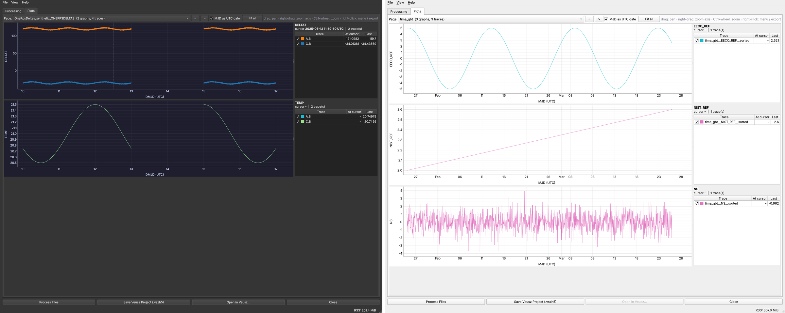

# FITS AutoPlot 0.2.0 and Franks AutoPlot 0.2.0: pyqtgraph Plots tab

Both GUIs now plot with **pyqtgraph**, the same way the AB Power Meter Monitor 1.7.0 does. Its `ab_live_plots.py` 0.1.0 was the model [1]. Saving the native `.vszh5` project and **Open in Veusz** are unchanged.

## What changed

| File | Version | Change |
|---|---|---|
| `_autoplot_pyqtgraph.py` | **0.1.0 (new)** | Plot module: `TracePlot`, `ImagePlot`, `ProjectPlotPanel`, `document_pages()` |
| `_autoplot_common.py` | 0.1.0 → **0.2.0** | The window has two tabs, **Processing** (unchanged) and **Plots**. Adds `show_plots(doc)`, the theme switch also restyles the plots, and Help > About now shows NRAO/GBO, licence and library versions |
| `FITS_AutoPlot.py` | 0.1.0 → **0.2.0** | Calls `show_plots()` when a batch finishes; version shown in the title bar |
| `Franks_AutoPlot.py` | 0.1.0 → **0.2.0** | Same |
| `tests/test_native_export.py` | 0.1.0 → **0.2.0** | New `test_pyqtgraph_plots_tab` |
| `requirements-py38.txt`, `setup_py3p8_nrao.sh` | **0.2.0** | Add `pyqtgraph` (0.13.3 is the last release for Python 3.8) |
| `FITS_AutoPlot_plugin.py`, `Franks_AutoPlot_plugin.py` | unchanged | Inside Veusz, Veusz itself is the viewer |

## How the Plots tab works

As in the AB monitor:

| Feature | Behaviour |
|---|---|
| Content | Every page of the in-memory project, read from the same `NativeDocument` that is saved, so the plots show exactly the pages, graphs, traces, legend names and trace colours of the `.vszh5` |
| Navigation | Page list (with the graph and trace count of each page) and `<` `>` buttons |
| Plot widget | One pyqtgraph plot per graph, with a **legend column** beside it: tick box, colour, trace name, **value at the cursor**, **last value**. Untick a row to hide that trace |
| Crosshair | Follows the mouse in every plot of the page; the x axes of a page are linked |
| Mouse | Drag pans, right-drag zooms one axis, **Ctrl+wheel** zooms (a plain wheel scrolls the page), right-click opens the menu (Export CSV / PNG / SVG), "A" auto-ranges; **Fit all** auto-ranges every plot |
| Time axes | Veusz datetime axes (seconds since 2009-01-01 UTC) are drawn as UTC dates. MJD axes are drawn as UTC dates while **MJD as UTC date** is ticked (the data are not changed) |
| Gaps | A step longer than 10 × the median step breaks the line, matching the project's broken x axes |
| Images | FITS image HDUs: ImageItem, viridis colour bar at the 1st–99th percentile |
| Large data | pyqtgraph "peak" downsampling and clip-to-view, so spikes stay visible; point symbols only up to 200 points per trace |
| Memory | Only the page on screen has plots. Changing page frees the previous page, including pyqtgraph's parentless menus (the leak found in the AB monitor). Arrays are the project's own, not copies, except where a conversion or gap break needs one |
| Theme | View > Dark / Light also restyles the plots, with the AB monitor colours |
| Without pyqtgraph | The Plots tab explains how to install it; processing and saving still work |

## Verification

| Check | Environment | Result |
|---|---|---|
| Repository suite (`python -m unittest discover -s tests`) | Python 3.13, PySide6 6.12, pyqtgraph 0.14.0, astropy 8.0.2 | 15 of 16 pass, including the new Plots-tab test. The one failure predates this change: `test_python38_grammar_and_history_order` stops at `veusz_console_scripts_20250623.py`, whose history is oldest-first. `Hanging_Threads.py` and `fastest_ascii_import.py` have the same order. All changed and new files pass the check |
| GUI end to end, FITS: 43,200 rows (10 s samples over 3 + 2 days with a 2-day outage), two channel pairs, a 64 × 48 image HDU | offscreen | 4 pages; MJD axes as UTC; gap broken; values at the cursor correct (A.B 121.1 ns, C.B −34.0 ns, set to ≈120 and ≈−35); image page drawn; every page visited; project saved |
| GUI end to end, Franks: `time_gbt.dat`, 60 days hourly | offscreen | 4 pages; 3 linked plots; saved |
| Same GUI test with **pyqtgraph 0.13.3 + PyQt5 5.15.11** | Your Python 3.8 stack, run on Python 3.13 | Pass |
| Python 3.8 grammar | All changed and new files | Pass |

Not tested: Python 3.8 itself, real GBO FITS / Franks files, and Windows.

## References

| # | Reference (IEEE) |
|---|---|
| [1] | W. W. Wallace, "ab_live_plots.py 0.1.0," AB Power Meter Monitor 1.7.0, GBO_Maser_Control repository, 2026. [Online]. Available: https://github.com/Braveheart53/GBO_Maser_Control/tree/main/AB_Power_Meter_Monitor_1.7.0 |
| [2] | pyqtgraph developers, "pyqtgraph documentation." [Online]. Available: https://pyqtgraph.readthedocs.io/en/latest/ |
| [3] | pyqtgraph developers, "DateAxisItem." [Online]. Available: https://pyqtgraph.readthedocs.io/en/latest/api_reference/graphicsItems/dateaxisitem.html |
| [4] | pyqtgraph developers, "PlotDataItem" (setData, downsampling, clipToView, connect="finite"). [Online]. Available: https://pyqtgraph.readthedocs.io/en/latest/api_reference/graphicsItems/plotdataitem.html |
| [5] | pyqtgraph 0.13.3 package metadata (Python ≥ 3.8; 0.13.4 and later need ≥ 3.9). [Online]. Available: https://pypi.org/project/pyqtgraph/0.13.3/ |
