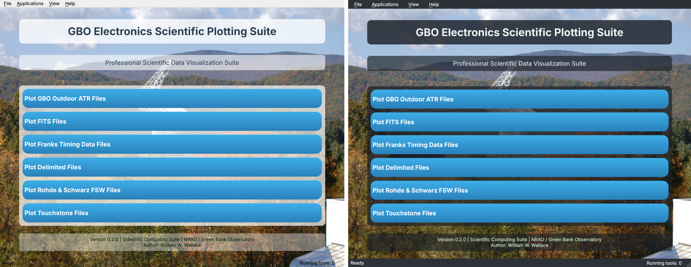
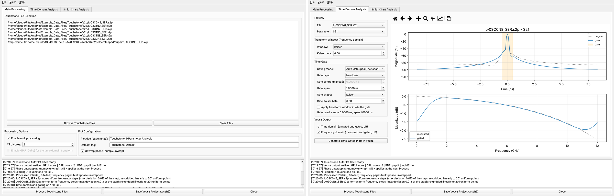

# Launcher 0.2.0, Touchstone AutoPlot 0.5.0, ORBIT/FR staging 0.0.1

| Item | Before | After | File |
|---|---|---|---|
| Launcher | 0.1.4 | **0.2.0** | `postProcessing_Launcher.py` (+ `postProcessing_Launcher.spec`, `pyinstaller_Command.txt`) |
| Touchstone AutoPlot | "V4" (taken as 0.4.0) | **0.5.0** | `Touchstone_AutoPlot.py` |
| ORBIT/FR plotter | none | **staged 0.0.1** | `ORBIT_FR/ORBIT_FR_API_REQUIREMENTS.md`, `ORBIT_FR/orbitfr_com_probe.py` |
| README | | Touchstone, Franks and ORBIT/FR rows; launcher paragraph | `README.md` |

Nothing else changed. FITS, Franks, ATR, CSV/TSV, R&S FSW, `_autoplot_common.py` and `_autoplot_native.py` are as on GitHub (`main` at `36add38`).

## 1. postProcessing_Launcher.py 0.2.0

### What you see

* One button per tool: ATR, FITS, **Franks** (new), Delimited, Rohde & Schwarz FSW, Touchstone. The ORBIT/FR button appears by itself once `ORBIT_FR/ORBITFR_AutoPlot.py` exists.
* **No "under construction" text** anywhere, and "Rhode" is now spelled "Rohde".
* **Background image and button style are unchanged.** In Dark Mode only the translucent panels, menu bar and status bar change tint.
* Menu bar:
  * **File**: Open Scripts Folder, Open Launch Log Folder, Exit (Ctrl+Q).
  * **Applications**: every tool, Ctrl+1 to Ctrl+6.
  * **View**: Light Mode or Dark Mode, remembered between sessions.
  * **Help**: About, Veusz Plugin Files, Project Repository, About Qt.
* **Help > About** follows your other tools: name, version, author, NRAO / GBO, e-mail link, GPL-3.0-or-later, copyright, the NSF/AUI facility note, and the GPL notice. **Show Details** lists the Python, Qt and platform versions and whether each tool script was found.
* The status bar shows how many tools are running. The modal "Application Launched" box is now a status-bar message.
* Each launch writes a log (File > Open Launch Log Folder; on Windows `%LOCALAPPDATA%\GBO_PostProcessing\launch_logs`). If a tool exits with an error within 4 s, a dialog shows the end of its log, for example a missing `skrf` module.

### Defects fixed

| # | Defect in 0.1.4 | Effect | Fix |
|---|---|---|---|
| 1 | The splash thread emitted `progressUpdated` / `splashFinished`, but the application listened to `progress_updated` / `splash_finished` | Whenever the splash was shown (always in a frozen build) the main window **never opened** | One pair of signals; the window opens in about 1.3 s |
| 2 | Splash path `assets/load_building.png`, but only `.jpg` exists | No splash in development; full 1920 × 1231 image if renamed | Path set to `.jpg`; image scaled to 720 × 480 |
| 3 | Button text after a launch was restored from a separate table that did not match the labels | Touchstone's button turned into "Touchstone_AutoPlot.py" (the TODO in the code) | Labels are never changed; the button is disabled for 2 s instead |
| 4 | Scripts, icons and images were looked up relative to the working directory | Starting the launcher from another folder found nothing | Paths are relative to the launcher (or the bundle when frozen) |
| 5 | `QT_API` was set after the Qt imports | No effect | Set first, as a default only |
| 6 | A frozen launcher ran `sys.executable script.py`, which is the launcher itself | Tools could not start from an .exe | `GBO_POSTPROC_PYTHON`, or python on PATH |
| 7 | `"\&"` escape in a string | SyntaxWarning | Removed |
| 8 | `&` in "Rohde & Schwarz" became a keyboard mnemonic | Label read "Rohde _Schwarz" | Escaped |

The PyInstaller spec now bundles the tool scripts as data. `collect_data_files()` on a single-file script returns nothing, so 0.1.4 bundled none of them.

## 2. Touchstone_AutoPlot.py 0.5.0

### Defects fixed (these were the open issues)

| # | Defect | Root cause | Fix |
|---|---|---|---|
| 1 | **Phase would not unwrap**, and the **Generate Time-Gated Plots button stayed disabled** | Every check box was read as `state == Qt.CheckState.Checked`. PySide6 sends an `int` (2), so the comparison is always False. Ticking "Unwrap" switched unwrapping **off**, and toggling the plot options left both off | All options use `toggled(bool)`; checked in the test below |
| 2 | **Every Smith chart export failed** | `export_smith_chart` used an undefined `output_path_normalized` (NameError, caught and logged as "Failed") | Fixed; exports run in a process pool |
| 3 | **Gated response could not be shown in the frequency domain** (or appeared shifted) | It was plotted against `np.fft.fftfreq`, a baseband axis from 0 Hz that wraps to negative frequencies | `skrf.time.time_gate` returns the gated network on the **measured** frequency axis; it is drawn over the ungated trace |
| 4 | Page notes held the whole data block | Header reader tested `line[0].isdigit()`; data lines start with spaces | Stops at the first numeric line |
| 5 | Unwrapped phase was clipped to ±360°, magnitude to −80…20 dB | Fixed axis limits | Auto |
| 6 | Reference-impedance box did nothing | Not connected | Renormalizes the Smith chart networks |
| 7 | Same file name in two folders: the second overwrote the first | Results keyed by base name | Unique keys ("name (2)") |
| 8 | `'mediumcyan'` is not a colour name | Typo | `darkcyan` |
| 9 | Possible mixed Qt bindings (matplotlib vs qtpy) | matplotlib backend imported before qtpy | qtpy first, then the Qt backend |

### Time domain and gating, now with scikit-rf

| Step | Implementation |
|---|---|
| Frequency grid | The FFT needs equal steps. The example files print frequencies to five digits, so steps differ by up to 1.3 %. The network is linearly re-gridded to the same start, stop and point count (max change in \|S\| 3.7 × 10⁻⁵), with a log note when the deviation exceeds 0.1 % |
| Time-domain response | `fftshift(ifft(ifftshift(W·S)))`, with W the transform window normalized to keep Σ\|S\|. This is scikit-rf's `Network.windowed(window).s_time`; the vectorized NumPy version matched it to **4 × 10⁻¹⁷**. CuPy is used for it when a GPU is present and enabled |
| Time axis | `Frequency.t_ns` (band-pass, t = 0 at the centre sample), Δt = 1/(N·Δf) |
| Gate | `skrf.time.time_gate(…, method='fft', t_unit='ns')` per S-parameter (scikit-rf gates one-ports). **Auto (peak, set span)**: centre at the peak of \|h(t)\|. **Auto (peak and span)**: scikit-rf's span detection, falling back to the set span when it cannot find two peaks (it could not on the example files). **Manual**: your centre and span. Band-pass or band-stop. Separate gate-shape window |
| Window inside the gate | Off by default. scikit-rf divides the gated spectrum by that window, which magnifies the band-edge error and is undefined for hann or blackman (zero at the edges). On the example S21 with a 1 ns gate the band-edge error was 2.8 dB without it and 6.8 dB with Kaiser β = 6; mid-band error 0.61 dB and 0.97 dB |
| Display | Time domain in dB, axis from peak − 120 dB, gate shaded in the preview. Gated and measured \|S\| in dB against GHz |

**Expected artefact:** the gated frequency response rolls off at the band edges. That is the gate's truncation in time, not a bug. A wider gate reduces it (S21: 1.4 dB edge error with a 4 ns gate versus 2.8 dB with 1 ns).

### Other changes

* **Native .vszh5** through `_autoplot_native.NativeDocument`, the same writer FITS and Franks use, so no embedded Veusz window is needed. Pages are 30 × 15 cm (two graphs side by side), with legends. Falls back to `veusz.embed` only if `_autoplot_native.py` is missing.
* Batch time gating and Smith export run in a worker thread with a **spawn** process pool, which is safe on Linux as well as Windows. The GUI stays responsive.
* Combined Smith PDF has a **two-level bookmark tree** (file > S11, S12 …). It uses pypdf, or PyPDF2 if that is what is installed.
* File / View (Light, Dark) / Help > About (NRAO) menus; a tighter main tab; per-parameter preview selectors.
* Removed dead code: `create_time_domain_plots`, `apply_gpu_acceleration`, `create_short_temp_dir`, and Taichi / PyOpenCL probing (none did an FFT).

## 3. ORBIT/FR

There is no public API reference for MVG ORBIT/FR 959 Spectrum. MVG states that scripting is COM-based, but the object model ships only with the installed software. As you asked, the work is **staged** in `ORBIT_FR/`:

* **`ORBIT_FR_API_REQUIREMENTS.md`**: what the sources confirm, what I need (the COM report, the scripting manual, example data, version and bitness, scope), and the proposed design.
* **`orbitfr_com_probe.py`**: run it on the 959 Spectrum PC. It reads the registry and type libraries only and **never creates a COM object**, so it cannot start the software or move hardware. It writes `orbitfr_com_report_*.md`. Tested here against a mock registry only, because it needs Windows.

## 4. Verification

| Check | Environment | Result |
|---|---|---|
| Launcher: splash → main window, buttons, menus, shortcuts, About, light and dark screenshots, launch of a good script and a failing one (exit code, log tail, reaping) | Python 3.13, PySide6 6.12.0, qtpy 2.4.3, offscreen | Pass |
| Python 3.8 grammar (`ast.parse(feature_version=(3, 8))`) and pyflakes | All three changed `.py` files | Pass, no warnings |
| Touchstone engine: auto, auto-full and manual gates, band-stop, scikit-rf equivalence, hann guard | L-03C0N8_SER.s2p, L-05B10N_SER.s2p | Pass |
| Touchstone GUI workflow: unwrap and option check boxes, 7 files incl. a same-name duplicate, time gating, save, Smith PDF (12 pages, file > parameter bookmarks), 12 PNGs | offscreen | Pass |
| **All 223 example .s2p files** (process pool): read, time domain and gate, frequency and time-gated pages, native save | 2 CPU cores: read 3.0 s, gating 3.2 s, build and save 7.1 s; 48.7 MB project | 220 processed. **3 input files are malformed**: an antivirus footer in `L-14C10N_SNT`, a quoted "1,000.00" in `L-15C22N_SNT`, and 5 columns in the 2-port `L-15C68N_SER`. They are reported as failures |
| Veusz consumer check | **Veusz 4.2.1** built from source (Qt 6.12) | 7-file project: 35 / 35 pages rendered. 220-file project: 5,940 datasets and 1,100 pages loaded in 57 s; 44 sampled pages rendered |

Not tested here: Windows (paths, `%LOCALAPPDATA%`, the PyInstaller build), Python 3.8 at run time (grammar only), Veusz 3.4, CuPy, mpld3 HTML export, and the COM probe on a real 959 Spectrum PC.

## References

| # | Reference (IEEE) |
|---|---|
| [1] | A. Arsenovic *et al.*, "scikit-rf: An open source Python package for microwave network creation, analysis, and calibration," *IEEE Microw. Mag.*, vol. 23, no. 1, pp. 98–105, Jan. 2022, doi: 10.1109/MMM.2021.3117139. Citation page: https://scikit-rf-official.readthedocs.io/en/stable/citations_ack/acknowledging.html |
| [2] | scikit-rf developers, `skrf.time.time_gate`, `Network.windowed`, `Frequency.t` source code, scikit-rf 2.2.0 (inspected locally, Nov. 2026). https://github.com/scikit-rf/scikit-rf |
| [3] | Agilent Technologies, "Time domain analysis using a network analyzer," Application Note 1287-12, 5989-5723EN. [Online]. Available: https://www.keysight.com/us/en/assets/7018-01451/application-notes/5989-5723.pdf |
| [4] | MVG, "MVG releases AM software upgrade for the US market: 959 SPECTRUM v7." [Online]. Available: https://www.mvg-world.com/en/news/mvg-releases-am-software-upgrade-for-the-us-market-959-spectrum-v7 |
| [5] | MVG, "959 Spectrum," product page. [Online]. Available: https://www.mvg-world.com/de/produkte/antennenmessung/software/959-spectrum |
| [6] | MVG, "OFR 9800A High Speed Switching Controller," datasheet, 2019. [Online]. Available: https://www.mvg-world.com/media/954/download/reference |
| [7] | NRAO Library, "Publication support policy" (footer: NRAO and GBO are facilities of the U.S. National Science Foundation operated by Associated Universities, Inc.). [Online]. Available: https://library.nrao.edu/policy.shtml |
| [8] | Veusz developers, Veusz 4.2.1 source distribution. [Online]. Available: https://pypi.org/project/veusz/ |
