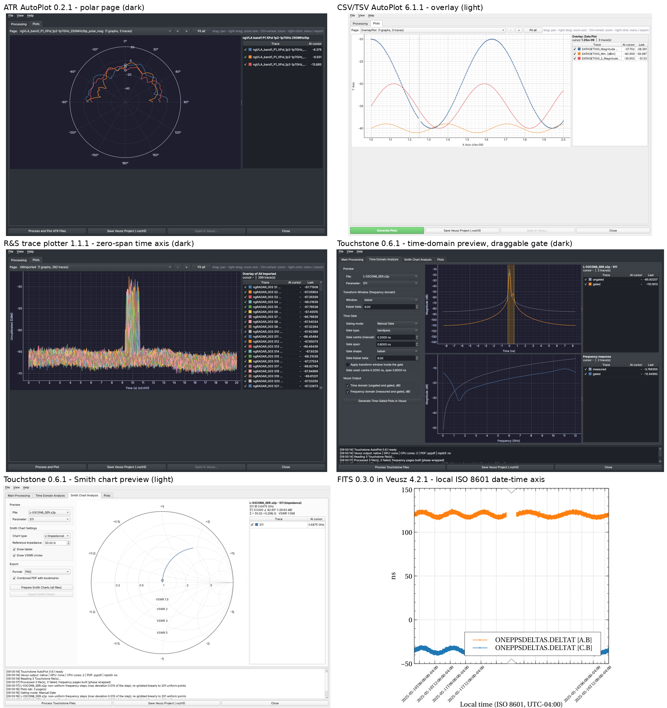
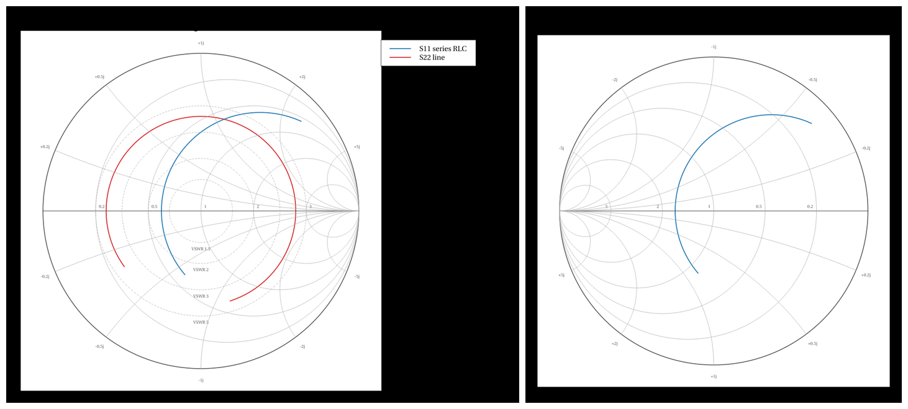
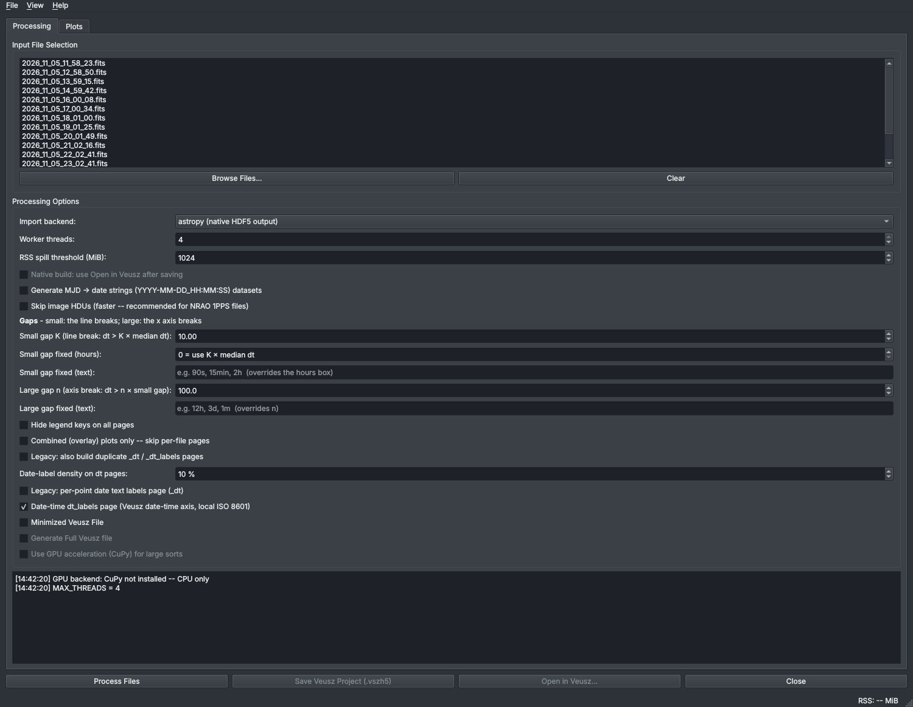
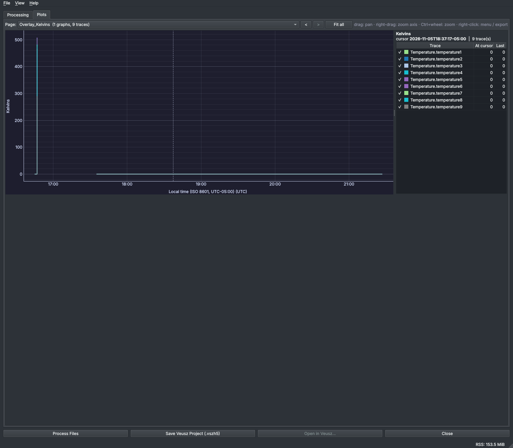
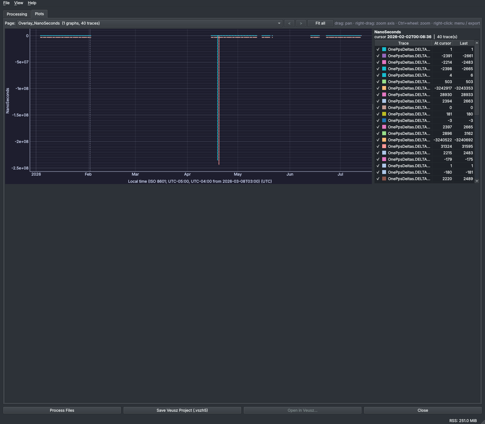

# FitsAutoPlot suite — release notes 2026-11-09

Covers the work of 2026-11-05 to 2026-11-09 on branch `claude/launcher-0.2.0-touchstone-0.5.0`
(local only, not pushed). It includes the time-domain review, pyqtgraph plots in every tool,
light/dark everywhere, and the user's Veusz writer used for every `.vszh5`. It also covers
the 2026-11-09 request: Veusz date-times shown in local ISO 8601, plot names like the
original scripts, and source headers in the page notes. Smith charts in Veusz through the
writer (0.0.26) came last, after these files were posted (§ 6).



*Left to right, top to bottom: ATR polar (dark), CSV/TSV (light), R&S zero-span time axis
(dark), Touchstone time domain with gate (dark), Touchstone Smith chart (light), FITS
dt_labels page rendered by Veusz 4.2.1 with the local ISO 8601 axis.*

## 1. Versions

Versions in the single full-suite archive `FitsAutoPlot_suite_0.4.0_2026-11-09.7z` (the FITS
addendum, § 10, added the last column's later entries).

| File | Before (11-05) | Now | What changed (details in each file's `# %%%%` history) |
|---|---|---|---|
| `vszh5_writer.py` | 0.0.24 | **0.0.27** | Widget names from the data, `header_notes`/`set_notes`, local ISO 8601 date-time axes (`VSZH5_DISPLAY_TZ`); 0.0.26 Smith charts; 0.0.27 gap rule (`median_step`, `gap_threshold`, `insert_gaps`, `axis_break_pairs`), exact DST change instant, `iana_zone` for Python 3.8, header template |
| `_autoplot_native.py` | 0.1.0 | **0.5.0** | Writes through vszh5_writer; Smith pages; 0.5.0 `TimeLayout`: every time axis laid out on save (local ISO 8601, small gaps break the line, large gaps break the axis) |
| `_autoplot_common.py` | 0.1.0 | **0.4.0** | Suite theme; date-time axes; 0.4.0 gap controls (K, n, fixed times), thread-safe log and memory monitor (Python 3.12 crash fix) |
| `_autoplot_pyqtgraph.py` | 0.1.0 | **0.3.1** | Polar, Smith, gate region; 0.3.1 the project's gap rule, plots deleted in the GUI thread |
| `_suite_gui.py` | — | **0.1.1** | Shared theme, menus, About, Open in Veusz, Export PDF/PNG |
| `FITS_AutoPlot.py` / `Franks_AutoPlot.py` | 0.2.0 | **0.4.0** | Date-time datasets; 0.4.0 padding rows left out, full FITS headers, pages in time order, small/large gap GUI |
| `FITS_AutoPlot_plugin.py` / `Franks_AutoPlot_plugin.py` | 0.1.0 | **0.3.0** | Dialog-only theme; 0.3.0 the same gap fields, thread-safe log |
| `ATR_AutoPlot.py` | 0.1.0 | **0.2.2** | Native writer, polar Plots tab, measurement time as a date-time; 0.2.2 header and docstrings |
| `CSV_TSV_AutoPlot.py` | 6.0.0 | **6.1.2** | Native writer, row alignment, local ISO 8601 date-times; 6.1.2 header and docstrings |
| `RAndS_FSW_ASCII_Plotter.py` | 1.0.3 | **1.1.2** | Zero-span time axis, binary sections, averages in mW, sweep times as date-times; 1.1.2 header and docstrings |
| `Touchstone_AutoPlot.py` | 0.5.0 | **0.7.1** | pyqtgraph previews, Smith chart pages; 0.7.1 header and docstrings |
| `postProcessing_Launcher.py` | 0.2.0 | **0.2.1** | Real icons on every button (no placeholders) |
| `Hanging_Threads.py` / `fastest_ascii_import.py` / `veusz_console_scripts_20250623.py` | 0.0.2 | **0.0.4** | Fixes of 11-05; 0.0.4 header and docstrings |
| `ORBIT_FR/orbitfr_com_probe.py` | 0.0.1 | **0.0.2** | Header template |
| `tools/make_suite_icons.py` | — | **0.0.1** (new) | Draws the launcher icons into `assets/` |
| `tests/test_native_export.py` | 0.2.0 | **0.3.1** | Gap rule; widgets deleted in the GUI thread |
| `tests/test_time_gaps.py` | — | **0.0.1** (new) | Gap helpers, TimeLayout, padding rows, real-file layouts |
| `tests/test_gui_close.py` | — | **0.0.1** (new) | Close-window stress: monitor thread firing, Plots tab, plugin dialogs, every window, GC in a second thread |
| `tests/test_writer_names_time.py` / `tests/test_smith_chart.py` | — | **0.0.2** | Header and docstrings |
| `requirements-py38.txt` / `requirements-py312.txt` | 0.2.0 / — | **0.3.0 / 0.1.0** | Exact tested sets; `environment-py38.yml` / `environment-py312.yml` (mamba) new; REQUIREMENTS.md new |

## 2. Date-times (2026-11-09 request)

**Stored.** Every time stamp is now a Veusz **date** dataset in UTC. FITS/Franks
dt_labels used plain numeric seconds before. The tools store a second date dataset,
`<name>_local`, beside it. The pages draw the local one, so a reader of the file
always has both.

**Shown.** The tick format is `%VDY-%VDm-%VDdT%VDH:%VDM:%VDS-05:00`. That gives
`2026-11-09T08:39:00-05:00`: ISO 8601, 24-hour clock, with the UTC offset of the
computer doing the processing. The axis label reads `Local time (ISO 8601, UTC-05:00)`
and the tick labels are rotated 45°. Veusz's `%VD` format codes have no time-zone field,
so the offset is written into the format as text. That works only while one offset
covers the data. When the data cross a daylight-saving change, the ticks drop the
offset and the axis label lists each offset and when it starts. The writer's design,
since 0.0.24, never prints a wrong offset.

**Changing the zone.** Set `VSZH5_DISPLAY_TZ` to `America/New_York`, `-05:00` or `UTC`
to process for another zone. This is useful on a build server or a container that
runs in UTC. A fixed offset works everywhere. Since writer 0.0.27, an IANA name also
works on Python 3.8, through backports.zoneinfo or python-dateutil (§ 10.4).

**No per-point labels.** The per-point text datasets are no longer written
(`EMIT_TEXT_X_DATASETS = False`). The older labelled `_dt` page is off by default
(check box "Legacy: per-point date text labels page (_dt)").

**Files with no zone.** The ATR "Time and Date" header and the R&S sweep time stamps
are stored as written (`<file>_datetime`, `<file>_sweep_time`), because the files do
not say which zone the instrument clock used. CSV time stamps with an offset or `Z`
are exact. Stamps without one are read as UTC by default, or as local time with
"Times without a zone" / `--naive-time local`.

### Conversions used

The Veusz date origin is 2009-01-01T00:00:00 and the Unix origin is
1970-01-01T00:00:00. The gap between them is 39 years, 10 of which are leap years
(1972, 1976, …, 2008):

$$
\Delta_{09} = -\left(39\cdot 365 + 10\right)\,\text{d}\cdot 86\,400\ \tfrac{\text{s}}{\text{d}}
            = -14\,245 \cdot 86\,400\ \text{s} = -1\,230\,768\,000\ \text{s}
$$

so for a Unix time $t_u$ (UTC seconds) the stored and displayed Veusz values are

$$
v_{\text{UTC}} = t_u + \Delta_{09}, \qquad
v_{\text{local}} = t_u + o(t_u) + \Delta_{09},
$$

where $o(t_u)$ is the UTC offset at that instant: $-18\,000$ s for EST and $-14\,400$ s
for EDT. It is looked up per sample, once per distinct UTC hour. For FITS/Franks MJD
(UTC days), the Unix origin is MJD 40587 (JD 2 440 587.5 − 2 400 000.5), so

$$
t_u = \left(\text{MJD} - 40\,587\right)\cdot 86\,400\ \text{s}.
$$

## 3. Names and page notes (2026-11-09 request)

| Tool | Page names | Graph / trace names | Page notes (Veusz: Properties › notes) |
|---|---|---|---|
| FITS / Franks | Unchanged (as the original scripts) | Unchanged | FITS header cards, unchanged |
| ATR | As the 2025 script | Single frequency: `<file>`; multi-frequency: the y dataset (`<file>_1200MHz_mag`) | `Source:`, header lines, frequencies, measured time (ISO 8601); overlays list every file |
| CSV/TSV | Per file and overlay, as 6.0.0 | Trace = y dataset | `Source:` and the lines above the column header; the overlay lists every file |
| R&S | `<file>::Section N;<stamp>` (underscores as spaces) and `<file> average`, as the 2025 script | Graph = y dataset (`<file>_Section3`, `<file>_avg_dB`, `Averages_avg_dB`) | `Source:`, full header, sweep count. A section page adds its own time; the average page lists every sweep time |
| Touchstone | As 0.5.0 | `<file>_<Sij>_TG_Graph` / `_TG_Freq_Graph` (0.4.x names); trace = y dataset (`<file>_S21_mag_dB`) | Plot title, `Source:`, comment/option lines, summary (ports, points, span, z0) |
| Writer helpers | Caller's name | `g_<y>` / `g_<page>`, xy = y dataset, `img_<ds>`, `cbar_<ds>`, `bars_<first>` | `notes=` on every helper |

`_autoplot_native` names any widget added without a name after the dataset it draws when
the document is saved. `widget_name()` turns any text into a valid Veusz widget name: it
replaces `/`, trims surrounding blanks and rejects `.`/`..`.

**Compatibility note for other programs.** The writer's page helpers used to name the
graph `graph`. A caller that sets `"graph/x/…"` by path after calling a helper must now
use the returned name, or pass `graph_name="graph"`. The AB Power Meter Monitor 1.7.0
and MHM2010 workbench test suites pass with 0.0.25. The workbench's own test pins the
version string `0.0.24`, a literal and not a behaviour difference.

## 4. Time-domain review (2026-11-05)

| Where | Finding | Fix |
|---|---|---|
| R&S `.sft` zero span (x-Unit `s`) | Drawn against Start…Stop as if it were a frequency sweep | Time axis 0…SWT, "Time (s)"; own `AllImported_time` / `Averages_time` pages |
| R&S x-Axis `LOG` | Points spaced linearly | Logarithmic spacing and a log x axis |
| R&S averages | "Average only" made no plot; averages must not be means of dB | Power mean in mW (`linear_power_mean_dbm`, NaN-aware), a page per file plus `Averages` |
| R&S binary sections | `ngRADAR_003.sft` unreadable | `SectionN;stamp\n` + N × float32 LE read |
| FITS/Franks overlay dt pages | `detect_time_breaks_unit_aware` not imported (NameError swallowed): no broken axis on overlays | Imported |
| FITS/Franks broken axes | Gap pairs in UTC while the axis now shows local time | `mjd_break_pairs_to_dtsec(local=True)` |
| FITS/Franks dt pages | Time stored as plain numbers | Veusz date datasets (UTC + local) |
| pyqtgraph date axes | UTC dates | `DateAxisItem(utcOffset=0)` on already-local values, cursor read-out with offset |
| Touchstone TD | Checked against scikit-rf in 0.5.0 (vectorized transform equal to `Network.windowed().s_time`; `skrf.time.time_gate`) | Kept; preview moved to pyqtgraph with a draggable gate |
| CSV date columns | Text sent to Veusz; X and Y dropped NaN separately (rows misaligned) | Columns classified numeric / date-time / text; rows stay aligned |
| ATR azimuth | Fixed 1° step | From the header limits and the point count |

## 5. Found while checking this release

* **R&S notes grew as sweeps².** Every section page listed every sweep time, on the page
  and on the graph. With all example files (588 pages), the document script was 11.5 MB
  and Veusz 4.2.1 had not finished loading it after 5 minutes. Each section page now
  names only its own sweep. The script is 2.2 MB and loads in 13.8 s.

## 6. Smith charts in Veusz (writer 0.0.26, Touchstone 0.7.0)



*Rendered by Veusz 4.2.1 from a file written without Veusz. Left: an impedance chart with
VSWR circles and two traces, legend beside the chart. Right: an admittance chart.*

**Method.** Veusz has no Smith-chart widget. The chart is assembled from widgets it does
have, so it stays editable in Veusz:

* The graph has a fixed aspect ratio of 1. Its axes are $\mathrm{Re}\,\Gamma$ and
  $\mathrm{Im}\,\Gamma$, hidden, at $\pm 1.14$.
* The grid is ordinary xy lines read from datasets. One xy widget draws a whole family of
  circles, joined with NaN breaks.
* The grid values are point labels of marker-less xy widgets (a text dataset).
* The data are xy traces of $\mathrm{Im}\,\Gamma$ against $\mathrm{Re}\,\Gamma$.
* The graph notes say "Smith chart (impedance)" or "(admittance)" and give $Z_0$. That is
  how the Plots tab recognises the page and draws it with its own interactive Smith plot,
  which reads out f, Γ, Z and VSWR at the cursor.

**Grid equations.** With the normalized impedance $z = Z/Z_0 = r + jx$,

$$
\Gamma = \frac{z-1}{z+1} = \frac{(r^2 + x^2 - 1) + j\,2x}{(r+1)^2 + x^2}.
$$

Eliminating $x$ (constant $r$) gives the resistance circles; eliminating $r$ (constant $x$)
gives the reactance circles:

$$
\left(\Gamma_r - \frac{r}{1+r}\right)^2 + \Gamma_i^2 = \left(\frac{1}{1+r}\right)^2,
\qquad
\left(\Gamma_r - 1\right)^2 + \left(\Gamma_i - \frac{1}{x}\right)^2 = \left(\frac{1}{x}\right)^2 .
$$

Only the part of each reactance circle inside $|\Gamma| \le 1$ ($r \ge 0$) is drawn. It is
traced exactly as $\Gamma(r)$ with $r = \tan\theta$, $0 \le \theta < \pi/2$, so every arc starts
on the unit circle and ends at $\Gamma = 1$. Setting $r = 0$ gives $\Gamma = e^{j\varphi}$ with
$\varphi = 2\arctan(1/x)$, which is where the $x$ labels go.

The admittance chart uses $y = Y/Y_0 = g + jb$ and
$\Gamma = (1-y)/(1+y) = -\,(y-1)/(y+1)$: the same grid rotated by 180°, as scikit-rf draws it.

A VSWR circle $S$ has radius $|\Gamma| = (S-1)/(S+1)$. The defaults are 1.5, 2, 3 and 5,
scikit-rf's values.

**Using it.**

```python
import vszh5_writer as w
grid = w.smith_grid("smith_z", "z", vswr=w.SMITH_VSWR)          # once per document
data = w.smith_trace_datasets("dut_S11_gamma", gamma, freq_hz)  # _re, _im, _freq_Hz
doc = w.VszDoc("my tool")
w.smith_page(doc, "Smith_dut", [w.smith_trace("dut_S11_gamma", "S11")], grid,
             title="dut - Smith chart (Z0 = 50 ohm)", notes=w.header_notes(header, source=path))
with w.VeuszWriter("out.vszh5") as vw:
    grid.write(vw)
    for name, values in data.items():
        vw.dataset_1d(name, values)
    vw.finish(doc.text())
```

On a `NativeDocument` (every AutoPlot tool), use `_autoplot_native.add_smith_page(doc.Root, ...)`
with the same grid and traces.

**Touchstone AutoPlot 0.7.0.** "Smith chart pages in the Veusz project" is on by default in
the Smith settings. Prepare Smith Charts then adds a page `Smith_<file>` per file:

* It shows the reflection parameters (S11, S22, …) at the reference impedance.
* It uses the chosen chart type, labels and VSWR circles.
* The graph is `<file>_Smith_Graph`.
* Each trace is named after its dataset `<file>_<Sii>_gamma_im`.

Transmission parameters are left out of these pages. They are still in the PNG/SVG/PDF/HTML
Smith export.

**Checks.**

* `tests/test_smith_chart.py` (7 tests): every grid point satisfies the circle equations,
  and $z$ recovered from the grid has the right $r$ or $x$; Γ ↔ Z ↔ VSWR round trips; the
  page script; the widget tree; recognition by the Plots tab.
* Veusz 4.2.1 renders the demo and the Touchstone pages (all 6 pages of a 3-file project, PASS).
* Every setting used (graph `aspect`, axis `hide`, xy `labels` with
  `Label/posnHorz|posnVert`, key `horzManual`) also exists in the Veusz 3.6.2 source.
* The Smith code also works with pyqtgraph 0.13.3 and PyQt5 (the Python 3.8 stack).
* The writer's existing page helpers write byte-identical scripts to 0.0.25.

## 7. Verification

| Check | Result |
|---|---|
| `python -m unittest discover -s tests` (`test_native_export.py` 16, `test_writer_names_time.py` 5, `test_smith_chart.py` 7) | 28 tests OK |
| Headless GUI runs, `VSZH5_DISPLAY_TZ=America/New_York`: FITS, Franks, CSV/TSV, ATR, R&S, Touchstone (Plots tab, light and dark, save) | Pass |
| Veusz 4.2.1 load and render of each tool's `.vszh5` (PDF/PNG/SVG) | Pass: ISO ticks `…T08:39:00-05:00`, label with offset, notes present, names as tabulated |
| R&S all example files, mode 0 (588 pages, 594 datasets), `tests/validate_in_veusz.py` | Loads in 13.8 s; all 588 pages rendered to SVG (PASS) |
| Writer 0.0.25 and 0.0.26 as a drop-in: AB Power Meter Monitor 1.7.0 runner (all 11 suites: appender, offline renders in Veusz, memory release, file locks, exporter, Grafana, IP separation, live plots, memory, GUI soak, 10-min headless soak) and MHM2010 workbench suite (112 tests) | Pass; the only failure is the workbench test that pins the writer version string |
| Python 3.8 grammar (`ast.parse(feature_version=(3, 8))`) of the 20 changed or new `.py` files | Pass |
| **Addendum (§ 10):** Python 3.8.20 and 3.12.3 environments, unit tests (37), every GUI headless, the four GBT FITS sets | Pass on both; identical projects (see REQUIREMENTS.md § 3) |

## 8. Data gaps and limits

* There is no Windows machine here: the Windows paths and the Veusz installer path are
  checked by reading only. (Python 3.8 and 3.12 and real GBT FITS files were tested in the
  addendum, § 10.)
* The ATR and R&S time stamps carry no zone. They are stored as the instrument wrote
  them; please confirm whether the range PC and the analyzers run on local time or UTC.
* For ATR multi-frequency files, the order of the frequency lines is assumed to be
  lower → upper.
* For R&S zero span, the x axis is taken as 0…SWT from the header.
* CSV time stamps without a zone are assumed UTC unless the option says local.

## 9. References

| # | Reference (IEEE) |
|---|---|
| [1] | Veusz developers, *Veusz 4.2.1* source (`document/loader.py`, `utils/dates.py`, `widgets/axisticks.py`). [Online]. Available: https://pypi.org/project/veusz/4.2.1/ |
| [2] | Veusz developers, "Reading data — dates," *Veusz manual*. [Online]. Available: https://veusz.github.io/docs/manual/datasets.html |
| [3] | *Date and time — Representations for information interchange — Part 1: Basic rules*, ISO 8601-1:2019. [Online]. Available: https://www.iso.org/standard/70907.html |
| [4] | P. Ganssle, "PEP 615 — Support for the IANA Time Zone Database in the Standard Library," Python Software Foundation, 2020. [Online]. Available: https://peps.python.org/pep-0615/ |
| [5] | W. D. Pence, L. Chiappetti, C. G. Page, R. A. Shaw, and E. Stobie, "Definition of the Flexible Image Transport System (FITS), version 3.0," *Astron. Astrophys.*, vol. 524, A42, 2010, doi: 10.1051/0004-6361/201015362. [Online]. Available: https://www.aanda.org/articles/aa/full_html/2010/16/aa15362-10/aa15362-10.html |
| [6] | IBIS Open Forum, *Touchstone® File Format Specification, Version 2.1*, ratified Jan. 26, 2024. [Online]. Available: https://www.ibis.org/touchstone_ver2.1/touchstone_ver2_1.pdf |
| [7] | A. Arsenovic *et al.*, "scikit-rf: An open source Python package for microwave network creation, analysis, and calibration," *IEEE Microw. Mag.*, vol. 23, no. 1, pp. 98–105, Jan. 2022, doi: 10.1109/MMM.2021.3117139. |
| [8] | Agilent Technologies, "Time domain analysis using a network analyzer," Application Note 1287-12, 5989-5723EN. [Online]. Available: https://www.keysight.com/us/en/assets/7018-01451/application-notes/5989-5723.pdf |
| [9] | pyqtgraph developers, "DateAxisItem." [Online]. Available: https://pyqtgraph.readthedocs.io/en/latest/api_reference/graphicsItems/dateaxisitem.html |
| [10] | h5py developers, "h5py 3.16.0." [Online]. Available: https://pypi.org/project/h5py/ |
| [11] | P. H. Smith, "Transmission line calculator," *Electronics*, vol. 12, no. 1, pp. 29–31, Jan. 1939. [Online]. Available: https://rfcafe.com/references/electronics-mag/transmission-line-calculator-phillip-h-smith-electronics-magazine-january-1939.htm |

## 10. FITS addendum (2026-11-09, afternoon)

Requests: analyse the attached GBT FITS files (`tack_data.zip`, `UWBR.7z`, `30d.7z`) and update
the suite. Gap rule: use a multiple of the median time step, not a ratio. A small gap breaks the
trace; a large gap, set by the user, breaks the x axis; both are set in the GUI. Use local ISO 8601
on every time axis. Use the author's header template, Spyder cells, detailed comments and
revision numbers in every file. The suite must work on Python 3.8 and 3.12, and the documents must
give both environments. Post one archive with every file and no placeholders.

### 10.1 Gap rule (writer 0.0.27, `_autoplot_native` 0.5.0)

For trace $j$ with time stamps $t_{j,1} < t_{j,2} < \dots$ (seconds), the steps are
$\Delta t_{j,i} = t_{j,i+1} - t_{j,i}$. Only finite, positive steps count; DMJD $\le 0$ padding
rows are already removed.

**Small gap: the line breaks.** The threshold is a multiple of the median step, or a fixed time
$T_s$ from the GUI:

$$
\tau_j =
\begin{cases}
T_s, & T_s > 0,\\[2pt]
K \cdot \operatorname{median}_i\!\left(\Delta t_{j,i}\right), & \text{otherwise},
\end{cases}
\qquad K = 10 \text{ by default.}
$$

When $\Delta t_{j,i} > \tau_j$, a NaN row goes between samples $i$ and $i+1$ of the plotted copies
(`<x>_local`, `<y>_gaps`). Veusz and pyqtgraph then draw no line across the hole. The stored data
are not changed.

**Large gap: the x axis breaks.** The axis threshold is set from the largest small-gap threshold
of the traces on that axis:

$$
\tau_{\text{axis}} =
\begin{cases}
\max\!\left(T_a,\ \max_j \tau_j\right), & T_a > 0,\\[2pt]
\max(n, 1)\cdot \max_j \tau_j, & n > 0,\\[2pt]
\infty \ (\text{one continuous axis}), & n = 0,
\end{cases}
\qquad n = 100 \text{ by default.}
$$

A hole $(a, b)$ in the union of all the traces' time stamps, with $b - a > \tau_{\text{axis}}$,
becomes a break $[\,a + m(b-a),\; b - m(b-a)\,]$ of a Veusz `axis-broken` widget, with
$m = 0.02$. The margin is a fraction of the gap. The old absolute margin was
$10^{-9}\,|t| \approx 5.3$ s at MJD 61000, and it erased holes of up to 10.6 s. The axis is
never broken where any trace has data, and $\tau_{\text{axis}} \ge \max_j \tau_j$ always holds, so
an axis break is always also a line break.

**Time scale.** MJD becomes Veusz date seconds as $t_{\text{V}} = (\text{MJD} - 54832)\times 86400$
(Veusz counts from 2009-01-01T00:00:00 UTC = MJD 54832). Ticks show the computer's local clock,
DST included: `2026-11-05T06:58:23-05:00`.

**Worked example (UWBR Temps).** Logging switches between 1 s and about 60 s. The median step is
1 s, so $\tau = 10 \times 1$ s $= 10$ s. Every 60 s step is a small gap, and the lines break
there. $\tau_{\text{axis}} = 100 \times 10$ s $= 1000$ s. The largest hole in the set is 100 s
(2026-11-05T21:43:33Z → 21:45:13Z), so the axis stays whole. The 0.3.0 rule broke the axis
at every one of those steps: 630 breaks on the overlay.

GUI: *Small gap K* (1–1000) or *Small gap fixed* (hours, or text such as `90s`, `15min`, `2h`;
it overrides K). *Large gap n* (0 = never break the axis) or *Large gap fixed* (e.g. `3d`; it
overrides n). The rule in use is written in every graph's notes.

### 10.2 The files

| Set | Files | Table HDU | Rows | Padding rows (DMJD ≤ 0) | First → last sample (UTC) | Median step | 99th pct step | Largest hole | Files with constant values |
|---|---|---|---|---|---|---|---|---|---|
| tack (azServo1Hz) | 10 | azServo1Hz | 36 000 | 0 | 2026-04-20T01:39:03Z → 11:39:02Z | 1 s | 1 s | 1 s | 0 |
| UWBR Temps | 15 | Temperature | 14 605 | 0 | 2026-11-05T11:58:23Z → 11-06T02:26:46Z | 1 s | 60.5 s | 100 s | 4 |
| UWBR Vacuum | 15 | Vacuum | 17 849 | 0 | 2026-11-05T11:43:16Z → 11-06T02:27:41Z | 1 s | 10.4 s | 70 s | 11 |
| 30d (OnePpsDeltas) | 319 | OnePpsDeltas | 1 130 171 | 2 233 (7 per file) | 2026-01-03T16:51:06Z → 07-13T14:40:30Z | 6 s | 36 s | 71.5 d | 0 |

Steps are those of the merged time stamps of each set. The 30d set has 40 CHANNELA–CHANNELB pairs,
which are taken in turn.

| Set | Pages | Datasets | `.vszh5` size | Line-break copies (`_gaps`) | Broken x axes (max breaks per axis) | Read + pages / save (3.12) |
|---|---|---|---|---|---|---|
| tack | 11 | 776 | 27.7 MB | 0 | 0 | 2.4 s / 0.7 s |
| UWBR Temps | 16 | 384 | 4.6 MB | 27 | 0 (was 630 breaks) | 1.0 s / 0.2 s |
| UWBR Vacuum | 16 | 95 | 1.2 MB | 2 | 0 | 0.3 s / 0.1 s |
| 30d | 320 | 40 195 | 246.5 MB | 200 | 2 (3) | 17.9 s / 34.2 s |





### 10.3 Found in the data (please check)

* **Padding rows.** Every OnePpsDeltas file ends in 7 rows with DMJD = 0 and empty
  CHANNELA/B. They were plotted as a 41st trace at MJD 0, which put an axis break from 1858 to
  2026 on every overlay. They are now left out and counted in the log.
* **Outlier.** CNS_GPS1 – GBTRtn DELTAT = −243 880 893 ns (−0.244 s) at 2026-04-19T22:28:36Z
  (file `2026_04_19_19_20_43.fits`). This one sample sets the y range of that trace.
* **71.5-day hole** in the 30d set, from 2026-02-02T18:51:12Z to 2026-04-15T07:18:42Z. No file
  covers it, and it becomes one of the x-axis breaks.
* **Constant values.** 4 of 15 Temperature files (2026-11-05 23:02 → 11-06 02:02 UTC) and 11 of
  15 Vacuum files have the same value in every row of every column. This may be a stalled
  sensor or logger.
* **Repeated time stamps.** 1 step in Temps and 15 steps in Vacuum are shorter than 0.05 s. These
  rows are kept.

### 10.4 Python 3.8 and 3.12

The package versions, mamba environments, differences between 3.8 and 3.12, and the test table
are in **REQUIREMENTS.md**. The two Pythons produced the same projects: the same dataset names,
equal arrays (NaN = NaN) and the same Veusz script, for all four sets (tack 776, Temps 384,
Vacuum 95 and 30d 40 195 datasets).

Fixed because of these tests:

* **Python 3.8:** `VSZH5_DISPLAY_TZ=America/New_York` raised `ModuleNotFoundError: zoneinfo`.
  It is fixed by `vszh5_writer.iana_zone()`, which falls back to backports.zoneinfo and then
  dateutil.
* **Python 3.12 / PySide6 6.12:** a segmentation fault at random, in 3 of 4 test runs; the
  committed suite of the same morning also had it. The memory-monitor thread held lambdas that
  referred to the window or plugin dialog. It could release the last reference, which destroyed Qt
  widgets outside the GUI thread. It also wrote to the log widget from its own thread. The fix
  is in `_autoplot_common` 0.4.0 and the plugins 0.3.0:
  * the callback is a bound method, held through `weakref.WeakMethod`;
  * `log()` and `append_log()` queue the text to the GUI thread;
  * `stop()` wakes the thread and joins it;
  * the stop event is no longer called `_stop`, a name that shadowed `threading.Thread._stop()`
    and broke `join()`.

  The Plots tab also deletes the plots of a page that is left in the GUI thread at once. Earlier,
  the garbage collector reached them from whichever thread it happened to run in.
* **Regression test:** `tests/test_gui_close.py` (4 tests). The FITS and Franks windows are
  opened with the RSS threshold at 0 MiB, so the monitor fires from its own thread. The Plots tab
  is filled and paged through, and the windows are closed and deleted. The two plugin dialogs and
  the ATR, CSV/TSV, R&S and Touchstone windows get the same treatment. Each cycle runs twice
  while a second thread calls `gc.collect()` every 2 ms. The test passes on 3.8, 3.12 and 3.13.

### 10.5 Headers, comments, revisions, assets

* Every `.py` file has the author's header: Header Info; Created on; Author Information with the
  e-mail, secondary e-mail and phone; Revisions with the semantic-schema line. Each entry is
  `# %%%% X.Y.Z:` and `Date:`. The newest entry holds the Function Descriptions (made from the
  code), the Variable Descriptions and More Info. Older entries are unchanged, newest first.
* All 358 functions, classes and methods that had no docstring now have one. Files changed only in
  documentation got a patch version, as listed in § 1. Test and utility scripts have Spyder
  `# %%` cells (Imports / Tests or Script / Run).
* Pop-up help: 131 buttons, check boxes, spin boxes, combo boxes, lists and text fields had no
  tooltip. Every one now has one, in FITS, Franks, both plugins, the shared main window, ATR,
  CSV/TSV, R&S and Touchstone. This includes the buttons made in loops, such as the delimiter
  presets and the R&S plot modes. The launcher, the Plots tab and the gap controls already had
  tooltips.
* `assets/` had placeholder text notes, not icons. It now has real 256 px PNG icons for every
  image the launcher looks for. `app_icon.png` is a crop of `GBT_2.ico`. The others are drawn by
  `tools/make_suite_icons.py`, which recreates them exactly. The placeholder notes were removed.

### 10.6 Data gaps and limits

* Veusz 4.2.1 needs about 130 s to open the 30d project (320 pages, 40 195 datasets). For a quick
  look, use *Combined (overlay) plots only* or the minimized save.
* Not tested on Windows. Windows needs `tzdata` for the IANA zone names; both requirement files
  install it.
* The cause of the −0.244 s outlier and of the constant UWBR files is not known from the files.
  Instrument logs or the operators would be needed.
* DMJD is read as UTC. Each file's PRIMARY header says `TIMESYS = 'UTC'` for DATE-OBS, and
  DATE-OBS matches the first DMJD of every file checked. The headers do not state the scale of the
  DMJD column itself.

### 10.7 References (addendum)

| # | Reference (IEEE) |
|---|---|
| [12] | P. J. Rousseeuw and C. Croux, "Alternatives to the median absolute deviation," *J. Amer. Statist. Assoc.*, vol. 88, no. 424, pp. 1273–1283, 1993, doi: 10.1080/01621459.1993.10476408. |
| [13] | The Qt Company, "Threads and QObjects," *Qt 6 documentation*. [Online]. Available: https://doc.qt.io/qt-6/threads-qobject.html |
| [14] | Python Software Foundation, "weakref — Weak references" (`WeakMethod`), *Python 3 documentation*. [Online]. Available: https://docs.python.org/3/library/weakref.html |
| [15] | Python Software Foundation, "zoneinfo — IANA time zone support," *Python 3 documentation*. [Online]. Available: https://docs.python.org/3/library/zoneinfo.html |
| [16] | Python Software Foundation, "tzdata," PyPI. [Online]. Available: https://pypi.org/project/tzdata/ |
| [17] | conda-forge, "Miniforge." [Online]. Available: https://github.com/conda-forge/miniforge |
| [18] | Veusz developers, "Axis-broken widget," *Veusz manual*. [Online]. Available: https://veusz.github.io/docs/manual/widgets.html |
| [19] | A. M. Price-Whelan *et al.*, "The Astropy Project: Sustaining and growing a community-oriented open-source project and the latest major release (v5.0) of the core package," *Astrophys. J.*, vol. 935, no. 2, 167, 2022, doi: 10.3847/1538-4357/ac7c74. |
