# FitsAutoPlot suite — release notes 2026-11-09

Covers the work of 2026-11-05 to 2026-11-09 on branch `claude/launcher-0.2.0-touchstone-0.5.0`
(local only, not pushed). It includes the time-domain review, pyqtgraph plots in every tool,
light/dark everywhere, and the user's Veusz writer used for every `.vszh5`. It also covers
the 2026-11-09 request: Veusz date-times shown in local ISO 8601, plot names like the
original scripts, and source headers in the page notes. Smith charts in Veusz through the
writer (0.0.26) came last, after these files were posted (§ 6).

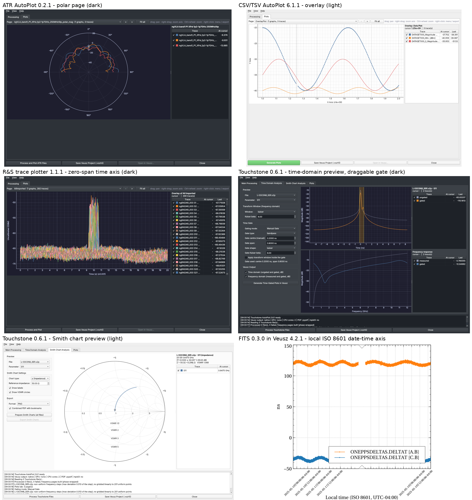

*Left to right, top to bottom: ATR polar (dark), CSV/TSV (light), R&S zero-span time axis
(dark), Touchstone time domain with gate (dark), Touchstone Smith chart (light), FITS
dt_labels page rendered by Veusz 4.2.1 with the local ISO 8601 axis.*

## 1. Versions

Versions in the single full-suite archive `FitsAutoPlot_suite_0.4.0_2026-11-09.7z` (the FITS
addendum, § 10, added the last column's later entries).

| File | Before (11-05) | Now | What changed (details in each file's `# %%%%` history) |
|---|---|---|---|
| `vszh5_writer.py` | 0.0.24 | **0.0.27** | Widget names from the data, `header_notes`/`set_notes`, local ISO 8601 date-time axes (`VSZH5_DISPLAY_TZ`); 0.0.26 Smith charts; 0.0.27 gap rule (`median_step`, `gap_threshold`, `insert_gaps`, `axis_break_pairs`), exact DST change instant, `iana_zone` for Python 3.8, header template |
| `_autoplot_native.py` | 0.1.0 | **0.5.0** | Writes through vszh5_writer; Smith pages; 0.5.0 `TimeLayout`: every time axis laid out on save (local ISO 8601, small gaps break the line, large gaps break the axis) |
| `_autoplot_common.py` | 0.1.0 | **0.4.0** | Suite theme; date-time axes; 0.4.0 gap controls (K, n, fixed times), thread-safe log and memory monitor (Python 3.12 crash fix) |
| `_autoplot_pyqtgraph.py` | 0.1.0 | **0.3.1** | Polar, Smith, gate region; 0.3.1 the project's gap rule, plots deleted in the GUI thread |
| `_suite_gui.py` | — | **0.1.1** | Shared theme, menus, About, Open in Veusz, Export PDF/PNG |
| `FITS_AutoPlot.py` / `Franks_AutoPlot.py` | 0.2.0 | **0.4.0** | Date-time datasets; 0.4.0 padding rows left out, full FITS headers, pages in time order, small/large gap GUI |
| `FITS_AutoPlot_plugin.py` / `Franks_AutoPlot_plugin.py` | 0.1.0 | **0.3.0** | Dialog-only theme; 0.3.0 the same gap fields, thread-safe log |
| `ATR_AutoPlot.py` | 0.1.0 | **0.2.2** | Native writer, polar Plots tab, measurement time as a date-time; 0.2.2 header and docstrings |
| `CSV_TSV_AutoPlot.py` | 6.0.0 | **6.1.2** | Native writer, row alignment, local ISO 8601 date-times; 6.1.2 header and docstrings |
| `RAndS_FSW_ASCII_Plotter.py` | 1.0.3 | **1.1.2** | Zero-span time axis, binary sections, averages in mW, sweep times as date-times; 1.1.2 header and docstrings |
| `Touchstone_AutoPlot.py` | 0.5.0 | **0.7.1** | pyqtgraph previews, Smith chart pages; 0.7.1 header and docstrings |
| `postProcessing_Launcher.py` | 0.2.0 | **0.2.1** | Real icons on every button (no placeholders) |
| `Hanging_Threads.py` / `fastest_ascii_import.py` / `veusz_console_scripts_20250623.py` | 0.0.2 | **0.0.4** | Fixes of 11-05; 0.0.4 header and docstrings |
| `ORBIT_FR/orbitfr_com_probe.py` | 0.0.1 | **0.0.2** | Header template |
| `tools/make_suite_icons.py` | — | **0.0.1** (new) | Draws the launcher icons into `assets/` |
| `tests/test_native_export.py` | 0.2.0 | **0.3.1** | Gap rule; widgets deleted in the GUI thread |
| `tests/test_time_gaps.py` | — | **0.0.1** (new) | Gap helpers, TimeLayout, padding rows, real-file layouts |
| `tests/test_gui_close.py` | — | **0.0.1** (new) | Close-window stress: monitor thread firing, Plots tab, plugin dialogs, every window, GC in a second thread |
| `tests/test_writer_names_time.py` / `tests/test_smith_chart.py` | — | **0.0.2** | Header and docstrings |
| `requirements-py38.txt` / `requirements-py312.txt` | 0.2.0 / — | **0.3.0 / 0.1.0** | Exact tested sets; `environment-py38.yml` / `environment-py312.yml` (mamba) new; REQUIREMENTS.md new |

## 2. Date-times (2026-11-09 request)

**Stored.** Every time stamp is now a Veusz **date** dataset in UTC. FITS/Franks
dt_labels used plain numeric seconds before. The tools store a second date dataset,
`<name>_local`, beside it. The pages draw the local one, so a reader of the file
always has both.

**Shown.** The tick format is `%VDY-%VDm-%VDdT%VDH:%VDM:%VDS-05:00`. That gives
`2026-11-09T08:39:00-05:00`: ISO 8601, 24-hour clock, with the UTC offset of the
computer doing the processing. The axis label reads `Local time (ISO 8601, UTC-05:00)`
and the tick labels are rotated 45°. Veusz's `%VD` format codes have no time-zone field,
so the offset is written into the format as text. That works only while one offset
covers the data. When the data cross a daylight-saving change, the ticks drop the
offset and the axis label lists each offset and when it starts. The writer's design,
since 0.0.24, never prints a wrong offset.

**Changing the zone.** Set `VSZH5_DISPLAY_TZ` to `America/New_York`, `-05:00` or `UTC`
to process for another zone. This is useful on a build server or a container that
runs in UTC. A fixed offset works everywhere. Since writer 0.0.27, an IANA name also
works on Python 3.8, through backports.zoneinfo or python-dateutil (§ 10.4).

**No per-point labels.** The per-point text datasets are no longer written
(`EMIT_TEXT_X_DATASETS = False`). The older labelled `_dt` page is off by default
(check box "Legacy: per-point date text labels page (_dt)").

**Files with no zone.** The ATR "Time and Date" header and the R&S sweep time stamps
are stored as written (`<file>_datetime`, `<file>_sweep_time`), because the files do
not say which zone the instrument clock used. CSV time stamps with an offset or `Z`
are exact. Stamps without one are read as UTC by default, or as local time with
"Times without a zone" / `--naive-time local`.

### Conversions used

The Veusz date origin is 2009-01-01T00:00:00 and the Unix origin is
1970-01-01T00:00:00. The gap between them is 39 years, 10 of which are leap years
(1972, 1976, …, 2008):

$$
\Delta_{09} = -\left(39\cdot 365 + 10\right)\,\text{d}\cdot 86\,400\ \tfrac{\text{s}}{\text{d}}
            = -14\,245 \cdot 86\,400\ \text{s} = -1\,230\,768\,000\ \text{s}
$$

so for a Unix time $t_u$ (UTC seconds) the stored and displayed Veusz values are

$$
v_{\text{UTC}} = t_u + \Delta_{09}, \qquad
v_{\text{local}} = t_u + o(t_u) + \Delta_{09},
$$

where $o(t_u)$ is the UTC offset at that instant: $-18\,000$ s for EST and $-14\,400$ s
for EDT. It is looked up per sample, once per distinct UTC hour. For FITS/Franks MJD
(UTC days), the Unix origin is MJD 40587 (JD 2 440 587.5 − 2 400 000.5), so

$$
t_u = \left(\text{MJD} - 40\,587\right)\cdot 86\,400\ \text{s}.
$$

## 3. Names and page notes (2026-11-09 request)

| Tool | Page names | Graph / trace names | Page notes (Veusz: Properties › notes) |
|---|---|---|---|
| FITS / Franks | Unchanged (as the original scripts) | Unchanged | FITS header cards, unchanged |
| ATR | As the 2025 script | Single frequency: `<file>`; multi-frequency: the y dataset (`<file>_1200MHz_mag`) | `Source:`, header lines, frequencies, measured time (ISO 8601); overlays list every file |
| CSV/TSV | Per file and overlay, as 6.0.0 | Trace = y dataset | `Source:` and the lines above the column header; the overlay lists every file |
| R&S | `<file>::Section N;<stamp>` (underscores as spaces) and `<file> average`, as the 2025 script | Graph = y dataset (`<file>_Section3`, `<file>_avg_dB`, `Averages_avg_dB`) | `Source:`, full header, sweep count. A section page adds its own time; the average page lists every sweep time |
| Touchstone | As 0.5.0 | `<file>_<Sij>_TG_Graph` / `_TG_Freq_Graph` (0.4.x names); trace = y dataset (`<file>_S21_mag_dB`) | Plot title, `Source:`, comment/option lines, summary (ports, points, span, z0) |
| Writer helpers | Caller's name | `g_<y>` / `g_<page>`, xy = y dataset, `img_<ds>`, `cbar_<ds>`, `bars_<first>` | `notes=` on every helper |

`_autoplot_native` names any widget added without a name after the dataset it draws when
the document is saved. `widget_name()` turns any text into a valid Veusz widget name: it
replaces `/`, trims surrounding blanks and rejects `.`/`..`.

**Compatibility note for other programs.** The writer's page helpers used to name the
graph `graph`. A caller that sets `"graph/x/…"` by path after calling a helper must now
use the returned name, or pass `graph_name="graph"`. The AB Power Meter Monitor 1.7.0
and MHM2010 workbench test suites pass with 0.0.25. The workbench's own test pins the
version string `0.0.24`, a literal and not a behaviour difference.

## 4. Time-domain review (2026-11-05)

| Where | Finding | Fix |
|---|---|---|
| R&S `.sft` zero span (x-Unit `s`) | Drawn against Start…Stop as if it were a frequency sweep | Time axis 0…SWT, "Time (s)"; own `AllImported_time` / `Averages_time` pages |
| R&S x-Axis `LOG` | Points spaced linearly | Logarithmic spacing and a log x axis |
| R&S averages | "Average only" made no plot; averages must not be means of dB | Power mean in mW (`linear_power_mean_dbm`, NaN-aware), a page per file plus `Averages` |
| R&S binary sections | `ngRADAR_003.sft` unreadable | `SectionN;stamp\n` + N × float32 LE read |
| FITS/Franks overlay dt pages | `detect_time_breaks_unit_aware` not imported (NameError swallowed): no broken axis on overlays | Imported |
| FITS/Franks broken axes | Gap pairs in UTC while the axis now shows local time | `mjd_break_pairs_to_dtsec(local=True)` |
| FITS/Franks dt pages | Time stored as plain numbers | Veusz date datasets (UTC + local) |
| pyqtgraph date axes | UTC dates | `DateAxisItem(utcOffset=0)` on already-local values, cursor read-out with offset |
| Touchstone TD | Checked against scikit-rf in 0.5.0 (vectorized transform equal to `Network.windowed().s_time`; `skrf.time.time_gate`) | Kept; preview moved to pyqtgraph with a draggable gate |
| CSV date columns | Text sent to Veusz; X and Y dropped NaN separately (rows misaligned) | Columns classified numeric / date-time / text; rows stay aligned |
| ATR azimuth | Fixed 1° step | From the header limits and the point count |

## 5. Found while checking this release

* **R&S notes grew as sweeps².** Every section page listed every sweep time, on the page
  and on the graph. With all example files (588 pages), the document script was 11.5 MB
  and Veusz 4.2.1 had not finished loading it after 5 minutes. Each section page now
  names only its own sweep. The script is 2.2 MB and loads in 13.8 s.

## 6. Smith charts in Veusz (writer 0.0.26, Touchstone 0.7.0)

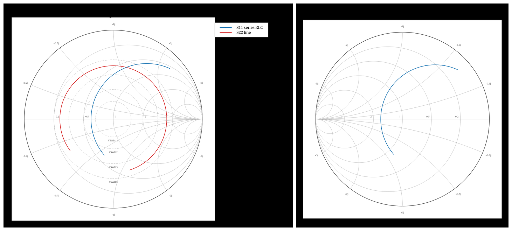

*Rendered by Veusz 4.2.1 from a file written without Veusz. Left: an impedance chart with
VSWR circles and two traces, legend beside the chart. Right: an admittance chart.*

**Method.** Veusz has no Smith-chart widget. The chart is assembled from widgets it does
have, so it stays editable in Veusz:

* The graph has a fixed aspect ratio of 1. Its axes are $\mathrm{Re}\,\Gamma$ and
  $\mathrm{Im}\,\Gamma$, hidden, at $\pm 1.14$.
* The grid is ordinary xy lines read from datasets. One xy widget draws a whole family of
  circles, joined with NaN breaks.
* The grid values are point labels of marker-less xy widgets (a text dataset).
* The data are xy traces of $\mathrm{Im}\,\Gamma$ against $\mathrm{Re}\,\Gamma$.
* The graph notes say "Smith chart (impedance)" or "(admittance)" and give $Z_0$. That is
  how the Plots tab recognises the page and draws it with its own interactive Smith plot,
  which reads out f, Γ, Z and VSWR at the cursor.

**Grid equations.** With the normalized impedance $z = Z/Z_0 = r + jx$,

$$
\Gamma = \frac{z-1}{z+1} = \frac{(r^2 + x^2 - 1) + j\,2x}{(r+1)^2 + x^2}.
$$

Eliminating $x$ (constant $r$) gives the resistance circles; eliminating $r$ (constant $x$)
gives the reactance circles:

$$
\left(\Gamma_r - \frac{r}{1+r}\right)^2 + \Gamma_i^2 = \left(\frac{1}{1+r}\right)^2,
\qquad
\left(\Gamma_r - 1\right)^2 + \left(\Gamma_i - \frac{1}{x}\right)^2 = \left(\frac{1}{x}\right)^2 .
$$

Only the part of each reactance circle inside $|\Gamma| \le 1$ ($r \ge 0$) is drawn. It is
traced exactly as $\Gamma(r)$ with $r = \tan\theta$, $0 \le \theta < \pi/2$, so every arc starts
on the unit circle and ends at $\Gamma = 1$. Setting $r = 0$ gives $\Gamma = e^{j\varphi}$ with
$\varphi = 2\arctan(1/x)$, which is where the $x$ labels go.

The admittance chart uses $y = Y/Y_0 = g + jb$ and
$\Gamma = (1-y)/(1+y) = -\,(y-1)/(y+1)$: the same grid rotated by 180°, as scikit-rf draws it.

A VSWR circle $S$ has radius $|\Gamma| = (S-1)/(S+1)$. The defaults are 1.5, 2, 3 and 5,
scikit-rf's values.

**Using it.**

```python
import vszh5_writer as w
grid = w.smith_grid("smith_z", "z", vswr=w.SMITH_VSWR)          # once per document
data = w.smith_trace_datasets("dut_S11_gamma", gamma, freq_hz)  # _re, _im, _freq_Hz
doc = w.VszDoc("my tool")
w.smith_page(doc, "Smith_dut", [w.smith_trace("dut_S11_gamma", "S11")], grid,
             title="dut - Smith chart (Z0 = 50 ohm)", notes=w.header_notes(header, source=path))
with w.VeuszWriter("out.vszh5") as vw:
    grid.write(vw)
    for name, values in data.items():
        vw.dataset_1d(name, values)
    vw.finish(doc.text())
```

On a `NativeDocument` (every AutoPlot tool), use `_autoplot_native.add_smith_page(doc.Root, ...)`
with the same grid and traces.

**Touchstone AutoPlot 0.7.0.** "Smith chart pages in the Veusz project" is on by default in
the Smith settings. Prepare Smith Charts then adds a page `Smith_<file>` per file:

* It shows the reflection parameters (S11, S22, …) at the reference impedance.
* It uses the chosen chart type, labels and VSWR circles.
* The graph is `<file>_Smith_Graph`.
* Each trace is named after its dataset `<file>_<Sii>_gamma_im`.

Transmission parameters are left out of these pages. They are still in the PNG/SVG/PDF/HTML
Smith export.

**Checks.**

* `tests/test_smith_chart.py` (7 tests): every grid point satisfies the circle equations,
  and $z$ recovered from the grid has the right $r$ or $x$; Γ ↔ Z ↔ VSWR round trips; the
  page script; the widget tree; recognition by the Plots tab.
* Veusz 4.2.1 renders the demo and the Touchstone pages (all 6 pages of a 3-file project, PASS).
* Every setting used (graph `aspect`, axis `hide`, xy `labels` with
  `Label/posnHorz|posnVert`, key `horzManual`) also exists in the Veusz 3.6.2 source.
* The Smith code also works with pyqtgraph 0.13.3 and PyQt5 (the Python 3.8 stack).
* The writer's existing page helpers write byte-identical scripts to 0.0.25.

## 7. Verification

| Check | Result |
|---|---|
| `python -m unittest discover -s tests` (`test_native_export.py` 16, `test_writer_names_time.py` 5, `test_smith_chart.py` 7) | 28 tests OK |
| Headless GUI runs, `VSZH5_DISPLAY_TZ=America/New_York`: FITS, Franks, CSV/TSV, ATR, R&S, Touchstone (Plots tab, light and dark, save) | Pass |
| Veusz 4.2.1 load and render of each tool's `.vszh5` (PDF/PNG/SVG) | Pass: ISO ticks `…T08:39:00-05:00`, label with offset, notes present, names as tabulated |
| R&S all example files, mode 0 (588 pages, 594 datasets), `tests/validate_in_veusz.py` | Loads in 13.8 s; all 588 pages rendered to SVG (PASS) |
| Writer 0.0.25 and 0.0.26 as a drop-in: AB Power Meter Monitor 1.7.0 runner (all 11 suites: appender, offline renders in Veusz, memory release, file locks, exporter, Grafana, IP separation, live plots, memory, GUI soak, 10-min headless soak) and MHM2010 workbench suite (112 tests) | Pass; the only failure is the workbench test that pins the writer version string |
| Python 3.8 grammar (`ast.parse(feature_version=(3, 8))`) of the 20 changed or new `.py` files | Pass |
| **Addendum (§ 10):** Python 3.8.20 and 3.12.3 environments, unit tests (37), every GUI headless, the four GBT FITS sets | Pass on both; identical projects (see REQUIREMENTS.md § 3) |

## 8. Data gaps and limits

* There is no Windows machine here: the Windows paths and the Veusz installer path are
  checked by reading only. (Python 3.8 and 3.12 and real GBT FITS files were tested in the
  addendum, § 10.)
* The ATR and R&S time stamps carry no zone. They are stored as the instrument wrote
  them; please confirm whether the range PC and the analyzers run on local time or UTC.
* For ATR multi-frequency files, the order of the frequency lines is assumed to be
  lower → upper.
* For R&S zero span, the x axis is taken as 0…SWT from the header.
* CSV time stamps without a zone are assumed UTC unless the option says local.

## 9. References

| # | Reference (IEEE) |
|---|---|
| [1] | Veusz developers, *Veusz 4.2.1* source (`document/loader.py`, `utils/dates.py`, `widgets/axisticks.py`). [Online]. Available: https://pypi.org/project/veusz/4.2.1/ |
| [2] | Veusz developers, "Reading data — dates," *Veusz manual*. [Online]. Available: https://veusz.github.io/docs/manual/datasets.html |
| [3] | *Date and time — Representations for information interchange — Part 1: Basic rules*, ISO 8601-1:2019. [Online]. Available: https://www.iso.org/standard/70907.html |
| [4] | P. Ganssle, "PEP 615 — Support for the IANA Time Zone Database in the Standard Library," Python Software Foundation, 2020. [Online]. Available: https://peps.python.org/pep-0615/ |
| [5] | W. D. Pence, L. Chiappetti, C. G. Page, R. A. Shaw, and E. Stobie, "Definition of the Flexible Image Transport System (FITS), version 3.0," *Astron. Astrophys.*, vol. 524, A42, 2010, doi: 10.1051/0004-6361/201015362. [Online]. Available: https://www.aanda.org/articles/aa/full_html/2010/16/aa15362-10/aa15362-10.html |
| [6] | IBIS Open Forum, *Touchstone® File Format Specification, Version 2.1*, ratified Jan. 26, 2024. [Online]. Available: https://www.ibis.org/touchstone_ver2.1/touchstone_ver2_1.pdf |
| [7] | A. Arsenovic *et al.*, "scikit-rf: An open source Python package for microwave network creation, analysis, and calibration," *IEEE Microw. Mag.*, vol. 23, no. 1, pp. 98–105, Jan. 2022, doi: 10.1109/MMM.2021.3117139. |
| [8] | Agilent Technologies, "Time domain analysis using a network analyzer," Application Note 1287-12, 5989-5723EN. [Online]. Available: https://www.keysight.com/us/en/assets/7018-01451/application-notes/5989-5723.pdf |
| [9] | pyqtgraph developers, "DateAxisItem." [Online]. Available: https://pyqtgraph.readthedocs.io/en/latest/api_reference/graphicsItems/dateaxisitem.html |
| [10] | h5py developers, "h5py 3.16.0." [Online]. Available: https://pypi.org/project/h5py/ |
| [11] | P. H. Smith, "Transmission line calculator," *Electronics*, vol. 12, no. 1, pp. 29–31, Jan. 1939. [Online]. Available: https://rfcafe.com/references/electronics-mag/transmission-line-calculator-phillip-h-smith-electronics-magazine-january-1939.htm |

## 10. FITS addendum (2026-11-09, afternoon)

Requests: analyse the attached GBT FITS files (`tack_data.zip`, `UWBR.7z`, `30d.7z`) and update
the suite. Gap rule: use a multiple of the median time step, not a ratio. A small gap breaks the
trace; a large gap, set by the user, breaks the x axis; both are set in the GUI. Use local ISO 8601
on every time axis. Use the author's header template, Spyder cells, detailed comments and
revision numbers in every file. The suite must work on Python 3.8 and 3.12, and the documents must
give both environments. Post one archive with every file and no placeholders.

### 10.1 Gap rule (writer 0.0.27, `_autoplot_native` 0.5.0)

For trace $j$ with time stamps $t_{j,1} < t_{j,2} < \dots$ (seconds), the steps are
$\Delta t_{j,i} = t_{j,i+1} - t_{j,i}$. Only finite, positive steps count; DMJD $\le 0$ padding
rows are already removed.

**Small gap: the line breaks.** The threshold is a multiple of the median step, or a fixed time
$T_s$ from the GUI:

$$
\tau_j =
\begin{cases}
T_s, & T_s > 0,\\[2pt]
K \cdot \operatorname{median}_i\!\left(\Delta t_{j,i}\right), & \text{otherwise},
\end{cases}
\qquad K = 10 \text{ by default.}
$$

When $\Delta t_{j,i} > \tau_j$, a NaN row goes between samples $i$ and $i+1$ of the plotted copies
(`<x>_local`, `<y>_gaps`). Veusz and pyqtgraph then draw no line across the hole. The stored data
are not changed.

**Large gap: the x axis breaks.** The axis threshold is set from the largest small-gap threshold
of the traces on that axis:

$$
\tau_{\text{axis}} =
\begin{cases}
\max\!\left(T_a,\ \max_j \tau_j\right), & T_a > 0,\\[2pt]
\max(n, 1)\cdot \max_j \tau_j, & n > 0,\\[2pt]
\infty \ (\text{one continuous axis}), & n = 0,
\end{cases}
\qquad n = 100 \text{ by default.}
$$

A hole $(a, b)$ in the union of all the traces' time stamps, with $b - a > \tau_{\text{axis}}$,
becomes a break $[\,a + m(b-a),\; b - m(b-a)\,]$ of a Veusz `axis-broken` widget, with
$m = 0.02$. The margin is a fraction of the gap. The old absolute margin was
$10^{-9}\,|t| \approx 5.3$ s at MJD 61000, and it erased holes of up to 10.6 s. The axis is
never broken where any trace has data, and $\tau_{\text{axis}} \ge \max_j \tau_j$ always holds, so
an axis break is always also a line break.

**Time scale.** MJD becomes Veusz date seconds as $t_{\text{V}} = (\text{MJD} - 54832)\times 86400$
(Veusz counts from 2009-01-01T00:00:00 UTC = MJD 54832). Ticks show the computer's local clock,
DST included: `2026-11-05T06:58:23-05:00`.

**Worked example (UWBR Temps).** Logging switches between 1 s and about 60 s. The median step is
1 s, so $\tau = 10 \times 1$ s $= 10$ s. Every 60 s step is a small gap, and the lines break
there. $\tau_{\text{axis}} = 100 \times 10$ s $= 1000$ s. The largest hole in the set is 100 s
(2026-11-05T21:43:33Z → 21:45:13Z), so the axis stays whole. The 0.3.0 rule broke the axis
at every one of those steps: 630 breaks on the overlay.

GUI: *Small gap K* (1–1000) or *Small gap fixed* (hours, or text such as `90s`, `15min`, `2h`;
it overrides K). *Large gap n* (0 = never break the axis) or *Large gap fixed* (e.g. `3d`; it
overrides n). The rule in use is written in every graph's notes.

### 10.2 The files

| Set | Files | Table HDU | Rows | Padding rows (DMJD ≤ 0) | First → last sample (UTC) | Median step | 99th pct step | Largest hole | Files with constant values |
|---|---|---|---|---|---|---|---|---|---|
| tack (azServo1Hz) | 10 | azServo1Hz | 36 000 | 0 | 2026-04-20T01:39:03Z → 11:39:02Z | 1 s | 1 s | 1 s | 0 |
| UWBR Temps | 15 | Temperature | 14 605 | 0 | 2026-11-05T11:58:23Z → 11-06T02:26:46Z | 1 s | 60.5 s | 100 s | 4 |
| UWBR Vacuum | 15 | Vacuum | 17 849 | 0 | 2026-11-05T11:43:16Z → 11-06T02:27:41Z | 1 s | 10.4 s | 70 s | 11 |
| 30d (OnePpsDeltas) | 319 | OnePpsDeltas | 1 130 171 | 2 233 (7 per file) | 2026-01-03T16:51:06Z → 07-13T14:40:30Z | 6 s | 36 s | 71.5 d | 0 |

Steps are those of the merged time stamps of each set. The 30d set has 40 CHANNELA–CHANNELB pairs,
which are taken in turn.

| Set | Pages | Datasets | `.vszh5` size | Line-break copies (`_gaps`) | Broken x axes (max breaks per axis) | Read + pages / save (3.12) |
|---|---|---|---|---|---|---|
| tack | 11 | 776 | 27.7 MB | 0 | 0 | 2.4 s / 0.7 s |
| UWBR Temps | 16 | 384 | 4.6 MB | 27 | 0 (was 630 breaks) | 1.0 s / 0.2 s |
| UWBR Vacuum | 16 | 95 | 1.2 MB | 2 | 0 | 0.3 s / 0.1 s |
| 30d | 320 | 40 195 | 246.5 MB | 200 | 2 (3) | 17.9 s / 34.2 s |

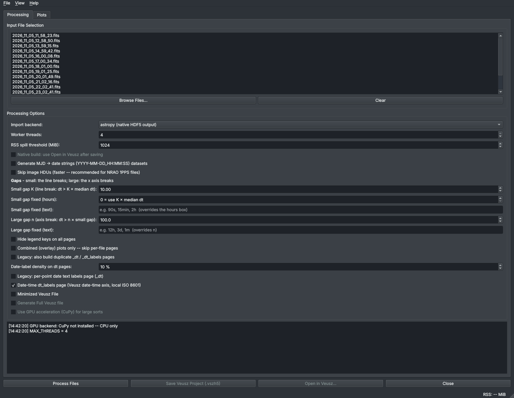
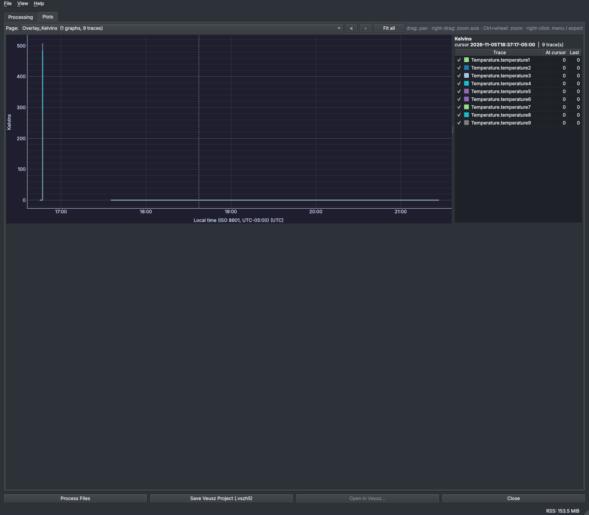
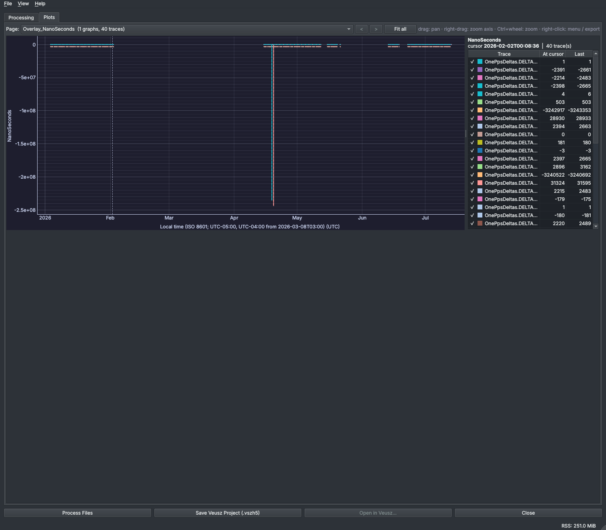

### 10.3 Found in the data (please check)

* **Padding rows.** Every OnePpsDeltas file ends in 7 rows with DMJD = 0 and empty
  CHANNELA/B. They were plotted as a 41st trace at MJD 0, which put an axis break from 1858 to
  2026 on every overlay. They are now left out and counted in the log.
* **Outlier.** CNS_GPS1 – GBTRtn DELTAT = −243 880 893 ns (−0.244 s) at 2026-04-19T22:28:36Z
  (file `2026_04_19_19_20_43.fits`). This one sample sets the y range of that trace.
* **71.5-day hole** in the 30d set, from 2026-02-02T18:51:12Z to 2026-04-15T07:18:42Z. No file
  covers it, and it becomes one of the x-axis breaks.
* **Constant values.** 4 of 15 Temperature files (2026-11-05 23:02 → 11-06 02:02 UTC) and 11 of
  15 Vacuum files have the same value in every row of every column. This may be a stalled
  sensor or logger.
* **Repeated time stamps.** 1 step in Temps and 15 steps in Vacuum are shorter than 0.05 s. These
  rows are kept.

### 10.4 Python 3.8 and 3.12

The package versions, mamba environments, differences between 3.8 and 3.12, and the test table
are in **REQUIREMENTS.md**. The two Pythons produced the same projects: the same dataset names,
equal arrays (NaN = NaN) and the same Veusz script, for all four sets (tack 776, Temps 384,
Vacuum 95 and 30d 40 195 datasets).

Fixed because of these tests:

* **Python 3.8:** `VSZH5_DISPLAY_TZ=America/New_York` raised `ModuleNotFoundError: zoneinfo`.
  It is fixed by `vszh5_writer.iana_zone()`, which falls back to backports.zoneinfo and then
  dateutil.
* **Python 3.12 / PySide6 6.12:** a segmentation fault at random, in 3 of 4 test runs; the
  committed suite of the same morning also had it. The memory-monitor thread held lambdas that
  referred to the window or plugin dialog. It could release the last reference, which destroyed Qt
  widgets outside the GUI thread. It also wrote to the log widget from its own thread. The fix
  is in `_autoplot_common` 0.4.0 and the plugins 0.3.0:
  * the callback is a bound method, held through `weakref.WeakMethod`;
  * `log()` and `append_log()` queue the text to the GUI thread;
  * `stop()` wakes the thread and joins it;
  * the stop event is no longer called `_stop`, a name that shadowed `threading.Thread._stop()`
    and broke `join()`.

  The Plots tab also deletes the plots of a page that is left in the GUI thread at once. Earlier,
  the garbage collector reached them from whichever thread it happened to run in.
* **Regression test:** `tests/test_gui_close.py` (4 tests). The FITS and Franks windows are
  opened with the RSS threshold at 0 MiB, so the monitor fires from its own thread. The Plots tab
  is filled and paged through, and the windows are closed and deleted. The two plugin dialogs and
  the ATR, CSV/TSV, R&S and Touchstone windows get the same treatment. Each cycle runs twice
  while a second thread calls `gc.collect()` every 2 ms. The test passes on 3.8, 3.12 and 3.13.

### 10.5 Headers, comments, revisions, assets

* Every `.py` file has the author's header: Header Info; Created on; Author Information with the
  e-mail, secondary e-mail and phone; Revisions with the semantic-schema line. Each entry is
  `# %%%% X.Y.Z:` and `Date:`. The newest entry holds the Function Descriptions (made from the
  code), the Variable Descriptions and More Info. Older entries are unchanged, newest first.
* All 358 functions, classes and methods that had no docstring now have one. Files changed only in
  documentation got a patch version, as listed in § 1. Test and utility scripts have Spyder
  `# %%` cells (Imports / Tests or Script / Run).
* Pop-up help: 131 buttons, check boxes, spin boxes, combo boxes, lists and text fields had no
  tooltip. Every one now has one, in FITS, Franks, both plugins, the shared main window, ATR,
  CSV/TSV, R&S and Touchstone. This includes the buttons made in loops, such as the delimiter
  presets and the R&S plot modes. The launcher, the Plots tab and the gap controls already had
  tooltips.
* `assets/` had placeholder text notes, not icons. It now has real 256 px PNG icons for every
  image the launcher looks for. `app_icon.png` is a crop of `GBT_2.ico`. The others are drawn by
  `tools/make_suite_icons.py`, which recreates them exactly. The placeholder notes were removed.

### 10.6 Data gaps and limits

* Veusz 4.2.1 needs about 130 s to open the 30d project (320 pages, 40 195 datasets). For a quick
  look, use *Combined (overlay) plots only* or the minimized save.
* Not tested on Windows. Windows needs `tzdata` for the IANA zone names; both requirement files
  install it.
* The cause of the −0.244 s outlier and of the constant UWBR files is not known from the files.
  Instrument logs or the operators would be needed.
* DMJD is read as UTC. Each file's PRIMARY header says `TIMESYS = 'UTC'` for DATE-OBS, and
  DATE-OBS matches the first DMJD of every file checked. The headers do not state the scale of the
  DMJD column itself.

### 10.7 References (addendum)

| # | Reference (IEEE) |
|---|---|
| [12] | P. J. Rousseeuw and C. Croux, "Alternatives to the median absolute deviation," *J. Amer. Statist. Assoc.*, vol. 88, no. 424, pp. 1273–1283, 1993, doi: 10.1080/01621459.1993.10476408. |
| [13] | The Qt Company, "Threads and QObjects," *Qt 6 documentation*. [Online]. Available: https://doc.qt.io/qt-6/threads-qobject.html |
| [14] | Python Software Foundation, "weakref — Weak references" (`WeakMethod`), *Python 3 documentation*. [Online]. Available: https://docs.python.org/3/library/weakref.html |
| [15] | Python Software Foundation, "zoneinfo — IANA time zone support," *Python 3 documentation*. [Online]. Available: https://docs.python.org/3/library/zoneinfo.html |
| [16] | Python Software Foundation, "tzdata," PyPI. [Online]. Available: https://pypi.org/project/tzdata/ |
| [17] | conda-forge, "Miniforge." [Online]. Available: https://github.com/conda-forge/miniforge |
| [18] | Veusz developers, "Axis-broken widget," *Veusz manual*. [Online]. Available: https://veusz.github.io/docs/manual/widgets.html |
| [19] | A. M. Price-Whelan *et al.*, "The Astropy Project: Sustaining and growing a community-oriented open-source project and the latest major release (v5.0) of the core package," *Astrophys. J.*, vol. 935, no. 2, 167, 2022, doi: 10.3847/1538-4357/ac7c74. |

## 11. Speed, GPU for NVIDIA and AMD, dB averages (2026-11-09, evening)

Requests: *"check all items for parallel processing and GPU (both amd and nvidia based) processing
is implemented wherever it would help speed up any process. IF you find areas where it can be
implemented, do so"* and, after that, *"if any unit is in dB, you are always averaging in the
linear domain and then transferring back to dB where needed."* Archive:
`FitsAutoPlot_suite_0.4.1_2026-11-09.7z` (every tracked file).

### 11.1 Versions

| File | Before | Now | What changed |
|---|---|---|---|
| `_autoplot_parallel.py` | — | **0.0.1** (new) | `adaptive_map()`: a `spawn` process pool only when it finishes sooner (11.3) |
| `_autoplot_gpu.py` | — | **0.0.1** (new) | One GPU layer: CuPy on CUDA (NVIDIA), CuPy on ROCm (AMD), PyOpenCL (any OpenCL GPU); NumPy fallback; size thresholds; self-tests; `power_mean_db` (11.4, 11.5) |
| `vszh5_writer.py` | 0.0.27 | **0.0.28** | Faster save, same file contents (name set, one HDF5 call per dataset and text dataset, cached UTC offsets); `block_reduce` docstring: "mean" is for linear values |
| `_autoplot_native.py` | 0.5.0 | **0.5.1** | Reverse local/UTC map kept, fast text datasets and tags |
| `_autoplot_common.py` | 0.4.0 | **0.4.1** | GPU helpers through `_autoplot_gpu` (NVIDIA or AMD), CuPy no longer imported at start-up; `ProgressThrottle`; `gpu_tooltip` / `gpu_usage_text` |
| `FITS_AutoPlot.py` / `Franks_AutoPlot.py` | 0.4.0 | **0.4.1** | Files read in parallel processes when it pays off; throttled progress; GPU checkbox for NVIDIA or AMD with the GPU use in the log |
| `FITS_AutoPlot_plugin.py` / `Franks_AutoPlot_plugin.py` | 0.3.0 | **0.3.1** | Throttled progress; GPU checkbox and log (threads only inside Veusz) |
| `ATR_AutoPlot.py` | 0.2.2 | **0.2.3** | Adaptive pool (was: always a pool from 4 files) |
| `RAndS_FSW_ASCII_Plotter.py` | 1.1.2 | **1.1.3** | Adaptive pool; averages through `power_mean_db` (linear domain), GPU for large stacks; reference [4] replaced (it cited a standard withdrawn in 1990) |
| `Touchstone_AutoPlot.py` | 0.7.1 | **0.7.2** | Adaptive pool for reading, time domain and Smith export; GPU only for large transforms; CuPy not imported at start-up |
| `tests/test_parallel_gpu.py` | — | **0.0.1** (new) | 19 tests: pool rule, sort keys, linear-domain dB means, CuPy stand-in (CUDA and ROCm), OpenCL |
| `README.md`, `REQUIREMENTS.md` (0.2.0) | | | Parallel and GPU sections; GPU packages for 3.8 and 3.12; `AUTOPLOT_GPU` |

### 11.2 What was slow, and what it is now

Measured on this computer (Linux, 2 CPUs, no GPU), Python 3.13, before and after this round.

| Task | Before | After | Cause and change |
|---|---|---|---|
| FITS 30-day OnePpsDeltas, 319 files, build pages (GUI) | 17.9 s | 8.4 s | astropy holds the GIL, so reader threads ran one at a time: process pool; O(n²) name checks and a reverse map rebuilt per axis removed; progress repaints throttled |
| same project, save (246 MB, 40 195 datasets) | 34.2 s | 14.2 s | list search per dataset (9 s), a second HDF5 lookup per dataset, 183 000 zone look-ups; HDF5 itself is serial (h5py global lock [33]) |
| Touchstone time domain, 220 files, "multiprocessing" on | 2.1 s (pool) | 0.5 s | the fixed pool cost more than the work; the adaptive rule keeps it in one process |
| ATR, 25 files | 0.19 s (pool) | 0.01 s | as above |
| CSV/TSV, 60 files × 50 000 rows | 1.37 s (1 thread) | 0.81 s (2 threads) | already parallel (pandas releases the GIL); unchanged |
| Every program and spawn worker start-up with CuPy installed | CuPy imported | not imported | GPU libraries are imported on first use |

The tack (10 files), UWBR Temps (15) and 30-day (319) projects are identical, dataset by dataset
and in the document script (apart from its "Generated by ... 0.5.1, vszh5_writer 0.0.28" comment
line), to those of 0.4.0 / writer 0.0.27, on Python 3.8, 3.12 and 3.13; so are the R&S project of the
40 files in `R&S_DataFiles/All` and all 1 760 Touchstone time-domain responses (gated and
un-gated) of the 220 readable example files (3 of the 223 are malformed).

### 11.3 When a process pool is used

`_autoplot_parallel.adaptive_map()` runs the first two items in the program's own process and
times them (s per item). For the N remaining items and W workers:

  t_seq = s · N,  t_pool = t_start + 1.1 · s · N / W,  pool when t_seq − t_pool ≥ 0.5 s

t_start is 0.3 s on Linux and 1.0 s on Windows (an estimate; not measured on Windows) plus the
program's own import time, which every `spawn` worker pays again. The factor 1.1 allows for
pickling. Results come back in input order; the log says which way the batch ran. A main script
without an `if __name__ == "__main__":` guard never gets a pool (found in testing: a helper script
without the guard made every worker run it again and hung). `spawn` is used on every platform [29].

### 11.4 GPU: NVIDIA and AMD

| Operation | Program | GPU from (elements) | CUDA / ROCm (CuPy) | OpenCL (PyOpenCL) | Check |
|---|---|---|---|---|---|
| stable sort order | FITS, Franks (+ plugins) | 200 000 | `cupy.argsort` of 64-bit keys (stable [21]) | radix sort of the same keys [27] | identical to `np.argsort(kind="stable")`, NaN last, −0 = +0 |
| dB mean in the linear domain | R&S | 1 000 000 | same code as NumPy | one work item per point | 1.4e-14 dB from NumPy (35 example averages, PoCL) |
| centred inverse FFT | Touchstone | 1 000 000 | cuFFT / hipFFT | pyvkfft [28] if installed | self-test 1e-12 relative |

* **Selection**: `AUTOPLOT_GPU=auto` (CuPy, then an OpenCL GPU), `cuda`, `rocm`, `opencl`, `off`.
  CuPy built for ROCm reports `is_hip`, so AMD and NVIDIA builds are told apart [20], [23], [24].
* **Self-test**: on first use each operation runs on a small input with NaN, ±inf, ±0 and ties and
  is compared with NumPy. A mismatch or error switches that operation to NumPy for good; the
  tooltip and log say so. So an untested driver can never change a result.
* **Thresholds** are estimates (no GPU here to measure). The real files are far below them: the
  largest FITS sort had 28 212 values (13 119 sorts in 0.04 s), the largest R&S average 149 799
  values, a Touchstone network at most 6 404 (804 to 6 404 in the examples). **So, at the suite's data sizes, the GPU does not speed
  anything up; the CPU path is faster and is what runs.** The GPU code is there for much larger
  files (e.g. long 1 Hz logs or waterfalls of many sweeps).
* **Tested**: OpenCL for real with PoCL 3.0 on the CPU [31] (Python 3.8 with PyOpenCL 2024.1,
  3.12 and 3.13 with 2026.1.4): unit tests, a FITS tack batch with every sort on OpenCL (42 sorts;
  project identical) and the R&S averages on OpenCL. CuPy (CUDA and ROCm) with a stand-in module
  built on NumPy: selection, self-test, fallback and code paths, not GPU arithmetic.
* **Not done, and why**: saving (HDF5 is serial [33]); the pyqtgraph Plots tab (it already draws at
  most about two points per screen pixel, peak-preserving, so OpenGL drawing would not change the
  speed and pyqtgraph marks it experimental); CSV/TSV (I/O-bound, already threads); the Veusz
  plugins (no process pools inside Veusz; GPU sort offered as in the programs).

### 11.5 dB values: averaged in the linear domain

Every place where the suite handles dB values, checked 2026-11-09:

| Where | What happens to dB values | Verdict |
|---|---|---|
| R&S `power_mean()` per file (all sweeps) | P = 10 log10( (1/K) Σ 10^(P_k/10) ), NaN left out, max-referenced (`_autoplot_gpu.power_mean_db`) | linear domain (power) ✔ |
| R&S "AllFiles" average | the same over every sweep of every file (not a mean of the per-file means) | ✔ |
| R&S `<file>_avg_lin` | 10^(P_avg/10) (mW for dBm) | ✔ |
| Touchstone magnitude, time domain, gate | dB only computed, 20 log10 \|S\|, from complex S; windows and gates act on complex S | no dB averaging ✔ |
| Touchstone re-gridding (non-uniform files) | interpolates the complex S-parameters (scikit-rf, Cartesian) | linear ✔ |
| ATR, CSV/TSV, FITS, Franks | dB columns are plotted, not averaged | no averaging ✔ |
| pyqtgraph Plots tab | downsampling "peak" (min/max per pixel), cursor = nearest sample | no averaging ✔ |
| `vszh5_writer.block_reduce` (not used by the suite) | "power_mean_db" for dB; "mean" documented as linear-only | ✔ (doc) |

Why it matters: 0 dB and −10 dB average to −2.60 dB as powers, not −5 dB; for noise, averaging
in dB reads up to 2.51 dB low [30]. `power_mean_db(..., factor=20)` averages amplitudes (|S|,
volts) instead, if ever needed. Tests: `tests/test_parallel_gpu.py` (`PowerMeanTests`): hand
values, NaN / ±inf, ±400 dB without overflow, and bit-identical results to the writer's
`linear_power_mean_dbm` for finite data.

### 11.6 Verification

| Check | Python 3.8.20 | Python 3.12.3 | Python 3.13 |
|---|---|---|---|
| `python -m unittest discover -s tests` (60 tests) | OK (2 skipped: OpenCL, not installed) | OK (2 skipped) | OK (2 skipped) |
| OpenCL tests with PoCL | OK (PyOpenCL 2024.1) | OK (2026.1.4) | OK (2026.1.4) |
| Headless GUI runs: FITS tack / Temps / Vacuum / 30-day, ATR, CSV, R&S, Touchstone, Plots tab, launcher | pass | pass | pass |
| Format check (header template, revision = version, Date lines, docstrings, 3.8 grammar) | 30 Python files OK | | |
| Tooltip audit (every interactive widget) | 0 missing | | |

### 11.7 Data gaps and limits

* No GPU was available: the CUDA and ROCm paths ran only against a stand-in module, and OpenCL
  only on the CPU (PoCL). GPU speed-ups and the thresholds are not measured; please run
  `python -m unittest tests.test_parallel_gpu -v` on a GPU computer and send the output.
* pyvkfft (OpenCL FFT) could not be installed here (no binary for this Python); its path is
  untested and guarded by the self-test.
* ROCm CuPy wheels need Python 3.10+ and Linux; on Windows or Python 3.8, AMD GPUs are reached
  through PyOpenCL only.
* The pool start-up on Windows (1.0 s) is an estimate. Only 2 CPUs here; more cores make the
  FITS reader pool faster still.
* Franks AutoPlot's process reader was checked in the unit and GUI tests, not timed on a large
  Franks batch.

### 11.8 References (round 11)

| # | Reference (IEEE) |
|---|---|
| [20] | CuPy developers, "Upgrade guide" (Python 3.8 dropped in v13, 3.9 in v14), *CuPy documentation*. [Online]. Available: https://docs.cupy.dev/en/latest/upgrade.html |
| [21] | CuPy developers, `cupy/_sorting/sort.py` ("argsort ... with a stable sorting"), GitHub. [Online]. Available: https://github.com/cupy/cupy/blob/main/cupy/_sorting/sort.py |
| [22] | CuPy developers, "cupy-cuda12x 14.2.0" and "cupy-cuda13x 14.2.0," PyPI, Aug. 2026. [Online]. Available: https://pypi.org/project/cupy-cuda12x/ , https://pypi.org/project/cupy-cuda13x/ |
| [23] | CuPy developers, "cupy-rocm-7-0 14.2.0," PyPI, Aug. 2026. [Online]. Available: https://pypi.org/project/cupy-rocm-7-0/ |
| [24] | G. Pinkert and E. Li, "Plug-and-Play CuPy on ROCm: Data analytics acceleration made simple," *AMD ROCm Blogs*, Nov. 14, 2025. [Online]. Available: https://rocm.blogs.amd.com/artificial-intelligence/cupy-v13/README.html |
| [25] | A. Klöckner, N. Pinto, Y. Lee, B. Catanzaro, P. Ivanov, and A. Fasih, "PyCUDA and PyOpenCL: A scripting-based approach to GPU run-time code generation," *Parallel Comput.*, vol. 38, no. 3, pp. 157–174, 2012, doi: 10.1016/j.parco.2011.09.001. |
| [26] | A. Klöckner *et al.*, "pyopencl 2026.1.4" (Python ≥ 3.10; 2024.1 for Python 3.8), PyPI. [Online]. Available: https://pypi.org/project/pyopencl |
| [27] | A. Klöckner *et al.*, "Parallel algorithms: sorting (radix sort)," *PyOpenCL documentation*. [Online]. Available: https://documen.tician.de/pyopencl/_sources/algorithm.rst.txt |
| [28] | D. Tolmachev, "VkFFT—A performant, cross-platform and open-source GPU FFT library," *IEEE Access*, vol. 11, 2023. [Online]. Available: https://ieeexplore.ieee.org/document/10036080/ ; pyvkfft: https://pypi.org/project/pyvkfft |
| [29] | Python Software Foundation, "multiprocessing — Contexts and start methods," *Python 3 documentation*. [Online]. Available: https://docs.python.org/3/library/multiprocessing.html |
| [30] | Keysight Technologies, "Noise measurements," *89600 VSA software help*. [Online]. Available: https://helpfiles.keysight.com/csg/89600B/Webhelp/Subsystems/powerspectrum/content/ps_noisemeasurements.htm |
| [31] | P. Jääskeläinen, C. Sánchez de La Lama, E. Schnetter, K. Raiskila, J. Takala, and H. Berg, "pocl: A performance-portable OpenCL implementation," *Int. J. Parallel Program.*, vol. 43, no. 5, pp. 752–785, 2015, doi: 10.1007/s10766-014-0320-y. |
| [32] | *IEEE Standard for Floating-Point Arithmetic*, IEEE Std 754-2019, 2019, doi: 10.1109/IEEESTD.2019.8766229 (bit patterns used for the sort keys). |
| [33] | h5py developers, "Thread safety" (one global lock serialises all h5py calls), *h5py documentation*. [Online]. Available: https://docs.h5py.org/en/stable/threads.html |

## 12. Trace names, source/type tags, nothing cut (2026-11-10)

Request: *"update the touchstone plot order fix, also ensure traces are given meaningful names
based on the source data and trace type and ensure tags are used to tag all data based on both
type and data source. Ensure there is absolutely not truncation in any data when exporting to any
file type. ... See the maser analysis chat and compare the vszh5 writer for any updates. Before
changing the vszh5 writer, check all other chats and ensure a global update is utilized here."*
Archive: `FitsAutoPlot_suite_0.4.2_2026-11-10.7z` (every tracked file).

### 12.1 Versions

| File | Before | Now | What changed |
|---|---|---|---|
| `vszh5_writer.py` | 0.0.28 | **0.0.29** | The registry master from the maser workbench chat (exact ISO 8601 / MJD text; additions only). SHA-256 `50631331470ebd50162030f971529044076a6c813a264393067522a504f9d701` = the RF project master. No chat has a newer writer, and this round needs no writer change, so there is no 0.0.30. |
| `_autoplot_native.py` | 0.5.1 | **0.5.2** | `tag_data`, `source_tag`, `type_tag`, `trace_widget_name`, `exact_number_text`, `float_loses_text`; tags inherited by local / gap copies and a safety net for any untagged dataset; `%.12Vg` numeric ticks; `GetDataType`; local-time copies as one exact sum |
| `_autoplot_common.py` | 0.4.1 | **0.4.2** | Exact `mjd_to_datestr`; `dataset_kinds` / `tag_named_datasets` for FITS and Franks |
| `FITS_AutoPlot.py` / `Franks_AutoPlot.py` | 0.4.1 | **0.4.2** | Names, tags, nothing cut (12.2-12.4) |
| `FITS_AutoPlot_plugin.py` / `Franks_AutoPlot_plugin.py` | 0.3.1 | **0.3.2** | Overlay records carry the source |
| `ATR_AutoPlot.py` | 0.2.3 | **0.2.4** | Exact frequencies, kept text and trailing lines, tags |
| `CSV_TSV_AutoPlot.py` | 6.1.2 | **6.1.3** | Exact parsing with every pandas, kept text, exact seconds, mixed ISO 8601, tags |
| `RAndS_FSW_ASCII_Plotter.py` | 1.1.3 | **1.1.4** | Every sweep in the notes, inf/nan, kept sections, tags |
| `Touchstone_AutoPlot.py` | 0.7.2 | **0.7.3** | Tags, data-named traces, exact notes, mpld3 fallback, order fix documented |
| `_autoplot_pyqtgraph.py` | 0.3.1 | **0.3.2** | CSV export with every digit |
| `tests/test_names_tags_precision.py` | — | **0.0.1** (new) | 21 tests (12.5, 12.6) |
| `requirements-py38.txt` / `REQUIREMENTS.md` | 0.3.0 / 0.2.0 | **0.3.1 / 0.2.1** | mpld3 0.5.10 on Python 3.8; pandas parser note |

### 12.2 Trace names

Every trace (xy / polar point) widget is named after the dataset it draws:
`trace_widget_name(y_dataset[, variant])` keeps letters, digits and `_` (a leading digit stays).
The legend text is unchanged.

| Program | 0.4.1-era name | Now (example) |
|---|---|---|
| FITS AutoPlot | `xy_Tach1_azServo1Hz` | `ds_2026_04_20_01_39_03__azServo1Hz__Tach1__sorted` (+ `_date_labels`, `_local_time`) |
| Franks AutoPlot | `xy_CNS2018`, `xy_CNS2018_dtL` | `ds_2026_01__CNS2018__sorted`, `..._local_time` |
| ATR AutoPlot | `<stem>` (single frequency) | `<stem>_mag`, `<stem>_phase`, `<stem>_2700MHz_mag` |
| CSV/TSV | `Overlay_<file>_<col>` | `<file>_<col>` |
| R&S, Touchstone | data names already | unchanged, made widget-safe |

### 12.3 Tags: data source and data type

Every dataset carries at least one `source_` and one `type_` tag (Veusz `TagDatasets`). The old
bare tags (`<file>`, `raw`, `sorted`, `datestr`, `Avg_dB`, `Avg_Linear`, the run name) are
replaced.

| Program | `source_` | `type_` (examples) |
|---|---|---|
| FITS / Franks | file stem; every contributing file on overlays | `raw`, `sorted`, `time_MJD`, `time_local`, `time_labels`, `time_text`, `gap_rows`, `overlay`, `exact_text`, `complex_real` / `complex_imaginary`, `text` |
| ATR | file stem | `azimuth_deg`, `frequency_MHz`, `magnitude_dB`, `phase_deg`, `time_measured`, `exact_text` |
| CSV/TSV | file stem | `<column>`, `x_data`, `y_data`, `time_utc`, `time_local`, `time_text`, `exact_text` |
| R&S | file stem (all files for the all-file average) | `frequency_Hz` / `time_s` / `index`, `time_sweep`, `sweep`, `dBm`, `average_dB`, `average_linear`, `power_linear`, `all_files`, `sweep_unaligned`, `sweep_text` |
| Touchstone | file stem and `source_<run>`; grid: `source_Touchstone_AutoPlot` | `frequency_GHz`, `magnitude_dB`, `phase_deg`, `unwrapped`, `S11` ... `S22`, `time_ns`, `time_domain_dB`, `gated` / `ungated` / `measured`, `smith_gamma_real` / `_imaginary`, `frequency_Hz`, `Z0_50_ohm`, `smith_grid` |
| any other (safety net in `finalize()`) | `source_<program>` | by kind of dataset |

### 12.4 Truncation found and removed

| Where | What was cut | Now |
|---|---|---|
| Franks `time_gbt.dat` | the COMMENTS column (`names[:5]`, `toks[:ncols]`) | `COMMENTS` text column (rest of the line as written); extra tokens `EXTRA_TEXT`; `#` lines in the notes |
| FITS / Franks MJD date text | whole seconds (`02:29:07` for 02:29:06.72) | every digit (writer 0.0.29 `mjd_iso_local_strings`, Decimal) |
| FITS complex columns | imaginary part dropped | `__re` and `__im` datasets |
| FITS / CSV / Franks integers beyond 2^53 | digits lost in float64 | `*_exact_text` beside the numbers |
| Franks / CSV words among numbers | the word (a NaN) | `*_exact_text` keeps the cell text |
| CSV, pandas 2.0.3 (Python 3.8) and 3.0.5 | default C parser wrong by up to 7 375 ulp (relative 1e-12) for numbers with more than 15 digits or a power of ten beyond ±22: 212 971 of 400 000 17-digit values | `float_precision="round_trip"` for files that have such numbers, decided by a byte scan and a parser probe; pandas 3.1.1 deprecates the option ("All float precision modes now use the same converter") [34] |
| CSV date-times | pandas 2.0 `total_seconds()` 1 ulp off; offsets and nanoseconds lost in float seconds; mixed ISO 8601 files skipped | seconds from integer nanoseconds (correctly rounded); stamps kept as `<col>_text`; `format="ISO8601"` retry |
| Local-time copies (all programs) | round trip through Unix seconds (step 2.4e-7 s) | UTC + offset in one addition; tack / Temps / Franks: at most 1.19e-7 s different, whole seconds identical |
| ATR | `%g` (6 digits) frequency names: 1420.4051 and 1420.4052 MHz both `1420p41MHz`, one overwrote the other; -Inf, words and an odd last value dropped; lines after `*` dropped | exact names (`_mhz_text`); `*_exact_text`; notes keep the trailing lines and the reading notes |
| R&S | notes stopped at 2 000 sweeps; `inf` / `nan` sections dropped or read as binary; short sections and text sections dropped; rows with a word dropped; files with ragged rows refused | all sweeps listed; `inf`/`nan` are numbers; printable text never read as binary; `_Section<n>_unaligned` / `_Section<n>_text` kept; ragged rows padded |
| Touchstone notes and titles | `%g`, `%.4g`, `%.6g` | `repr` (`_num`) |
| Touchstone HTML Smith export on Python 3.8 | mpld3 0.5.11 / 0.5.12 call `Axis.get_converter`, absent in matplotlib 3.7.5, so no HTML was written | mpld3 0.5.10 pinned for 3.8 (works; every digit kept); PNG fallback with the reason |
| Plots tab CSV export (pyqtgraph 0.13.3 and 0.14.0) | `numpy.format_float_positional(precision=10)`: 1.234e-12 → `0.0000000000`, 0.12345678901234568 → `0.1234567890` | "CSV of original plot data (every digit)" writes `repr` [38], [39] |
| Veusz numeric ticks | default `%Vg` showed MJD 61234.1 as 6.1×10⁴ | `%.12Vg` |

Checked and found exact: the `.vszh5` writer (float64, HDF5), the pyqtgraph HDF5 exporter, mpld3
0.5.12 (Python 3.12) and 0.5.10 (Python 3.8) HTML (full `repr` digits in the page). PNG / SVG / PDF
are pictures, not data exports.

### 12.5 Touchstone time-gated page order (fixed in 0.7.2, documented now)

0.7.1 collected the time-domain results with `as_completed`, so the time-gated pages followed the
order in which the pool finished: 53 of the 220 example files were out of file order. Since 0.7.2,
`adaptive_map` stores each result at its input index and `run_time_domain_batch` builds its dict in
input order. Two new tests force a process pool in which a later item finishes first (a 2 s job, and
a 200 001-point network) and check that the results and pages stay in input order.

### 12.6 Verification

| Check | Python 3.8.20 | Python 3.12 | Python 3.13 |
|---|---|---|---|
| Unit tests (`python -m unittest discover -s tests`) | 81 OK (2 skipped: OpenCL not installed) | 81 OK (2 skipped) | 81 OK (OpenCL on PoCL) |
| Headless GUI runs (`run_env_checks.sh`) | 6 of 6 pass | 6 of 6 pass | 6 of 6 pass |
| Format check (header, revision = version, Date lines, docstrings, 3.8 grammar) | 13 changed files OK | | |
| Tooltip audit | 0 missing | | |

Projects compared with the 0.4.1-era output, dataset by dataset (Python 3.12):

| Project | Datasets before → now | Lost | Changed | Added | Untagged | Old `xy_` names |
|---|---|---|---|---|---|---|
| FITS tack | 776 → 776 | 0 | 42 (local copies, ≤ 1.19e-7 s) | 0 | 0 | 0 |
| FITS UWBR Temps | 384 → 384 | 0 | 24 (local copies) | 0 | 0 | 0 |
| Franks, 7 `.t00new` + `time_gbt.dat` | 377 → 383 | 0 | 34 local copies, 16 date strings (fractions kept) | 6 (COMMENTS, exact text) | 0 | 0 |
| ATR, 25 files | 129 → 133 | 0 | 0 | 4 (exact text) | 0 | 0 |
| R&S, 42 files | 826 → 826 | 0 | 0 | 0 | 0 | 0 |
| CSV/TSV `temps.tsv` | 4 → 5 | 0 | 0 | 1 (time text) | 0 | 0 |
| Touchstone, 223 files | 7 279 → 7 279 | 0 | 0 | 0 | 0 | 0 |

All eight projects (the seven above plus a CSV test of nanosecond stamps, 2^53 + 1 integers,
20-digit decimals and words) load in Veusz 4.2.1 with every dataset tagged `source_` and `type_`,
and their first, middle and last pages render. CSV loading, 60 files of 50 000 × 5: 2.1 s on
Python 3.8 (1.1 s before; the byte scan), 0.6 s on 3.12.

### 12.7 Data gaps and limits

* The suite's Touchstone values come from scikit-rf; a Touchstone file with more digits than
  float64 holds is not checked for exact text (skrf parses the numbers).
* Veusz's own Data editor shows 6 digits; that is Qt display only, the file holds float64.
* The CSV byte scan is conservative: any exponent or 16-character run of digits switches pandas
  2.x / 3.0 to the slower exact parser, even when the fast one would have been right.
* `zoneinfo` names on Python 3.8 come through `iana_zone()` (dateutil / backports), as before.
* Still no GPU here (section 11.7).
* The suite's copy in `C:\Users\wwallace\Claude\Projects\GBO_PostProcessing\FitsAutoPlot` could
  not be updated: the computer was not connected to this session.

### 12.8 References (round 12)

| # | Reference (IEEE) |
|---|---|
| [34] | pandas developers, "pandas.read_csv" (float_precision; "Deprecated since version 3.1.0: All float precision modes now use the same converter"), *pandas documentation*. [Online]. Available: https://pandas.pydata.org/docs/reference/api/pandas.read_csv.html |
| [35] | W. D. Clinger, "How to read floating point numbers accurately," in *Proc. ACM SIGPLAN Conf. Programming Language Design and Implementation (PLDI)*, 1990, pp. 92–101, doi: 10.1145/93542.93557. |
| [36] | D. Goldberg, "What every computer scientist should know about floating-point arithmetic," *ACM Comput. Surv.*, vol. 23, no. 1, pp. 5–48, 1991, doi: 10.1145/103162.103163. |
| [37] | Veusz developers, "Veusz command line and embedding interface (API)" (TagDatasets), *Veusz documentation*. [Online]. Available: https://veusz.readthedocs.io/en/latest/api.html |
| [38] | pyqtgraph developers, `pyqtgraph/exporters/CSVExporter.py`, GitHub. [Online]. Available: https://github.com/pyqtgraph/pyqtgraph/blob/master/pyqtgraph/exporters/CSVExporter.py |
| [39] | NumPy developers, "numpy.format_float_positional," *NumPy documentation*. [Online]. Available: https://numpy.org/doc/stable/reference/generated/numpy.format_float_positional.html |
| [40] | pandas developers, "pandas.to_datetime" (format="ISO8601"), *pandas documentation*. [Online]. Available: https://pandas.pydata.org/docs/reference/api/pandas.to_datetime.html |
| [41] | W. W. Wallace, "vszh5_writer 0.0.29 release notes" and "vszh5_writer registry," RF project documents, Nov. 10, 2026. |
| [42] | mpld3 developers, "mpld3," PyPI. [Online]. Available: https://pypi.org/project/mpld3/ |

## 13. Gap options in every plot generator (2026-11-16)

Request: *"Update all the plot generators, especially the fitsAutoplot files to be gap aware in the
data and add options to both break the line / trace or add an X-axis break. See the Maser Timing
Plots and telemetry effort and the vszh5_writer in all chats (update as needed and ensure you bump
the revision accordingly). Pull from those projects for the most up to date writer if you do not
already have it, and use it accordingly."*
Archive: `FitsAutoPlot_suite_0.4.3_2026-11-16.7z` (every tracked file, assets included).

### 13.1 Versions

| File | Before | Now | What changed |
|---|---|---|---|
| `vszh5_writer.py` | 0.0.29 | **0.0.30** | Built from the registry master 0.0.29 (SHA-256 `50631331...a504f9d701`, checked; no chat had a newer writer - the maser workbench 0.3.x still uses 0.0.29). Additions only: `GapRule`, `rule_gap_positions`, `rule_axis_break_pairs`, `break_points`, `gap_plan`, `local_veusz_exact`, `axis_break_pairs(log_threshold=)`, `x_breaks=` on `xy_page` / `Panel` (`grid_page`) / `time_pair_pages` (`mjd_breaks`, `local_breaks`). Every 0.0.29 call writes the same file (tested object by object). SHA-256 `26194c8e96572fce2106bb5588d33d7c3f024fbd5169ff626cab2e40aa01f604`; rebuilt byte for byte by `docs/writer_0.0.30/make_0030.py` + `add_entry_0030.py` from the stored 0.0.29. |
| `_autoplot_native.py` | 0.5.2 | **0.5.3** | `TimeLayout(break_lines, break_axis, numeric)`; `_layout_numeric_axis` (non-time axes, geometric rule); `_drop_unused_plot_copies`; notes state the rule in use; `add_gap_arguments` / `layout_from_args`; gap-text parsing moved here (Qt-free) |
| `_autoplot_common.py` | 0.4.2 | **0.4.3** | Three check boxes in the FITS / Franks gap controls; `time_layout()` passes them |
| `_autoplot_pyqtgraph.py` | 0.3.2 | **0.3.3** | Plots tab follows the options; broken-axis intervals shaded; log sweeps no longer cut |
| `_suite_gui.py` | 0.1.1 | **0.1.2** | `GapOptionsBox` for ATR, CSV/TSV, R&S and Touchstone |
| `FITS_AutoPlot.py` / `Franks_AutoPlot.py` | 0.4.2 | **0.4.3** | Gap options (through `_autoplot_common` 0.4.3) |
| `FITS_AutoPlot_plugin.py` / `Franks_AutoPlot_plugin.py` | 0.3.2 | **0.3.3** | Gap options in the dialog and as plugin fields |
| `ATR_AutoPlot.py` | 0.2.4 | **0.2.5** | Gaps box; batch flags |
| `CSV_TSV_AutoPlot.py` | 6.1.3 | **6.1.4** | Gaps box; batch flags |
| `RAndS_FSW_ASCII_Plotter.py` | 1.1.4 | **1.1.5** | Gaps box; batch flags |
| `Touchstone_AutoPlot.py` | 0.7.3 | **0.7.4** | Gaps box |
| `tests/test_gap_options.py`, `tests/test_writer_0030.py` | — | **0.0.1** (new) | 16 + 12 tests |
| `REQUIREMENTS.md` | 0.2.1 | **0.2.2** | No new packages; test results |

### 13.2 The rule

For one trace with sorted x values $x_0 \le x_1 \le \dots \le x_{N-1}$ (time in seconds, MJD in
days, frequency in Hz, angle in degrees, index), the steps are

$$
\Delta x_i = x_{i+1} - x_i , \qquad i = 0, \dots, N-2 .
$$

**Small gap (line break).** With the multiplier $K$ (default 10) or a fixed small gap $\tau_\mathrm{fix}$,

$$
\tau_j =
\begin{cases}
\tau_\mathrm{fix}, & \tau_\mathrm{fix} > 0 \\
K \cdot \operatorname{median}\{\Delta x_i > 0\}, & \text{otherwise}
\end{cases}
\qquad\text{gap at } i \iff \Delta x_i > \tau_j .
$$

A NaN row goes between samples $i$ and $i+1$ of the plot copies `<x>_gaps` / `<y>_gaps`; the
stored data are not changed. With **break_lines off** no rows are added and the line is drawn across.

**Large gap (x-axis break).** For the traces $j$ sharing one x axis, with the multiple $n$ (default
100) or a fixed large gap $T_\mathrm{fix}$,

$$
T =
\begin{cases}
\max\left(T_\mathrm{fix},\ \max_j \tau_j\right), & T_\mathrm{fix} > 0 \\
\max(n, 1) \cdot \max_j \tau_j, & n > 0 \\
\text{no axis breaks}, & n = 0
\end{cases}
$$

and the axis is cut where the merged, sorted x values of **all** traces, $u_0 < u_1 < \dots$, have
$u_{k+1} - u_k > T$, i.e. where no trace has data. The left-out interval keeps a margin
$m = 0.02$ of the gap on each side so the samples beside it stay visible:

$$
\left[\, u_k + m\,(u_{k+1}-u_k),\ \ u_{k+1} - m\,(u_{k+1}-u_k) \,\right]
\;\to\; \text{Veusz \texttt{axis-broken} } \texttt{breakPoints}\ [43].
$$

Since $T \ge \max_j \tau_j$, an axis break always falls where every line is already broken (when
line breaks are on). With **break_axis off** the axis stays continuous. The two options are
independent: line breaks only, axis breaks only, both, or neither.

**Axes that are not time (geometric test).** A log-spaced sweep $x_i = x_0 r^i$ has growing steps,

$$
\Delta x_i = x_0 (r-1)\, r^{i}, \qquad
\operatorname{median}_i \Delta x_i = x_0 (r-1)\, r^{99}\,\frac{1+r}{2} \quad (N = 201),
$$

so the linear test $\Delta x_i > K \cdot \operatorname{median}$ holds for

$$
i > 99 + \log_r\!\left(K\,\frac{1+r}{2}\right).
$$

For 10 MHz - 10 GHz in 201 points, $r = 10^{3/200} = 1.035142\ldots$ and $K = 10$:
$i > 99 + \dfrac{\ln(10 \cdot 1.017571)}{\ln 1.035142} = 99 + 67.17 = 166.17$, so the 33 steps
$i = 167 \dots 199$ were called gaps - exactly the 33 false breaks the Plots tab 0.3.2 drew. On
non-time axes a step must therefore also be large on a log scale (positive x only):

$$
\ln\frac{x_{i+1}}{x_i} > K \cdot \operatorname{median}_k \ln\frac{x_{k+1}}{x_k},
$$

and for the axis $\ln(u_{k+1}/u_k) > n \cdot \max_j \lambda_j$ with $\lambda_j$ the log threshold
of trace $j$. For the log sweep $\ln(x_{i+1}/x_i) = \ln r$ for every $i$, so no step exceeds
$K \ln r$ ($K \ge 1$): no false breaks. A real hole in a linear or a log sweep is large on both
scales and is still found. Time axes (values far from zero, where the log test adds nothing) use
the linear test only, as before. Unsorted traces (a loop, a polar trace), label axes and the
hidden axes of Smith charts are never cut.

### 13.3 Options

| GUI (Gaps box; FITS / Franks gap controls) | Batch flag (ATR, CSV/TSV, R&S) | Plugin field | `TimeLayout` / `GapRule` | Default | Effect |
|---|---|---|---|---|---|
| Break the line / trace at small gaps | `--no-line-breaks` | `gap_break_lines` | `break_lines` | on | NaN rows in plot copies at small gaps |
| Small gap K | `--gap-k K` | — (dialog) | `k` | 10 | $\tau = K \cdot \operatorname{median}(\Delta x)$; also scales the large gap |
| Small gap fixed (time) | `--gap-small 90s` | `gap_string` | `manual_s` | none | fixed $\tau$ (time axes) |
| Break the x axis at large gaps | `--no-axis-breaks` | `gap_break_axis` | `break_axis` | on | Veusz broken axis; Plots tab shades the interval |
| Large gap n | `--gap-n N` | `gap_axis_n` | `n` | 100 | $T = n \cdot \max_j \tau_j$; 0 = no axis breaks |
| Large gap fixed (time) | `--gap-large 12h` | `gap_axis_string` | `axis_manual_s` | none | fixed $T$ (time axes), never below $\max_j \tau_j$ |
| Also on x axes that are not time | `--no-numeric-gaps` | `gap_numeric` | `numeric` | on | the rule on sorted frequency / angle / index axes, with the log test |

Gap texts: `s`, `min`, `h`, `d`, `m` (months, 30.4375 d); a bare number is hours. The K and
small-gap boxes stay enabled while either break is on (they set the scale of the large gap). Every
control has a tool tip. Each graph's notes end with the rule in use, every number exact, e.g.
`Gaps: lines drawn across gaps; x-axis break (large gap) where dt > 100 x the small-gap threshold.`
Changing the options and saving again replaces that line and removes the plot copies of the old
layout.

### 13.4 Measured on real data (Python 3.12)

| Data | Options | Broken axes (breaks) | Line-break copies | Notes |
|---|---|---|---|---|
| GBT SiteTime OnePpsDeltas, 30 days, 319 FITS files (40 195 datasets) | defaults | 2 (4) | 200 | 29.8 s |
| same | line breaks off | 2 (4) | 0 | lines across, axis still cut |
| same | axis breaks off | 0 | 200 | one continuous axis |
| same | both off | 0 | 0 | |
| UWBR Rcvr Temps, 15 files | defaults | 0 | 27 | no gap reaches 100 x the small gap |
| same | n = 1 | 19 (1 431) | 27 | every small gap also cuts the axis |
| R&S, 42 example `.sft` files | defaults | AllImported, Averages: `[288280000.0, 13621720000.0]` Hz | 0 | the ~10 MHz and ~14 GHz files no longer share 13.3 GHz of empty axis |
| 201-point 10 MHz - 10 GHz log sweep | defaults | 0 | 0 | 0.3.2 Plots tab: 33 false breaks |
| CSV, 1 s stamps with a 2 h hole | `--no-line-breaks` | 1 | 0 | note: "lines drawn across gaps" |

With the default options every example project (FITS tack and Temps, Franks, ATR, R&S, CSV, TSV,
223 Touchstone files) has the same datasets as 0.4.2, value for value; the scripts differ only by
the "Gaps:" note now also written on numeric graphs and the R&S overlay break above. The four
30-day variants load in Veusz 4.2.1 and their broken-axis pages render (axis kinds checked per page):

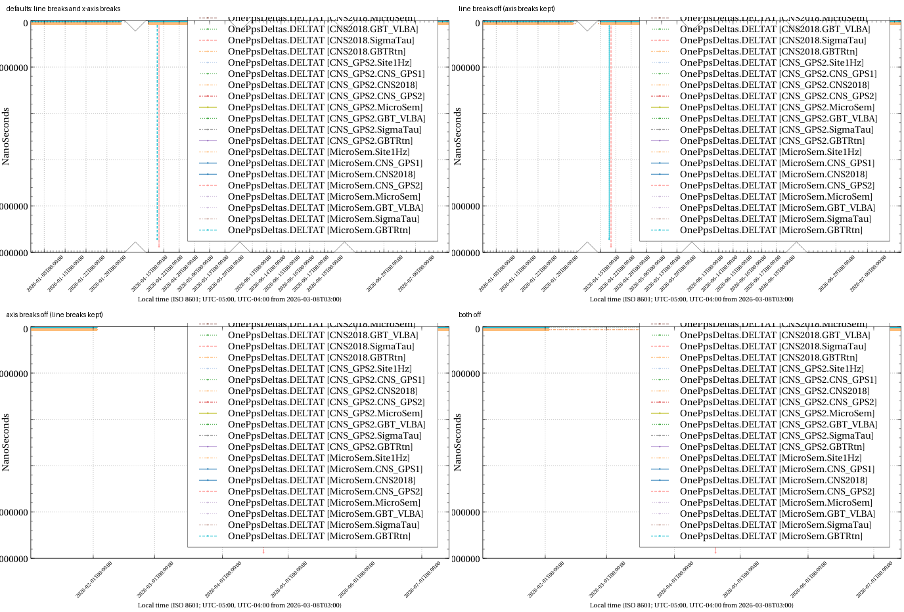

*GBT SiteTime OnePpsDeltas, 30 days, overlay page rendered by Veusz 4.2.1. Top: the x axis is
broken (zigzag marks) with and without line breaks; bottom: one continuous axis, with line breaks
(left) and with every line drawn across its gaps (right).*

### 13.5 vszh5_writer 0.0.30 and the registry

The registry (RF project `claude/vszh5-writer-registry.md`) was read first: master 0.0.29, no newer
copy in any chat. 0.0.30 takes the next patch number, is written back as the master
(`claude/vszh5_writer.py`) with its notes (`claude/vszh5-writer-0.0.30-notes.md`), and the
registry lists FitsAutoPlot 0.4.3 on 0.0.30. The MHM2010 / T4 Maser Timing Workbench (0.3.x, on
0.0.29) can take 0.0.30 as a drop-in: nothing it calls changes, and `gap_plan()` / `x_breaks=`
give its timing plots the same two options.

### 13.6 Verification

| Check | Python 3.8.20 | Python 3.12.3 | Python 3.13.18 |
|---|---|---|---|
| Unit tests (`python -m unittest discover -s tests`) | 109 OK (3 skipped: Veusz / OpenCL not installed) | 109 OK (3 skipped) | 109 OK (1 skipped; Veusz 4.2.1 renders broken axes) |
| Headless GUI and real-data runs (`run_env_checks.sh`: date-time pages, FITS tack / Temps / Vacuum / 30-day 1PPS, ATR, CSV, R&S, Touchstone, Touchstone Plots tab and Smith, Plots tab, launcher) | 13 of 13 pass | 13 of 13 pass | 13 of 13 pass |
| Format check (header, revision = version, Date lines, docstrings, 3.8 grammar) | every `.py` OK | | |
| Tooltip audit | 0 missing | | |
| Plots tab, two traces 13.6 GHz apart | | one shaded break region; y range covers both traces | |

### 13.7 Data gaps and limits

* The geometric test needs positive x; an axis with zero or negative values (e.g. a phase axis in
  degrees from -180) uses the linear test only.
* A fixed small or large gap is a time and applies to time axes only; non-time axes use K and n.
* pyqtgraph has no broken axis: the Plots tab draws the full range with the left-out intervals
  shaded grey.
* The R&S overlay axis break leaves two 13.3 GHz-apart groups whose tick labels can crowd; turn
  axis breaks off for one continuous axis.
* Still no GPU here (section 11.7); the gap rule is NumPy work and needs none.
* The suite's copy in `C:\Users\wwallace\Claude\Projects\GBO_PostProcessing\FitsAutoPlot` was
  updated to 0.4.3 (92 files: every tracked file except `Example_Data_Files`, `Archive` and
  `.idea`, as in the 0.4.0 sync), and the archive was placed beside it; the archive and three
  program files read back from that computer match by SHA-256. Its old `__pycache__` folders were
  left as they were (Python rebuilds them). The 0.4.1 and 0.4.2 archives were never copied there
  (the computer was offline then); 0.4.3 contains all of their changes.

### 13.8 References (round 13)

| # | Reference (IEEE) |
|---|---|
| [43] | Veusz developers, `veusz/widgets/axisbroken.py` (class `AxisBroken`, `axis-broken`, setting `breakPoints`: "Pairs of values to start and stop breaks"), GitHub. [Online]. Available: https://github.com/veusz/veusz/blob/master/veusz/widgets/axisbroken.py |
| [44] | pyqtgraph developers, "LinearRegionItem," *pyqtgraph documentation*. [Online]. Available: https://pyqtgraph.readthedocs.io/en/latest/api_reference/graphicsItems/linearregionitem.html |
| [45] | W. S. Cleveland, *The Elements of Graphing Data*, rev. ed. Hobart Press, 1994, ISBN 978-0-9634884-1-1 (scale breaks). |
| [46] | I. Sesia and P. Tavella, "Estimating the Allan variance in presence of long periods of missing data and outliers," *Metrologia*, vol. 45, pp. S134–S142, 2008. [Online]. Available: https://hdl.handle.net/11696/29548 |
| [47] | L. Galleani and I. Sesia, "The corrected Allan variance: Stability analysis of frequency measurements with missing data," *IEEE Trans. Ultrason., Ferroelect., Freq. Control*, vol. 66, no. 10, pp. 1667–1683, Oct. 2019, doi: 10.1109/TUFFC.2019.2927424. |
| [48] | *IEEE Standard Definitions of Physical Quantities for Fundamental Frequency and Time Metrology—Random Instabilities*, IEEE Std 1139-2022. [Online]. Available: https://standards.ieee.org/ieee/1139/7585/ |
| [49] | W. W. Wallace, "vszh5_writer registry" and "vszh5_writer 0.0.30 notes," RF project documents, Nov. 16, 2026. |

[46]-[48] concern *analysis* of timing data with missing samples (e.g. Allan variance of maser
data); the suite only *plots* gaps and leaves the data unchanged, so those methods still apply to
the stored datasets.

## 14. Clear clears everything; added files join the data already read (2026-11-16)

Request: *"ok, now for the fitsAutoPlot (and all others where this happens) ensure you clear all
data from plots and memory when the clear files is pressed. This should mean that any data loaded
from the those will not be saved into vuesz once they are cleared if a user adds more files after a
clear. If a user does not clear, and then adds more files, it should not "forget" the data, but it
should update the plots when processed. So to reiterate, clear should clear everything AND fully
release the memory to windows or linux. But it should not clear if they add more data without
pressing clear. Start with fitsAutoPlotter and then check all other plotters."*
Archive: `FitsAutoPlot_suite_0.4.4_2026-11-16.7z` (every tracked file, assets included).

### 14.1 What was wrong (measured before the change)

| Program | Clear did | Adding files and processing again did |
|---|---|---|
| FITS AutoPlot 0.4.3 / Franks 0.4.3 | emptied the file list only. The project, the Plots tab and the cache kept the data; the next batch added its pages to the **old** project, so cleared files were saved again. GBT tack, 5 files, Clear, 5 other files: the project still had the 10 old pages and 340 datasets of the cleared files; RSS 306 MiB before and after Clear | re-read every file and pushed it into the same project: 17 pages instead of 11 (every page of the first files twice) |
| ATR 0.2.5, R&S 1.1.5 | emptied the list; Save stayed enabled and wrote the old project; plots and data stayed | re-read every file, new project (correct, but all files read again) |
| CSV/TSV 6.1.4 | forgot the loaded files, but the project, Plots tab and preview stayed; Save wrote the old project | correct (loaded files kept, new project) |
| Touchstone 0.7.4 | forgot results and project, but the Plots tab and the time-domain / Smith previews still held the old data | re-read every file, new project |
| FITS / Franks plugins | Clear empties the dialog's file list before anything is read: nothing else to clear | each run reads its files once; the data stayed in Veusz's memory after the run |
| every Plots tab | a disposed plot's right-click menus waited for the event loop to be deleted (tack: +21 MiB RSS per process / Clear round) | |

### 14.2 What Clear does now (every program)

1. Refused while a batch reads files (Browse and Clear are also disabled during a FITS / Franks batch).
2. The file list, the data read from it (`KeptReads`), the project (`NativeDocument.release()`; Save
   is disabled, so **nothing cleared can be saved later**), the Plots tab and previews, the
   cache and its spill files (deleted after their memmaps are closed, which Windows needs).
3. Widgets given to `deleteLater()` are deleted at once, then `release_memory()`:

$$
\text{RSS}_\text{after} = \text{RSS}_\text{before} - \underbrace{\text{(freed by gc)}}_{\text{3 passes}} - \underbrace{\text{GPU pools}}_{\text{CuPy}} - \underbrace{\text{free heap pages}}_{\texttt{malloc\_trim} \,/\, \texttt{HeapCompact}}
$$

   * **Linux (glibc)**: `malloc_trim(0)`, which since glibc 2.8 "frees memory in all arenas and in
     all chunks with whole free pages" [50]. glibc returns blocks of at least `M_MMAP_THRESHOLD`
     (128 KiB at start) to the kernel as soon as they are freed, but the threshold rises to the size
     of a freed mapped block (up to 32 MiB on 64-bit), and smaller freed blocks stay in the
     heap [56]. Measured:
     400 MB of freed 80 kB arrays stayed resident (1202 MiB) until `malloc_trim` returned them
     (43 MiB).
   * **Windows**: `_heapmin()` of the C runtime, which "releases unused heap memory to the
     operating system" [51]; `HeapCompact()` on every process heap, which coalesces free blocks
     (Windows normally does this at `HeapFree` already, so it is a safety step) [52]; then
     `SetProcessWorkingSetSize(process, -1, -1)`, which "removes as many pages as possible from the
     working set" - what Task Manager shows as memory [53].
   * **macOS**: `malloc_zone_pressure_relief`.
   * The log shows `Memory released: RSS a -> b MiB (...)`.

### 14.3 What adding files does now (no Clear)

Process reads only the files it has no data for - new files, files changed on disk (size or
modification time), or files read with other read options - and **keeps** the data of the others,
even if such a file has since been moved. Then a new project is built from **every listed file**,
so the plots update and the project is the same as all files processed at once. A file that failed
is read again next time. Pressing Process with nothing new rebuilds the project at once (useful
after changing plot options).

### 14.4 Measured (Python 3.12, Linux)

| Data | Check | Result |
|---|---|---|
| FITS, GBT tack (10 files) | first 5, then 5 added, vs all 10 at once | identical: 792 HDF5 objects, same script; only the 5 new files read |
| FITS, tack | Clear | project, Plots tab, kept data, cache: empty. RSS 278 -> 175 MiB (window open: 146 MiB) |
| FITS, tack | Clear, then the second 5 only | 0 pages / datasets of the cleared files (before: 10 pages, 340 datasets) |
| FITS, 30 days of 1PPS (319 files, 40 195 datasets) | Clear | RSS 651 -> 221 MiB (window open: 147 MiB) |
| FITS, tack, 4 process / Clear rounds | Python objects left after Clear (tracemalloc) | 1.4 MiB every round (before the menu fix: +1.1 MiB per round) |
| Franks (7 .t00new + time_gbt.dat) | half, then the rest added, vs all at once | identical (301 objects, same script) |
| ATR (25 files) | the same | identical (133 objects); Clear: RSS 139 -> 135 MiB |
| R&S (12 files, 2 unreadable) | the same | identical (454 objects); Clear: RSS 189 -> 156 MiB; the 2 bad files are tried again each time |
| Touchstone (16 .s2p) | the same | identical (144 objects); Plots tab and previews empty after Clear |
| CSV/TSV (2 files) | the same | identical; preview, project and plots empty after Clear |

Repeated rounds (30-day set, process all 319 files then Clear, six times): RSS after Clear
217, 301, 330, 314, 319, 322 MiB, against 652 to 675 MiB loaded - from the third round on it
settles instead of growing.  Clearing the log text as well made no difference (215, 271, 271 MiB),
and the Python objects left after Clear stay at 1.4 MiB, so what remains is native: libraries
loaded by the first batch and heap pages that still hold a few live objects.

### 14.5 Versions

| File | Before | Now |
|---|---|---|
| `_autoplot_native.py` | 0.5.3 | **0.5.4** (`release_memory`, `process_rss_mb`, `KeptReads`, `file_stamp`, `NativeDocument.release`) |
| `_autoplot_common.py` | 0.4.3 | **0.4.4** (Clear, kept data, new project per build, cache clear order) |
| `_autoplot_pyqtgraph.py` | 0.3.3 | **0.3.4** (menus deleted at once) |
| `_autoplot_gpu.py` | 0.0.1 | **0.0.2** (`release_memory`: CuPy pools) |
| `_suite_gui.py` | 0.1.2 | **0.1.3** (`release_after_clear`, `CLEAR_TOOLTIP`) |
| `FITS_AutoPlot.py` / `Franks_AutoPlot.py` | 0.4.3 | **0.4.4** |
| `FITS_AutoPlot_plugin.py` / `Franks_AutoPlot_plugin.py` | 0.3.3 | **0.3.4** |
| `ATR_AutoPlot.py` | 0.2.5 | **0.2.6** |
| `CSV_TSV_AutoPlot.py` | 6.1.4 | **6.1.5** |
| `RAndS_FSW_ASCII_Plotter.py` | 1.1.5 | **1.1.6** |
| `Touchstone_AutoPlot.py` | 0.7.4 | **0.7.5** |
| `tests/test_clear_and_add.py` | — | **0.0.1** (10 tests) |
| `REQUIREMENTS.md` | 0.2.2 | **0.2.3** (no new packages) |
| `vszh5_writer.py` | 0.0.30 | 0.0.30 (unchanged) |

### 14.6 Verification

| Check | Python 3.8.20 | Python 3.12.3 | Python 3.13.18 |
|---|---|---|---|
| Unit tests (`python -m unittest discover -s tests`) | 119 OK (3 skipped: Veusz / OpenCL not installed) | 119 OK (3 skipped) | 119 OK (1 skipped) |
| Headless GUI and real-data runs (`run_env_checks.sh`, 13 runs) | 13 of 13 pass | 13 of 13 pass | 13 of 13 pass |
| Format check (header, revision = version, Date lines, docstrings, 3.8 grammar) | every `.py` OK | | |
| Tooltip audit | 0 missing | | |

### 14.7 Data gaps and limits

* **Windows**: the Windows release path (`_heapmin`, `HeapCompact`, working-set trim) is written to
  the Win32 documentation [51]-[53] but was **not run on Windows** in this session (the computer was
  reachable for file copies only, not for running programs). The Linux path was measured.
* After Clear the RSS does not fall all the way to the window-open value: libraries loaded by the
  first batch (astropy's FITS and units modules, scikit-rf, pyqtgraph's plot classes) stay loaded,
  and heap pages that still hold a few live objects cannot be returned.
* `SetProcessWorkingSetSize(-1, -1)` moves pages out of the working set; Windows brings back any
  that are used again (a soft page fault), so a little of it returns as the program runs.
* The plugins run inside Veusz: their release also returns Veusz's own freed memory, which is harmless.

### 14.8 References (round 14)

| # | Reference (IEEE) |
|---|---|
| [50] | M. Kerrisk (ed.), "malloc_trim(3)," *Linux man-pages*. [Online]. Available: https://man7.org/linux/man-pages/man3/malloc_trim.3.html |
| [51] | Microsoft, "_heapmin," *Microsoft Learn: C runtime library reference*. [Online]. Available: https://learn.microsoft.com/en-us/cpp/c-runtime-library/reference/heapmin |
| [52] | Microsoft, "HeapCompact function (heapapi.h)," *Microsoft Learn: Win32 API*. [Online]. Available: https://learn.microsoft.com/en-us/windows/win32/api/heapapi/nf-heapapi-heapcompact |
| [53] | Microsoft, "SetProcessWorkingSetSize function (memoryapi.h)," *Microsoft Learn: Win32 API*. [Online]. Available: https://learn.microsoft.com/en-us/windows/win32/api/memoryapi/nf-memoryapi-setprocessworkingsetsize |
| [54] | Python Software Foundation, "tracemalloc - Trace memory allocations" and "gc - Garbage Collector interface," *Python 3 documentation*. [Online]. Available: https://docs.python.org/3/library/tracemalloc.html |
| [55] | The Qt Company, "QObject::deleteLater()" and "QCoreApplication::sendPostedEvents()," *Qt 6 documentation*. [Online]. Available: https://doc.qt.io/qt-6/qobject.html#deleteLater |
| [56] | M. Kerrisk (ed.), "mallopt(3)" (M_MMAP_THRESHOLD, dynamic threshold, DEFAULT_MMAP_THRESHOLD_MAX), *Linux man-pages*. [Online]. Available: https://man7.org/linux/man-pages/man3/mallopt.3.html |

## 15. Vertical tick labels: every major tick value shows (2026-11-16)

Request: *"Now, go through all writer calls that use dates or long numbers on the X-axis and rotate
them -90 so they are vertical and reading downwards like the attached screen shot. Change the writer
to do this in all plotters within this repo. Ensure you resize any axis in the grids to show all the
major tick mark values. Reducing the text size of the tick label or actually making them two lines
with the date and time split would be a better way to use the room"*; then *"Make sure you put the
date labels on two lines as I suggested and have shown, this just requires a "\\\\" where you want the
line break in the format string"* and *"I am mainly referring to the generated vszh5 file, not so
much the qt plots, but that would be nice as well"*.
Archive: `FitsAutoPlot_suite_0.4.5_2026-11-16.7z` (every tracked file, assets included).

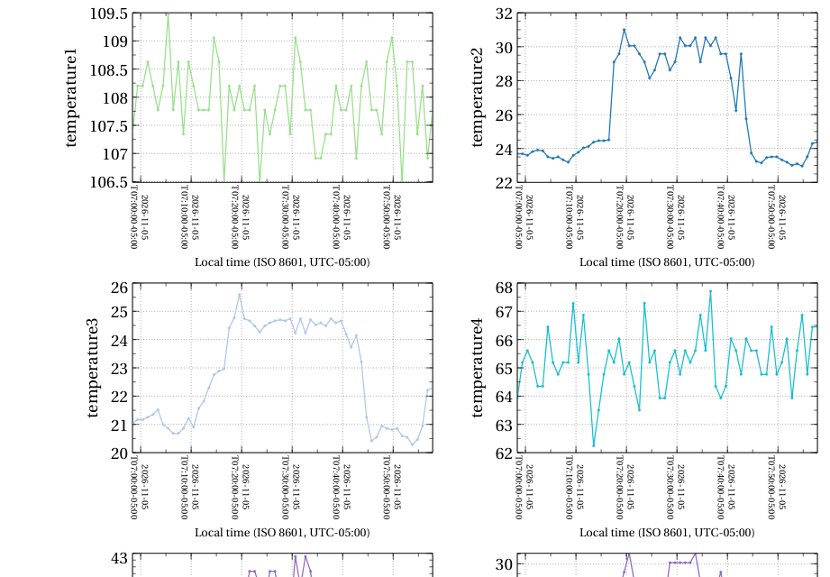

### 15.1 What was wrong (measured before the change)

Veusz draws an axis's label first and then each tick label only if it does not overlap one already
drawn (`Axis._drawTextWithoutOverlap`); the axis label is kept inside the graph's cell
(`ensureInBox`), so a margin too small for the tick labels pushes the axis label over them and they
are dropped [57]. 45-degree 25-character ISO labels also overlapped each other. Every page of the
0.4.4 example projects was rendered in Veusz 4.2.1 and every tick label counted
(`label_check.py`, which replays Veusz's own overlap test):

| Project (0.4.4) | x tick labels drawn | y tick labels drawn | Why |
|---|---|---|---|
| FITS, GBT tack azServo1Hz (10 files, 321 grid panels) | 723 of 1925 (37.6 %): 2 of 6 per panel | 1979 of 2017 (98.1 %) | 45-degree 25-character ISO labels overlap; 1.7 cm left margin too narrow for `-0.225` at 14 pt |
| FITS, GBT UWBR Temps (15 files) | 403 of 788 (51.1 %) | 813 of 813 | 45-degree ISO labels overlap |
| FITS, synthetic 1PPS (test file) | 44 of 46 (95.7 %) | 37 of 37 | one overlay page, 45 degrees |
| R&S FSW/FSP (12 files) | 2130 of 2563 (83.1 %) | 2618 of 2618 | level 7-digit Hz labels (`9999940`) at 14 pt overlap |
| CSV/TSV (2 files) | 15 of 18 (83.3 %) | 16 of 16 | level 10-digit Hz labels (`1000000000`) |
| FITS, GBT 30-day OnePpsDeltas (319 files) | 2162 of 2162 | 1284 of 1286 (99.8 %) | Overlay_NanoSeconds: 10-digit y labels (`-250000000`, 2.63 cm at 14 pt) in a 1.7 cm margin ran 1.07 cm off the page's left edge and 2 were dropped |

### 15.2 What the files show now

* **Date-time x axes**: `-90` degrees (Veusz draws a horizontal axis's label at 360 - rotate degrees,
  so -90 turns it clockwise: it reads downwards; checked by rendering, +90 reads upwards), 8 pt, on
  two lines: the format `%VDY-%VDm-%VDd\\T%VDH:%VDM:%VDS-05:00` - Veusz text markup `\\` ends a
  line [57], the way Veusz's own automatic date formats split date and time - so the label reads
  `2026-11-09` / `T13:50:00-05:00`, the date on the right of the turned text and the time on the left,
  as in the screenshot. The offset keeps its colon (ISO 8601 extended format, matching the date part
  and the axis label `UTC-05:00`) [58].
* **Long numbers on x**: a numeric label longer than 6 characters (`9999940` Hz, `1000000000` Hz,
  MJD `61349.25`) - or a level label wider than 80 % of the tick spacing - is turned the same way at
  8 pt. Short labels (`-150`, `2.5`, `0`) stay level at 14 pt.
* **Margins and page sizes**: every graph gets the bottom margin its tick labels and axis label need
  and the left margin its y labels need - the largest of a grid for all of its graphs, so the plots
  line up - and a page grows (never shrinks) until each plot keeps at least 6 x 4 cm and room for all
  of its labels. The room below an x axis follows Veusz's layout (`_drawTickLabels`,
  `_drawAxisLabel`):

$$
\text{room} = 2\,s_t + E + s_l + H_l + 0.15\ \text{cm},\qquad
E = \begin{cases} w_{\max} & \text{vertical labels} \\ n_{\text{lines}}\,h_t & \text{level labels} \end{cases}
$$

  with $s_t = 0.3\,\text{em}_t$ and $s_l = 0.3\,\text{em}_l$ the spacings of the tick and axis-label
  fonts, $H_l = 1.2\,\text{em}_l$ the axis label's height, $h_t = 1.15\,\text{em}_t$ a line of tick
  text and $w_{\max}$ the widest line of any label. Widths are sums of per-character advance widths -
  the larger of Arial/Helvetica and Times for each character - so the estimate is never below the
  drawn width (Veusz 4.2.1 at 8 pt: `T00:00:00-04:00` 2.07 cm estimated, 2.00 cm drawn;
  `1000000000` 1.57 cm estimated, 1.49 cm drawn). The labels themselves
  are the ones Veusz will draw: `veusz_ticks`, `veusz_date_ticks` and `veusz_number_text` are ports of
  Veusz 4.2.1's `AxisTicks`, `DateTicks` and `formatNumber` [57] and gave the same ticks, ranges and
  texts in every case compared (27 105 numeric tick sets, linear and log, with their texts in eight
  formats; 8 000 date tick sets, extended or not).
* **A plot must keep room for every y label**: $L_y \ge 1.2\,(n-1)\,h + h$ for $n$ labels of height
  $h$; along a vertical x axis the same with the two-line label's width.
* **Broken axes**: each part of a Veusz broken axis gets its own ticks; a part too short for them
  gets fewer major ticks (`MajorTicks/number`) until its labels fit.
* **Writer 0.0.31** does this in its page helpers (`xy_page`, `grid_page`, `image_page`,
  `frequency_time_pages`, `time_pair_pages`, `style_datetime_axis`) for every program that uses it;
  pages without a date axis or data ranges are written exactly as by 0.0.30 (checked object by
  object). The MJD page of `time_pair_pages` now shows 12 significant digits (Veusz's automatic
  format wrote `6.1349x10^4`). **`_autoplot_native` 0.5.5** does it for every page of every program in
  this repository on save (`_fit_page`), from the data ranges of the traces; saving twice writes the
  same file.
* **Plots tab** (pyqtgraph): below one day per tick the date sits above the time
  (`2026-11-09` / `T04:15`); the ticks are spaced for the wider date line (pyqtgraph stops drawing
  tick text that would fill more than 80 % of the axis) [59].

### 15.3 Measured after the change (Veusz 4.2.1)

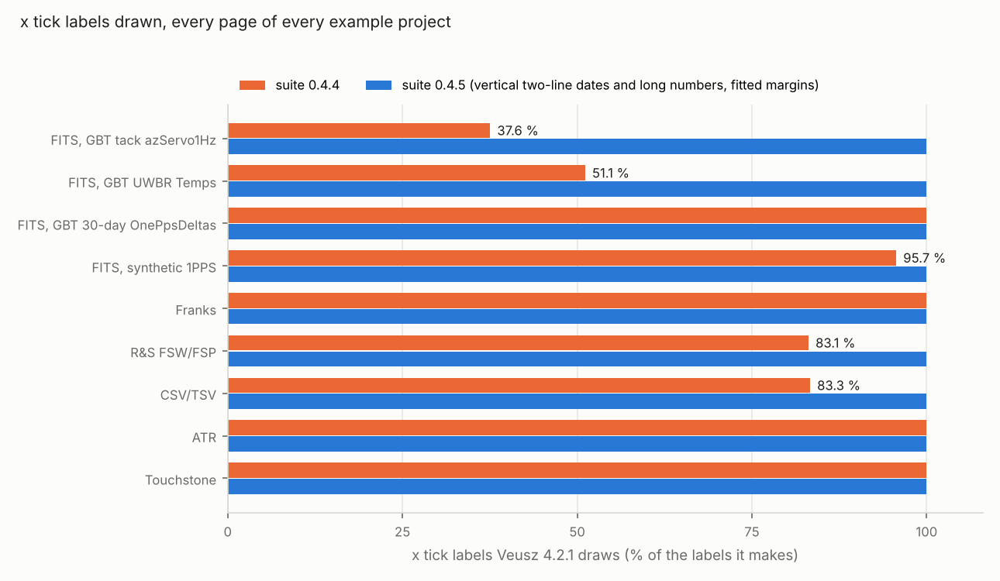

| Project | x axes | x labels drawn, 0.4.4 | x labels drawn, 0.4.5 | y labels drawn, 0.4.4 | y labels drawn, 0.4.5 |
|---|---|---|---|---|---|
| FITS, GBT tack azServo1Hz (10 files) | 321 | 723 of 1925 (37.6 %) | **1925 of 1925 (100 %)** | 1979 of 2017 (98.1 %) | **2017 of 2017 (100 %)** |
| FITS, GBT UWBR Temps (15 files) | 136 | 403 of 788 (51.1 %) | **788 of 788 (100 %)** | 813 of 813 (100 %) | **813 of 813 (100 %)** |
| FITS, GBT 30-day OnePpsDeltas (319 files) | 320 | 2162 of 2162 (100 %) | **2162 of 2162 (100 %)** | 1284 of 1286 (99.8 %) | **1286 of 1286 (100 %)** |
| FITS, synthetic 1PPS (test file) | 5 | 44 of 46 (95.7 %) | **46 of 46 (100 %)** | 37 of 37 (100 %) | **37 of 37 (100 %)** |
| Franks (time_gbt.dat test files) | 6 | 24 of 24 (100 %) | **24 of 24 (100 %)** | 38 of 38 (100 %) | **38 of 38 (100 %)** |
| R&S FSW/FSP (12 files) | 426 | 2130 of 2563 (83.1 %) | **2563 of 2563 (100 %)** | 2618 of 2618 (100 %) | **2618 of 2618 (100 %)** |
| CSV/TSV (2 files) | 3 | 15 of 18 (83.3 %) | **18 of 18 (100 %)** | 16 of 16 (100 %) | **16 of 16 (100 %)** |
| ATR (25 files) | 52 | 364 of 364 (100 %) | **364 of 364 (100 %)** | 312 of 312 (100 %) | **312 of 312 (100 %)** |
| Touchstone (16 .s2p) | 70 | 398 of 398 (100 %) | **398 of 398 (100 %)** | 428 of 428 (100 %) | **428 of 428 (100 %)** |
| **All** | 1339 | 6263 of 8288 (75.6 %) | **8288 of 8288 (100 %)** | 7525 of 7565 (99.47 %) | **7565 of 7565 (100 %)** |

Also with 0.4.5: the FITS and Franks date-label test projects (21 x axes, 174 labels) and the
Touchstone clear / add project (32 x axes, 174 labels) - every label drawn; the writer's own page
helpers (21 x axes: `xy_page`, `grid_page` 2 and 3 columns, `time_pair_pages` with and without
`mjd_range`, `image_page`, `frequency_time_pages`) - every label drawn. No drawn label reaches past
its graph's cell (Veusz's own outer bounds) or the page edge on any of them. Which x axes turned:
every date-time axis (FITS, Franks) and the long Hz axes (R&S, CSV/TSV); ATR (`-150` ... `150`),
Touchstone (`0`, `2.5`, `5` ...) and short FITS index axes stay level at 14 pt.

Clear / add (section 14) still gives the same project for all files at once and for half, then
the other half (ATR, R&S, Touchstone, CSV/TSV: every dataset and script line equal): the fit is
deterministic, and saving a project twice writes the same script. The fit of all 320 pages of the
30-day project takes 0.22 s (Python 3.13); the project still saves in about 15 s (14.6 s on 3.13,
15.7 s on 3.12; 0.4.4: 14.4 s).

### 15.4 Versions

| File | Before | Now |
|---|---|---|
| `vszh5_writer.py` | 0.0.30 | **0.0.31** (vertical labels, `axis_tick_room`, ports of Veusz's ticks and formats, fitted margins and pages; `LOCAL_DATETIME_ROTATE` 45 -> -90) |
| `_autoplot_native.py` | 0.5.4 | **0.5.5** (`_fit_page` on save) |
| `_autoplot_common.py` | 0.4.4 | **0.4.5** (`DEFAULT_DATETIME_TICK_ROTATE_DEG` 45 -> -90) |
| `_autoplot_pyqtgraph.py` | 0.3.4 | **0.3.5** (two-line date ticks) |
| `CSV_TSV_AutoPlot.py` | 6.1.5 | **6.1.6** (date x axis -90) |
| `tests/test_writer_0031.py` | — | **0.0.1** (16 tests) |
| `tests/test_writer_0030.py` | 0.0.1 | **0.0.2** (time-pair pages left out of the 0.0.29 identity) |
| `tests/test_time_gaps.py` / `tests/test_writer_names_time.py` | 0.0.1 / 0.0.2 | **0.0.2** / **0.0.3** (two-line format) |
| `REQUIREMENTS.md` | 0.2.3 | **0.2.4** (no new packages) |
| FITS / Franks 0.4.4, ATR 0.2.6, R&S 1.1.6, Touchstone 0.7.5, plugins 0.3.4 | | unchanged code (their projects change through `_autoplot_native`) |

### 15.5 Verification

| Check | Python 3.8.20 | Python 3.12.3 | Python 3.13.18 |
|---|---|---|---|
| Unit tests (`python -m unittest discover -s tests`) | 133 OK (5 skipped: 2 need PyOpenCL; 3 need Veusz, which `test_native_export` blocks in a full run) | 133 OK (5 skipped) | 133 OK (5 skipped; 3 in the PyOpenCL venv) |
| Veusz tests alone (`python -m unittest tests.test_writer_0031 tests.test_writer_0030`, Veusz 4.2.1) | | | 28 OK (ports equal to Veusz; every tick label drawn) |
| Headless GUI and real-data runs (`run_env_checks.sh`, 13 runs) | 13 of 13 pass | 13 of 13 pass | 13 of 13 pass |
| Plots tab two-line date ticks (screenshot) | pyqtgraph 0.13.3: shown | pyqtgraph 0.14.0: shown | 0.14.0: shown |
| Ports against Veusz 4.2.1 (`port_check.py`) | | | 27 105 numeric tick sets with texts in 8 formats, 8 000 date tick sets: 0 differences |
| Writer 0.0.31 vs master 0.0.30 | | | pages without dates or ranges identical (every dataset, attribute, script line) |
| Format check (header, revision = version, Date lines, docstrings, 3.8 grammar) | every `.py` OK | | |
| Tooltip audit | 0 missing | | |

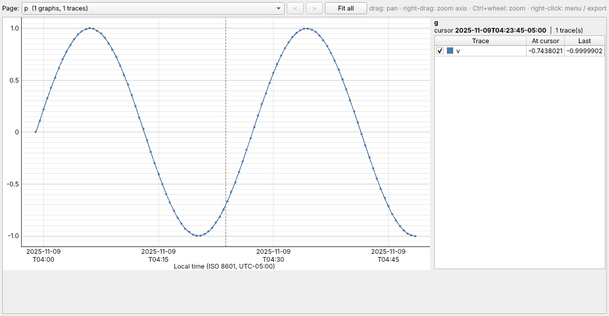

### 15.6 Data gaps and limits

* The label widths are estimates from character widths, not the fonts Veusz finds on your
  computer. They were checked against the drawn width with the font Veusz uses here (Liberation
  Serif, which fontconfig gives for Veusz's Times New Roman): 2-5 % above it. Each character's width
  is the larger of its Arial and Times widths, so Arial- and Times-like faces are covered; a much
  wider face set in Veusz's preferences could need more room than given.
* Rendered with Veusz 4.2.1 on Linux only; Veusz 3.6.2 was not rendered. Its source (PyPI sdist)
  has the same code as 4.2.1 in every file the fit follows - `axis.py`, `axisticks.py`,
  `axisbroken.py`, `grid.py`, `formatting.py`, `dates.py` - apart from comments and Qt 5 / Qt 6
  names, and the same `\\` line end in `textrender.py`, so 3.6.2 draws the same ticks and labels.
  Windows was not run in this session.
* A Veusz grid makes all rows the same height, so a page of many panels grows to fit the panel that
  needs most room.
* `MajorTicks/number` is a target: Veusz picks the closest count of 1, 2, 2.5 or 5 steps; the fit
  uses Veusz's own choice (ported), so the count it checks is the count Veusz draws.

### 15.7 References (round 15)

| # | Reference (IEEE) |
|---|---|
| [57] | Veusz developers, *Veusz 4.2.1* source code: `veusz/widgets/axis.py` (`_drawTickLabels`, `_drawAxisLabel`, `_drawTextWithoutOverlap`, `computeTicks`), `veusz/widgets/axisticks.py` (`AxisTicks`, `DateTicks`), `veusz/widgets/axisbroken.py`, `veusz/widgets/grid.py` (`_gridengine`, `_drawChild`), `veusz/utils/formatting.py` (`formatNumber`), `veusz/utils/textrender.py` (`\\` line end), `veusz/utils/dates.py`. [Online]. Available: https://pypi.org/project/veusz/4.2.1/ |
| [58] | *Date and time — Representations for information interchange — Part 1: Basic rules*, ISO 8601-1:2019, International Organization for Standardization, Geneva, 2019. [Online]. Available: https://www.iso.org/standard/70907.html |
| [59] | pyqtgraph developers, *pyqtgraph 0.14.0* source code: `pyqtgraph/graphicsItems/AxisItem.py` (`textFillLimits`, `generateDrawSpecs`) and `DateAxisItem.py` (`tickStrings`, `setZoomLevelForDensity`). [Online]. Available: https://github.com/pyqtgraph/pyqtgraph |

## 16. Time axes: local time from this computer's zone, UTC and MJD (2026-11-17)

Request (task 1 of 2): *"The local time plots should not be set to -5:00 UTC, but they should read
the time zone from the current machine processing the data and set the UTC offset accordingly. Also
add an option to generate both at MJD, UTC and, local times both in the GUI plots and the exported
vszh5 files. For example if a user wanted all plots in all types of time axis labels, there should be
tick boxes to select to do so, but default to Local time only"*; then *"ALL SHOULD BE RUN ON PYTHON
3.12!!!"*. Archive: `FitsAutoPlot_suite_0.4.6_2026-11-17.7z` (every tracked file, assets included).


### 16.1 Where the -05:00 comes from

Nothing in the suite fixes the offset. Every local time is the UTC instant plus the offset the
operating system gives for *that instant* in the zone of the computer running the program:
`datetime.astimezone()` without a zone uses "the system local time zone ... with the zone name and
offset obtained from the OS" [60] (cached per UTC hour, writer 0.0.28). In New York January data read
`-05:00` and July data `-04:00`; a project that crosses a daylight-saving change gets offset-free
ticks and an axis label that lists each offset and the minute it starts. Veusz date formats cannot
show a zone, so the offset is written into the tick format as text (`...%VDS-05:00`) - that literal is
what looked fixed. `VSZH5_DISPLAY_TZ` overrides the computer's zone only when it is set (a fixed
offset, `UTC`, or an IANA zone name such as `America/New_York` [64]).

Shown by the new tests (`tests/test_time_clocks.py`, a child Python per zone with `TZ` set and
`VSZH5_DISPLAY_TZ` unset - the way the operating system sets the computer's zone on Linux [61]):

| Computer's zone (`TZ`) | Same data, 2026-11-16 12:00 UTC: axis label | Tick format ends |
|---|---|---|
| America/New_York | `Local time (ISO 8601, EST, UTC-05:00)` | `-05:00` |
| America/Los_Angeles | `Local time (ISO 8601, PST, UTC-08:00)` | `-08:00` |
| Europe/Berlin | `Local time (ISO 8601, CET, UTC+01:00)` | `+01:00` |
| Asia/Kolkata | `Local time (ISO 8601, IST, UTC+05:30)` | `+05:30` |
| UTC | `Local time (ISO 8601, UTC+00:00)` | `+00:00` |
| America/New_York, July data | `Local time (ISO 8601, EDT, UTC-04:00)` | `-04:00` |
| America/New_York, 2026-10-31 .. 11-02 | `Local time (ISO 8601; UTC-04:00 EDT, UTC-05:00 EST from 2026-11-01T01:00)` | `%VDS` (no offset) |

What changed: the label now **names the zone** (the name the operating system gives: `EST`, `EDT`;
on Windows the long name, e.g. "Pacific Standard Time" [62]) and each graph's notes say where it came
from ("local time in the time zone of the computer that made this project (EST = UTC-05:00); every
sample has the UTC offset of its own date"). Across a change the names are listed when they are
abbreviations (6 characters or fewer, no space); long Windows names stay in the notes, so the label
does not grow past its plot. A time-axis label never runs past its plot now: the page fit makes the
plot at least as wide as the label (`_time_label_cm`).

### 16.2 The Local time / UTC / MJD tick boxes

| Where | Control | Default |
|---|---|---|
| FITS AutoPlot 0.4.5, Franks AutoPlot 0.4.5 | Processing options, under the gap controls: "Time axes - one set of pages per ticked clock" Local time / UTC / MJD, and a line naming this computer's zone and its offset now | Local time |
| CSV/TSV AutoPlot 6.1.7 | "Gaps and time axes" box, the same boxes; batch `--time-axes local,utc,mjd` or `all` | `local` |
| FITS / Franks Veusz plugins 0.3.5 | the same boxes in the dialog; saved fields `time_local`, `time_utc`, `time_mjd` | Local time |
| ATR, R&S, Touchstone | no date-time x axes: no boxes (their `--time-axes` is not offered) | - |

At least one box stays ticked. Each ticked clock draws every page that has date-time x axes once:
the first ticked clock keeps the page and its name, the others follow it as `<page>_utc` and
`<page>_mjd` - in the Plots tab and in the saved `.vszh5`. Pages without date-time axes (spectra,
images) are not copied. Changing the boxes and saving again adds or removes those pages and their
plot copies; the copies are rebuilt on every save, so they always show their page as it is.

| Clock | x data drawn | Ticks | Axis label |
|---|---|---|---|
| Local time | `<utc>_local` - UTC plus the computer's offset for each sample | `2026-04-19` / `T21:40:00-04:00` | `Local time (ISO 8601, EDT, UTC-04:00)` |
| UTC | the stored UTC date dataset (`<utc>_gaps` when the line breaks) | `2026-04-20` / `T01:40:00Z` (ISO 8601 "Z" = UTC [58]) | `UTC (ISO 8601)` |
| MJD | the exact MJD of the data (the stored MJD column; else UTC seconds / 86400 + 54832, within one float64 step) | `61150.07` (12 significant digits, `%.12Vg`) | `MJD (UTC)` |

MJD = JD - 2400000.5, days from 1858-11-17 00:00 UTC [63]; Veusz's date origin 2009-01-01 is MJD
54832 [57]. Line breaks and axis breaks are found in UTC seconds for every clock, so all three pages
break at the same samples; on the MJD page the breaks are drawn in days. The plot copies carry the
tags `type_time_utc` / `type_time_mjd` (and `type_gap_rows` when they hold gap rows).

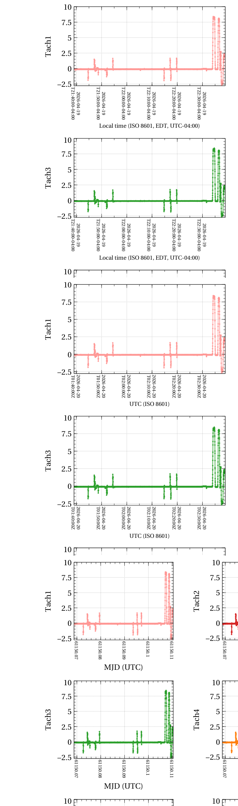

The Plots tab (`_autoplot_pyqtgraph` 0.3.6) shows the same pages: UTC pages read `...Z` at the
cursor; MJD pages stay numbers (the "MJD as UTC date" box does not turn them into dates) and use the
time gap rule on seconds, as the project. Found while checking: pyqtgraph writes a tick of 10 000 or
more with `%g`, six significant digits [59], so MJD ticks 61150.07 ... 61150.11 all read `61150.1`
(and a 100 Hz span at 10 MHz repeats one label). Every tick now gets the decimals its spacing needs
(`tick_texts`), and the cursor read-out shows 12 significant digits from 10 000 up.

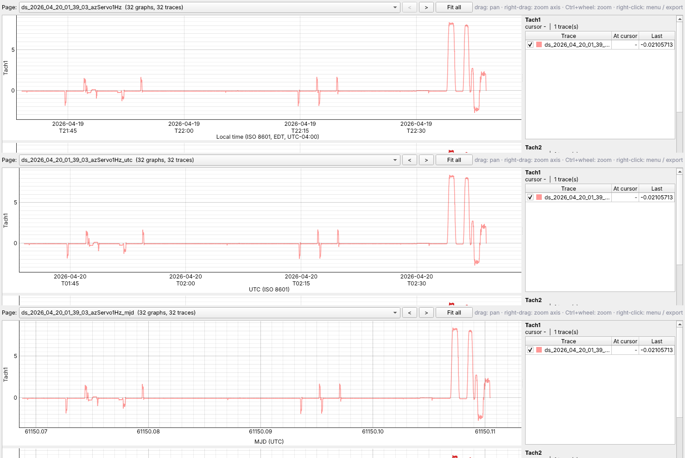

### 16.3 Measured (Python 3.12.3, Veusz 4.2.1)

Default (Local time only) against the 0.4.5 projects of the same files:

| Project | HDF5 objects | Identical | Script lines changed |
|---|---|---|---|
| FITS, GBT tack azServo1Hz (10 files, 11 pages) | 1573 | 1572 (the `Veusz` group's writer stamp differs) | 642 axis labels (zone name added) and 642 graph notes ("Time axis:" line) |
| FITS, GBT 30-day OnePpsDeltas (319 files, 320 pages) | 80 722 | 80 721 (the same stamp) | 640 axis labels and 640 graph notes |

Every dataset, its values, attributes and tags are the same; page sizes and margins too.

All three clocks, every page rendered in Veusz and every tick label counted (`label_check.py`):

| Project, all clocks | Pages | x tick labels drawn | y tick labels drawn | Outside cell or page |
|---|---|---|---|---|
| FITS, GBT tack (10 files) | 33 (11 per clock) | 5970 of 5970 | 6051 of 6051 | 0 |
| FITS, GBT UWBR Temps (15 files) | 48 | 2483 of 2483 | 2439 of 2439 | 0 |
| FITS, GBT 30-day OnePpsDeltas (319 files) | 960 (counted as three 320-page projects, see below) | 6154 of 6154 (local 2162, UTC 2161, MJD 1831) | 3858 of 3858 | 0 |
| FITS, synthetic 1PPS, tagged / untagged | 13 each | 101 of 101 each | 73 of 73 each | 0 |
| Franks, synthetic time_gbt | 30 | 368 of 368 | 336 of 336 | 0 |
| CSV/TSV, temps.tsv (`--time-axes all`) | 6 | 42 of 42 | 30 of 30 | 0 |

The 960-page 30-day project (326 MB, 53 195 datasets) did not fit in Veusz with the label recorder in
this 8 GB container, so the local-only, UTC-only and MJD-only projects of the same files were counted
(320 pages each). Each of their pages and datasets is identical, byte for byte, to the same page and
dataset of the all-clocks project (`compare_pages.py`: 320 of 320 pages and 40 195 / 40 195 / 27 595
of the datasets).

30-day 1PPS project: Plots-tab processing 10.0 s (local) and 14.6 s (all clocks); save 13.5 s and
24.4 s; file 259.1 MB and 325.9 MB (the UTC and MJD copies with gap rows).

### 16.4 Versions

| File | Version |
|---|---|
| `_autoplot_native.py` | 0.5.6 |
| `_autoplot_common.py` | 0.4.6 |
| `_autoplot_pyqtgraph.py` | 0.3.6 |
| `_suite_gui.py` | 0.1.4 |
| `FITS_AutoPlot.py`, `Franks_AutoPlot.py` | 0.4.5 |
| `CSV_TSV_AutoPlot.py` | 6.1.7 |
| `FITS_AutoPlot_plugin.py`, `Franks_AutoPlot_plugin.py` | 0.3.5 |
| `tests/test_time_clocks.py` | 0.0.1 (new, 15 tests) |
| `vszh5_writer.py` | 0.0.31 (unchanged; registry master) |
| `REQUIREMENTS.md` | 0.2.5 |

ATR 0.2.6, R&S 1.1.6 and Touchstone 0.7.5 are unchanged.

### 16.5 Verification (Python 3.12.3 only, as asked)

| Check | Result |
|---|---|
| Unit tests (`python -m unittest discover -s tests`) | 148 OK (6 skipped: 2 need PyOpenCL; 4 need Veusz, which `test_native_export` blocks in a full run) |
| Veusz tests alone (`python -m unittest tests.test_writer_0031 tests.test_writer_0030 tests.test_time_clocks`, Veusz 4.2.1 built for Python 3.12) | 43 OK |
| Headless GUI and real-data runs (`run_env_checks.sh`: every program's GUI, FITS tack / Temps / Vacuum / 30-day 1PPS, Touchstone, Plots tab, launcher) | 13 of 13 pass |
| GUI: FITS options and both plugin dialogs show the boxes (Local only), tool tips on every new widget | checked (screenshots; tooltip audit: 0 missing) |
| Format check (header, revision = version, Date lines, docstrings) | every `.py` OK |

### 16.6 Data gaps and limits

* Windows was not run here. There the zone comes from the Windows time-zone setting through the C
  runtime (`_tzset` uses "the time zone information specified by the operating system" when `TZ`
  is not set [62]); the names are long ("Eastern Standard Time"), so the label is wider - the page
  fit leaves room for it.
* Every extra clock adds pages and plot copies: the 30-day 1PPS project grows from 320 pages and
  259 MB (local) to 960 pages and 326 MB (all three); rendering all 960 pages in one Veusz 4.2.1
  process (with the label recorder) ran out of this container's 8 GB. Tick only the clocks a large
  set needs, or open it on a computer with more memory.
* The zone is read when the plots are made or saved; a project made in New York shows New York
  times wherever it is opened later (the label and notes say so). To show another zone, set
  `VSZH5_DISPLAY_TZ` before processing.
* Times before 1970-01-01 (MJD 40587) were not checked on Windows, where Python's
  `datetime.fromtimestamp` does not take negative times; FITS AutoPlot drops the DMJD <= 0 padding
  rows before any time axis is made.
* The MJD page uses exact MJD where the program has it (FITS raw DMJD, Franks MJD arrays); CSV/TSV
  time stamps are converted from UTC seconds (UTC / 86400 + 54832), within one float64 step
  (about 0.6 microseconds at MJD 61000).

### 16.7 References (round 16)

| # | Reference (IEEE) |
|---|---|
| [60] | Python Software Foundation, "datetime - Basic date and time types," *Python 3.12 Documentation* (`datetime.astimezone`, `tzinfo.tzname`). [Online]. Available: https://docs.python.org/3.12/library/datetime.html |
| [61] | Python Software Foundation, "time - Time access and conversions," *Python 3.12 Documentation* (`time.tzname`, `time.tzset`, the `TZ` variable). [Online]. Available: https://docs.python.org/3.12/library/time.html |
| [62] | Microsoft, "_tzset," *C runtime library reference*, Microsoft Learn. [Online]. Available: https://learn.microsoft.com/en-us/cpp/c-runtime-library/reference/tzset |
| [63] | R. Ray, "Modified Julian Dates," NASA Goddard Space Flight Center. [Online]. Available: https://core2.gsfc.nasa.gov/time/ |
| [64] | Internet Assigned Numbers Authority, "Time Zone Database." [Online]. Available: https://www.iana.org/time-zones |
| [57]-[59] | as in section 15: Veusz 4.2.1 source (date origin 2009-01-01, `%VD` formats), ISO 8601-1:2019, pyqtgraph source (`AxisItem.tickStrings`: `%g` from 10 000 up) |

## 17. RAM limit: plot data offloaded to disk above it (2026-11-17)

Request (task 2 of 2): *"take a look at offloading to disk if more a user value for RAM usage is
met when plotting if possible. Ensure everything plots correctly, quadruple check there are no
issues using this method. Offload likely to pickle file is best, then convert that pickle file to
the vszh5 file when the user saves it. ONLY do this when it exceeds the stated RAM usage (full
computer or system use, not just this program)"*. Run on Python 3.12 only. Archive:
`FitsAutoPlot_suite_0.4.7_2026-11-17.7z` (every tracked file, assets included).

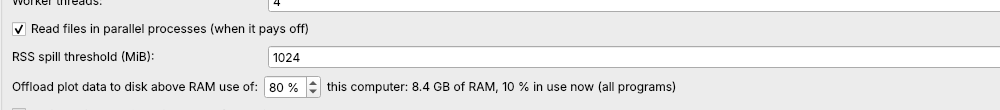

### 17.1 What it does

| | |
|---|---|
| Control | *Offload plot data to disk above RAM use of* 0 (never) .. 99 %, default **80 %**; one value for every tool of the suite and both plugins (saved like the theme); beside it this computer's RAM and the share in use now (every 2 s). Batch: `--ram-limit PERCENT` (ATR, R&S, CSV/TSV) |
| What is compared with the limit | the RAM in use on the **computer**, all programs together: (total - available) / total [65]-[67] (psutil when installed [65]; else `/proc/meminfo` MemAvailable on Linux [66] or `GlobalMemoryStatusEx` on Windows [67]) - not this program's own memory |
| When it is read | after each dataset is stored (at most every 0.2 s), at the end of every layout (`finalize`), on Save, and each time a file's data are kept |
| Below the limit | nothing is written; no file is made |
| At or above the limit | every dataset of 512 bytes or more, the exact MJD arrays and the data kept from the files read go to a pickle file [68] and are dropped from RAM; freed heap is handed back to the system |
| The file | one per project and one for the kept file data, made with `tempfile.mkstemp` (readable and writable only by your user [69]) in `AUTOPLOT_OFFLOAD_DIR`, else the system's temporary folder; deleted by Clear, when the project is replaced and when the program ends |
| Plots | the Plots tab, the time and gap layouts and `GetData` read the data back from the file (a fresh copy each time; nothing is changed in place) |
| Save | the `.vszh5` is written from the pickle file, one dataset at a time |
| Disk space | nothing moves when the disk has less free space than the data plus a fifth and 64 MB (a log line says so) |
| Log | the first move at once, then at most one line every 10 s with the totals so far, and the last totals when the batch ends (the 30-day set: 3 lines) |

### 17.2 Quadruple check (Python 3.12.3)

**1. Unit tests** (`tests/test_offload.py`, 16 tests; the whole suite 164 OK): the RAM reading (psutil
and `/proc/meminfo` agree within 5 points) and the limit (clamped 0..100, 0 / None / NaN = never);
no file below the limit; above it every dataset kind comes back **bit for bit** (1-D with
symmetric / negative / positive errors, dates with their exact MJD, text with "µs", "naïve", "日本"
and empty strings, 2-D with ranges and with edges; NaN, inf, -0.0, the subnormal 5e-324,
2^53 + 1); saved projects identical with every dataset offloaded (random datasets, local / UTC /
MJD clock pages, the synthetic FITS tagged / untagged and Franks projects); the Plots tab identical;
overwrite, drop, release; kept file data (unpicklable data stay in RAM and are reported); 8 threads
writing and reading 320 values at once; the folder variable; too little disk; a dropped store
deletes its file; 200 offloads in 10 s give 2 log lines; the GUI control (in a test settings file,
never yours) and `--ram-limit`.

**2. Every program's real files, saved in RAM and with every dataset offloaded** (minimum 0 bytes, so
even the smallest dataset went through the file); the two `.vszh5` compared object by object
(data bytes and attributes; only the save time stamp left out) and line by line:

| Program and files | Datasets offloaded | Kept files offloaded | HDF5 objects identical | Script lines identical |
|---|---|---|---|---|
| FITS, GBT tack azServo1Hz (10 files; local, UTC and MJD pages) | 818 of 818 | 10 | 1657 of 1657 | 37 911 of 37 911 |
| FITS, GBT UWBR Temps (15 files) | 419 of 419 | 15 | 866 of 866 | 16 190 of 16 190 |
| FITS, GBT UWBR Vacuum (15 files) | 113 of 113 | 15 | 254 of 254 | 2264 of 2264 |
| FITS, GBT 30-day OnePpsDeltas (319 files; limit 1 %, normal 512-byte minimum) | 39 115 (1080 small stay) | 319 | 80 722 of 80 722 | 192 000 of 192 000 |
| ATR (25 example files) | 133 of 133 | - (batch) | 303 of 303 | 6134 of 6134 |
| R&S (20 example `.sft` files, folder Processed) | 642 of 642 | - (batch) | 1316 of 1316 | 40 821 of 40 821 |
| CSV/TSV temps.tsv (`--time-axes all`) | 6 of 6 | - (batch) | 28 of 28 | 416 of 416 |
| Touchstone (223 example `.s2p`; 3 are malformed and fail either way) | 5940 of 5940 | 220 | 12 120 of 12 120 | 174 682 of 174 682 |

Because the files are identical, Veusz draws them identically (sections 15 and 16 counted every
tick label of these projects).

**3. The Plots tab**: `document_pages()` and the SHA-256 of every trace array (x and y, with
"MJD as UTC date" on and off), and of every dataset a trace or image names, in RAM and offloaded:

| Project | Pages identical | Trace fingerprints identical |
|---|---|---|
| FITS tack (all clocks) | 33 of 33 | 2112 of 2112 |
| FITS Temps | 48 of 48 | 864 of 864 |
| FITS Vacuum | 48 of 48 | 192 of 192 |
| R&S | 584 of 584 | 4656 of 4656 |
| ATR (Cartesian and polar) | 102 of 102 | 540 of 540 |
| Touchstone (frequency and time-gated pages) | 1100 of 1100 | 21 120 of 21 120 |

**4. Only above the limit, and what it saves** - FITS AutoPlot GUI, GBT 30-day OnePpsDeltas (319
files), this computer at 8-15 % RAM in use (8.4 GB):

| RAM limit | Offloaded | RSS after the batch | Peak during the batch | Batch | Save | Files on disk | Log lines |
|---|---|---|---|---|---|---|---|
| 80 % (default; not reached) | nothing | 599 MB | 648 MB | 10.8 s | 13.4 s | none made | 0 |
| 0 (never) | nothing | 600 MB | 649 MB | 10.9 s | 13.9 s | none made | 0 |
| 1 % (below the computer's use) | 39 115 datasets, 319 files | **377 MB (-37 %)** | 541 MB | 12.6-13.4 s | 15.6-17.2 s | 119 MB + 101 MB, both deleted by Clear | 3 |

The 80 % and 0 projects are identical to the offloaded one (object for object; the 80 % file only
carries the older writer stamp 0.5.6, made before the version was raised).

The 13 headless GUI and real-data runs pass on Python 3.12 (`run_env_checks.sh`), the RAM control
shows in every tool and in both plugin dialogs (default 80 %), and every new widget has a tool tip.

### 17.3 Versions

| File | Version |
|---|---|
| `_autoplot_native.py` | 0.5.7 |
| `_autoplot_common.py` | 0.4.7 |
| `_suite_gui.py` | 0.1.5 |
| `FITS_AutoPlot.py`, `Franks_AutoPlot.py` | 0.4.6 |
| `CSV_TSV_AutoPlot.py` | 6.1.8 |
| `ATR_AutoPlot.py` | 0.2.7 |
| `RAndS_FSW_ASCII_Plotter.py` | 1.1.7 |
| `Touchstone_AutoPlot.py` | 0.7.6 |
| `FITS_AutoPlot_plugin.py`, `Franks_AutoPlot_plugin.py` | 0.3.6 |
| `tests/test_offload.py` | 0.0.1 (new, 16 tests) |
| `REQUIREMENTS.md` | 0.2.6 |
| `_autoplot_pyqtgraph.py` 0.3.6, `vszh5_writer.py` 0.0.31 | unchanged |

### 17.4 Data gaps and limits

* Windows was not run here: the `GlobalMemoryStatusEx` path is used only without psutil (psutil
  7.2.2 is in the requirements), and Windows deletes the file when the program closes it.
* A file left by a program that was killed (power loss) stays in the temporary folder as
  `autoplot_project_*.pkl` / `autoplot_kept_*.pkl`; it can be deleted by hand. Never load such a file
  from elsewhere: unpickling can run code [68] - the suite only reads back the files it wrote itself.
* The file only grows: a dataset made again (UTC / MJD pages are rebuilt on every save) is written
  again; the file is emptied on Clear.
* The RAM use is read at most every 0.2 s while datasets are added: one dataset larger than the RAM
  still free is made in RAM before it can move. Veusz's own memory when it opens a large project is
  not affected (section 16.6).
* psutil 8 renamed `virtual_memory()` to `memory_physical()` (the old name stays, soft-deprecated
  [65]); the suite uses `memory_physical()` when it exists.

### 17.5 References (round 17)

| # | Reference (IEEE) |
|---|---|
| [65] | G. Rodola, "psutil API: memory_physical() / virtual_memory()," *psutil documentation*. [Online]. Available: https://psutil.io/api/#memory |
| [66] | The Linux kernel documentation, "The /proc Filesystem: /proc/meminfo, MemAvailable." [Online]. Available: https://docs.kernel.org/filesystems/proc.html |
| [67] | Microsoft, "GlobalMemoryStatusEx function (sysinfoapi.h)," *Win32 API*, Microsoft Learn. [Online]. Available: https://learn.microsoft.com/en-us/windows/win32/api/sysinfoapi/nf-sysinfoapi-globalmemorystatusex |
| [68] | Python Software Foundation, "pickle - Python object serialization," *Python 3.12 Documentation* (protocol 5, PEP 574; security warning). [Online]. Available: https://docs.python.org/3.12/library/pickle.html |
| [69] | Python Software Foundation, "tempfile - Generate temporary files and directories," *Python 3.12 Documentation* (`mkstemp`, `gettempdir`). [Online]. Available: https://docs.python.org/3.12/library/tempfile.html |

## 18. Gap options enforced (2026-11-17)

Request (after tasks 1 and 2): *"When done recheck the gap aware settings and ensure they are being
enforced."* Every gap option was set in every program, before a run and changed after a run, and
the project, the Plots tab and the saved `.vszh5` were compared with hand-worked expectations. Run
on Python 3.12 only. Archive: `FitsAutoPlot_suite_0.4.8_2026-11-17.7z` (every tracked file, assets
included).

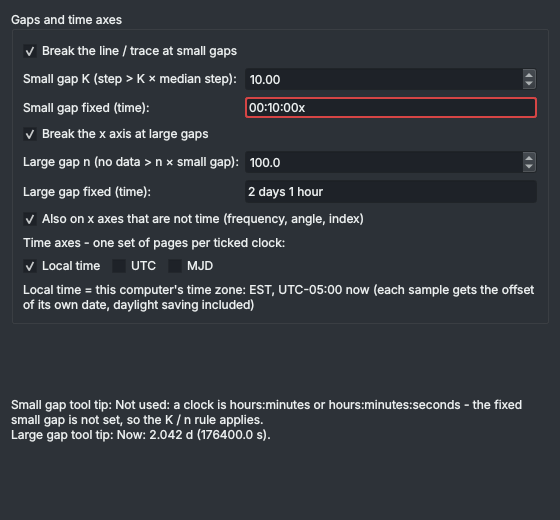

### 18.1 What was not enforced, and the fix

| # | Found | Effect before | Now |
|---|---|---|---|
| 1 | The gap text parser picked number-unit tokens out of the text wherever they were and ignored what lay between them | `00:10:00` = 0 h + 10 h + 0 h = **10 h**; `1x2` = 3 h; `.5h` = 5 h; `1:30` = 31 h - all used without a word | The whole entry must be read, token after token [70]; clocks `H:MM` / `H:MM:SS(.s)` (hours:minutes[:seconds], as ISO 8601 writes a time [73]); long unit names (`sec`, `minutes`, `hours`, `days`, `months`); anything else is refused with the reason |
| 2 | Units were added up in days (`value x (1/24)/60`), in binary floating point [72] | `16min` = 959.9999999999999 s, so a step of exactly 960 s was cut although "greater than 16 min" was asked | The text is read exactly (`fractions.Fraction`) and rounded once: `16min` = 960 s, `0.1h` = 360 s; the TimeLayout gets seconds everywhere |
| 3 | An unreadable entry gave 0 (no fixed gap) silently in CSV/TSV, ATR, R&S, Touchstone and every batch command | The K / n rule ran while the user believed a fixed gap was in force | The box is framed red with the reason in its tool tip (`Now: 15 min` when readable); the run, the save and the end of editing log `The fixed small gap '1x2' is not used: unknown unit 'x' ...`; batch: `--gap-small` / `--gap-large` are refused by argparse with the reason [71] |
| 4 | FITS / Franks (and both plugins): a text, readable or not, overrode the hours box | An unreadable text switched the hours box off too | An unreadable text is logged and the hours box is used |
| 5 | `--gap-k` / `--gap-n` took any number; TimeLayout did not clamp K | `--gap-k 0.5` cut the line at ordinary steps; `inf` / `nan` fixed gaps reached the notes | `--gap-k` must be >= 1, `--gap-n` >= 0 (argparse stops otherwise); TimeLayout keeps K >= 1 (not a number = the default), n and the fixed gaps finite |
| 6 | Gap options changed **after** a run: only the time-axis boxes redrew the Plots tab | The saved `.vszh5` used the new options, the Plots tab still showed the old ones | Every gap option redraws the Plots tab 0.5 s after the last change (a text when its editing ends [76]), in every program; the log states the rule in force |
| 7 | Local clock: the large-gap rule ran on local wall-clock seconds | US 2026-03-08 (spring forward [74]): a 1-hour jump with no data gap broke the local page (n = 2); 2026-11-01 (fall back): a 3-hour hole was 2 hours on the local clock and was not broken at `--gap-large 2.5h`, while the UTC and MJD pages were | Axis breaks are found in UTC seconds and moved onto the local axis, between the latest local value before the gap and the earliest after it [75]; where a fall-back hour leaves no room, no break (no sample is hidden). Without a daylight-saving change the breaks are exactly the 0.4.7 ones |
| 8 | Plots tab, local clock: each trace was cut again on its local copy | An extra line break at the spring-forward hour, which the project does not have | A clock trace is drawn as the project laid it out (cut in UTC); a clock axis shades exactly the project's `breakPoints` |

### 18.2 Checked (Python 3.12.3)

**CSV/TSV AutoPlot GUI, a file with known gaps** (1-minute samples, a 960 s step and a 172 800 s
step): 32 settings x (before the run, changed after the run) = 64 cases, counted in the project,
in what the Plots tab's curve holds and shades, and in the saved file - **64 of 64**:

| Setting | Line cuts | Axis breaks | Note |
|---|---|---|---|
| defaults (K = 10: 600 s; n = 100: 60 000 s) | 2 | 1 | |
| K = 15.9 / K = 16 | 2 / 1 | 1 | 954 s < 960 s; 960 s is not > 960 s |
| small `16min` / `15min 59s` | 1 / 2 | 1 | was 2 / 2 (959.999... s) |
| small `00:10:00` / `0:20` / `0.25` (h) | 2 / 1 / 2 | 1 | `00:10:00` was 10 h: 1 cut and no axis break |
| small `1x2`, `5ms` (unreadable) | 2 | 1 | logged, box red, K rule |
| n = 287.9 / n = 288 | 2 | 1 / 0 | 172 740 s / 172 800 s (not >) |
| large `47h 59min` / `2d` / `2 days 1 hour` / `3d` | 2 | 1 / 0 / 0 / 0 | |
| large `0:10` with small `20min` | 1 | 1 | never shorter than the small gap |
| large `1d,2h` (unreadable) | 2 | 1 | logged, box red, n rule |
| lines off / axis off / n = 0 / both off | 0 / 2 / 2 / 0 | 1 / 0 / 0 / 0 | |
| numeric x (index) rule on / off; small text on an index axis | 2 / 0; 2 | 0 | fixed gaps are time only |

**Every other program, before and after a run** (10 settings x 2; invariants: project breaks =
Plots tab shaded regions = file breaks; no broken axis outside the gap layout; axis breaks off or
n = 0: none; line breaks off: no gap rows; non-time axes off: nothing on them; the Plots tab draws
as many NaN rows as the project):

| Program and files | Cases OK | Axes | Breaks at the defaults | Note |
|---|---|---|---|---|
| FITS, GBT UWBR Vacuum (15 files) | 20 of 20 | 48 | 0 | 12 246 gap rows at K = 10; hours-box fallback checked |
| FITS, GBT tack azServo1Hz (10 files) | 20 of 20 | 963 | 0 | continuous 1 Hz data: no gaps at any setting |
| FITS, GBT 30-day OnePpsDeltas (319 files) | 20 of 20 | 960 | 12 | 1518 gap rows at the defaults; 21 breaks at small `1h` / large `1d`; 18 with the 0.5 h hours box |
| Franks, a `time_gbt.dat` with a 31-minute and a 7-day step (1-minute MJD samples) | 20 of 20 | 24 | 24 | 2 cuts and 1 break per graph at the defaults, as worked out by hand; the hours box (0.5 h) cuts the 31-minute step |
| ATR (example files) | 20 of 20 | 52 | 0 | evenly spaced azimuths |
| R&S (Processed `.sft`) | 20 of 20 | 584 | 2 | the overlay of files far apart in frequency |
| Touchstone (223 `.s2p`, frequency and time-gated pages) | 20 of 20 | 2200 | 0 | K = 2, n = 3: 72 gap rows, 0 with non-time axes off |

**Daylight saving** (`VSZH5_DISPLAY_TZ=America/New_York`; 1-minute data through 2026-03-08 07:00
UTC and 2026-11-01 06:00 UTC, with and without a 3-hour hole; defaults, n = 2 and a 2.5 h large
gap): the local, UTC and MJD pages have the same cuts and breaks in every case (before: 2
differences), the Plots tab draws the project's (before: one more line cut on the local page at the
spring-forward hour), no sample lies inside a break, and Veusz 4.2.1 draws the pages (the 2026-11-01 local page now breaks where the UTC page
does).

**No change elsewhere**: the 0.4.7 real-data projects made again with 0.4.8 - FITS tack (all
clocks), UWBR Temps and Vacuum, the 30-day 1PPS set, ATR, R&S, CSV/TSV and Touchstone - are
identical object for object (80 722 HDF5 objects for the 30-day set) and line for line; only the
writer stamp differs.

**Unit tests**: `tests/test_gap_enforcement.py` (20 tests: the accepted texts exactly, the refused
ones with a reason, the log lines, the TimeLayout ranges, the flags, both daylight-saving changes,
the Plots tab, the red frame, `layout_changed` / `follow()`, the FITS hours fallback, both
plugins); the whole suite 184 OK (6 Veusz tests skipped in the full run; the Veusz modules
alone: 59 OK); the 13 headless GUI and real-data runs pass (`run_env_checks.sh`).

### 18.3 Versions

| File | Version |
|---|---|
| `_autoplot_native.py` | 0.5.8 |
| `_autoplot_common.py` | 0.4.8 |
| `_suite_gui.py` | 0.1.6 |
| `_autoplot_pyqtgraph.py` | 0.3.7 |
| `FITS_AutoPlot.py`, `Franks_AutoPlot.py` | 0.4.7 |
| `CSV_TSV_AutoPlot.py` | 6.1.9 |
| `ATR_AutoPlot.py` | 0.2.8 |
| `RAndS_FSW_ASCII_Plotter.py` | 1.1.8 |
| `Touchstone_AutoPlot.py` | 0.7.7 |
| `FITS_AutoPlot_plugin.py`, `Franks_AutoPlot_plugin.py` | 0.3.7 |
| `tests/test_gap_enforcement.py` | 0.0.1 (new, 20 tests) |
| `REQUIREMENTS.md` | 0.2.7 |
| `vszh5_writer.py` 0.0.31 | unchanged (the writer's gap functions were right; the faults were in the suite's use of them) |

### 18.4 Data gaps and limits

* Windows was not run here; nothing in this round is platform-specific.
* `m` stays **months** (30.4375 d, as since 0.0.19); minutes are `min`. `5m` is 152 days - the tool
  tip shows it ("Now: 152.188 d (13149000.0 s)"), and the graph notes state every threshold.
* On the local clock a fall-back hour folds the time axis back on itself (wall-clock time repeats
  01:00-02:00); the data are drawn in their order, as before. Only the gap rule changed: it now uses
  UTC.
* The ATR and tack example files have no gaps at any setting, so they check that nothing is cut;
  the CSV file, the UWBR, 30-day, R&S and Touchstone sets check the cuts and breaks.

### 18.5 References (round 18)

| # | Reference (IEEE) |
|---|---|
| [70] | Python Software Foundation, "fractions - Rational numbers," *Python 3.12 Documentation*. [Online]. Available: https://docs.python.org/3.12/library/fractions.html |
| [71] | Python Software Foundation, "argparse - Parser for command-line options, arguments and subcommands" (`type=`, `ArgumentTypeError`), *Python 3.12 Documentation*. [Online]. Available: https://docs.python.org/3.12/library/argparse.html |
| [72] | *IEEE Standard for Floating-Point Arithmetic*, IEEE Std 754-2019, Jul. 2019, doi: 10.1109/IEEESTD.2019.8766229. |
| [73] | *Date and time - Representations for information interchange - Part 1: Basic rules*, ISO 8601-1:2019, ISO, Geneva, 2019. [Online]. Available: https://www.iso.org/standard/70907.html |
| [74] | National Institute of Standards and Technology, "Daylight Saving Time (DST)," NIST Time and Frequency Division. [Online]. Available: https://www.nist.gov/pml/time-and-frequency-division/popular-links/daylight-saving-time-dst |
| [75] | A. Belopolsky and T. Peters, "PEP 495 - Local Time Disambiguation," Python Enhancement Proposals, 2015. [Online]. Available: https://peps.python.org/pep-0495/ |
| [76] | The Qt Company, "QLineEdit Class" (`editingFinished()`, `textChanged()`), *Qt 6 Documentation*. [Online]. Available: https://doc.qt.io/qt-6/qlineedit.html |

## 19. Pages to draw: Per file / Combined axis / Overlay (2026-11-17)

Request: *"in the fits files only for the vszh5 file (do it in the qtplot as well), ensure these
options are available and working: Overlay (exists), Per File (exists), Combined Axis ... The
combined files should generate a plot that looks like the per file plots, but has the full range
of values in each axis ... concatenation of the datasets of the same value but not overlayed as
done in overlay. Add this type of plot to the drop down options in the qtplot interface as well,
just above the overlays. Implement this same thing in all other plotting routines. Ensure gap
awareness still applies when concatenation is utilized. Ensure this still follows the RAM usage
implementation."* Run on Python 3.12 only. Archive: `FitsAutoPlot_suite_0.4.9_2026-11-17.7z`
(every tracked file, assets included).

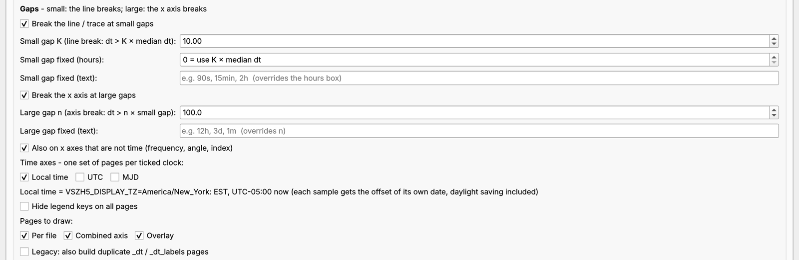

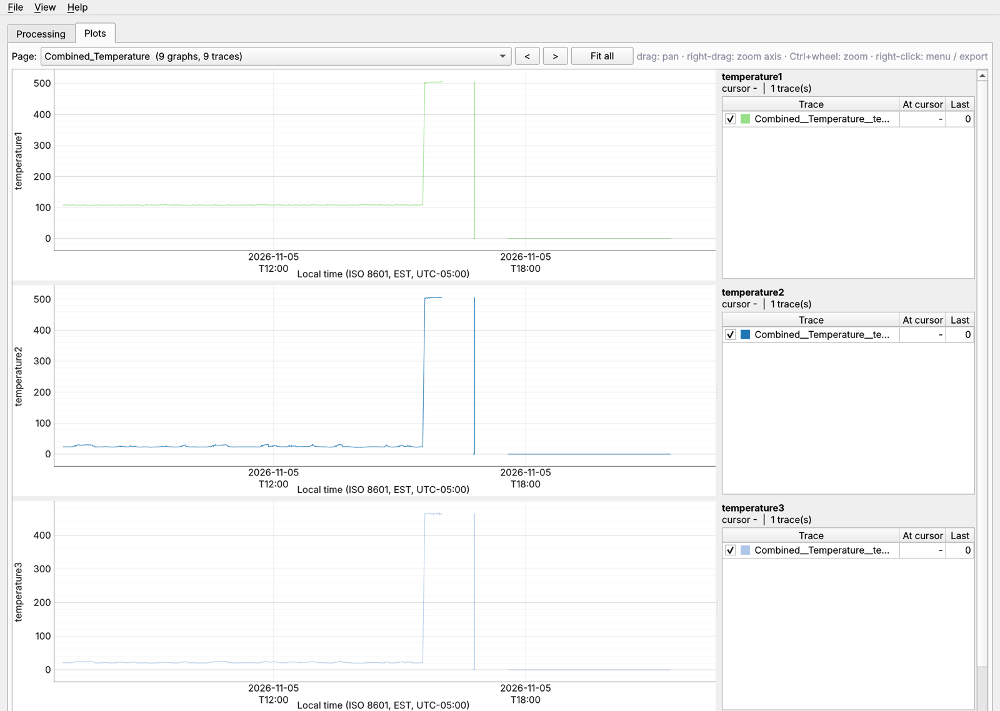

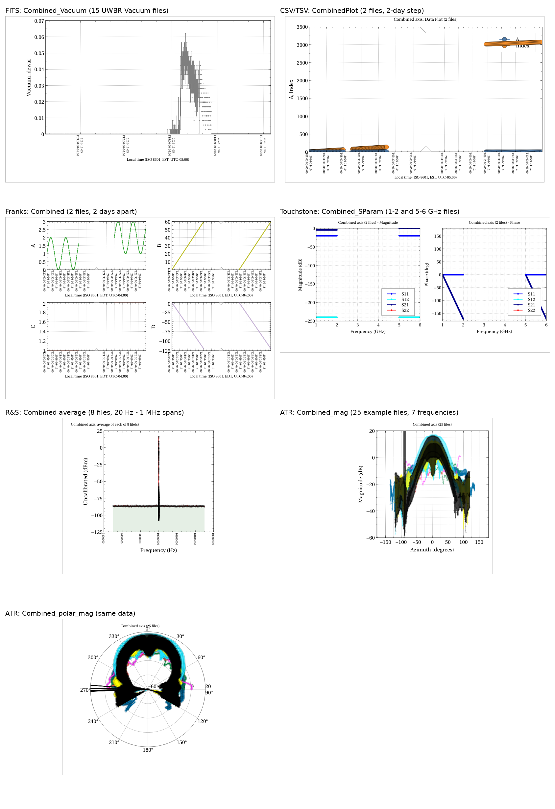

### 19.1 What each program draws

*Pages to draw* has three boxes, all ticked: **Per file** (each file's own pages, as before),
**Combined axis** (new) and **Overlay**. The combined pages come just above the first overlay page
in the project, in the Plots tab's page list and in the saved `.vszh5`. A box changed after a run
rebuilds the project half a second after the last change (a restarted single-shot timer [81]).

| Program | Combined-axis pages (new) | Joined on | Overlay pages | Where the choice is |
|---|---|---|---|---|
| FITS AutoPlot 0.4.8 | `Combined_<HDU>` (and its `_utc` / `_mjd` clock copies), one set per table-HDU layout (`Combined_2_<HDU>` ... when the files differ) | DMJD, per row tag (CHANNELA/B ...) | `Overlay_<unit>` | GUI box; plugin field `pages` |
| Franks AutoPlot 0.4.8 | `Combined` (`Combined_2` ... for another flavour or column layout) | MJD | `Overlay_<column>` | GUI box; plugin field `pages` |
| CSV/TSV AutoPlot 6.2.0 | `CombinedPlot` (graph `CombinedGraph`) | the X column | `OverlayPlot` | GUI box; `--pages` |
| ATR AutoPlot 0.3.0 | `Combined_mag`, `Combined_phase`, `Combined_polar_mag`, `Combined_polar_phase` (one trace per frequency) | azimuth | `Overlay_All_*` | GUI box; `--pages` |
| R&S plotter 1.2.0 | `Combined average` (per x kind and unit) and, in *All plots*, `Combined Section n` | frequency or time | `AllImported`, `Averages` | GUI box; `--pages` |
| Touchstone AutoPlot 0.8.0 | `Combined_SParam` (magnitude and phase) | frequency | `Overlay_SParam` (**new**: the tool had no multi-file overlay) | side-panel box |

The plugins keep the old `combined_only` field: it unticks *Per file*.

### 19.2 How a combined trace is made, and its gaps

For the files $f = 1 \dots F$ in page order, with x values $x^{(f)}$ and y values $y^{(f)}$ of the
same quantity, the combined trace is

$$
\mathbf{x}^{c} = \operatorname{concat}\left(x^{(1)}, \dots, x^{(F)}\right),\qquad
\pi = \operatorname{argsort}_{\text{stable}}\left(\mathbf{x}^{c}\right),\qquad
x_i = \mathbf{x}^{c}_{\pi_i},\quad y_i = \mathbf{y}^{c}_{\pi_i},\quad s_i = \mathbf{s}^{c}_{\pi_i},
$$

where $s$ is the file of each row. The sort is stable, so equal x keep their file order, and NaN x
go last [77], [78]. Nothing is rounded, thinned or averaged. Text x (CSV/TSV) stays in file order.

**Gaps.** Each file keeps its own small-gap threshold, measured on its own samples:

$$
T_f = \begin{cases} T_{\text{fixed}} & \text{a fixed small gap is set (time axes)} \\
K \cdot \operatorname{median}\left(\Delta x^{(f)}\right) & \text{otherwise.} \end{cases}
$$

The runs of a file are its samples between its own cuts (steps $> T_f$; on non-time axes also
larger than $K$ times the median step of $\ln x$, as before). Let $R$ be the union of every
file's runs. A step of the combined trace is cut (one NaN row in the plot copies) only when

$$
[x_i, x_{i+1}] \not\subseteq R \quad\text{and}\quad x_{i+1} - x_i > \max\left(T_{s_i}, T_{s_{i+1}}\right).
$$

So the trace breaks where no file has data. It never breaks inside a file's own sampling. The
step from one file to the next is cut only when it is a gap by both files' rules. The runs are
merged with a running maximum and looked up with a binary search [79], [80]. The x axis breaks
are those an overlay of the same files gets:
$\Delta > n \cdot \max_f T_f$, or the fixed large gap [18], [43].

**Why per file.** One median taken over the joined values (the first build of this round) cut
every step of a coarse file joined with a fine one:

| Data | One median of the joined values | Per file (now) | Check |
|---|---|---|---|
| UWBR Vacuum, 15 files | 3804 gap rows | **278** | equal to the files' own cuts (278) plus the steps between files (0), worked out independently |
| UWBR Temperature, 15 files, 9 traces | 5670 gap rows | **810** | 9 x (89 own cuts + 1 step between files) |
| R&S, 8 sweeps (100 Hz, 20 Hz and 1 MHz spans at 10 MHz) | 800 axis breaks, page 1824.2 cm wide | **0** breaks, normal page | the 1 MHz sweep covers the narrow ones |
| R&S, the 20 Processed files, 186 combined pages | 20 518 gap rows, 4037 axis breaks | **37 / 37** | |
| GBT 30-day 1PPS, 319 files | 313 gap rows, 3 breaks | 313 / 3 | one cadence: the same |

**Plots tab** (`_autoplot_pyqtgraph` 0.3.8): an x axis the project laid out is drawn from the
project's own cut copies and shades exactly the project's `breakPoints`. It no longer cuts the
joined values again. Before, R&S showed 4039 shaded breaks where the project and the file have 39.

### 19.3 RAM

* The combined datasets are stored with the same `SetData`, so the RAM-limit check runs as each
  one is stored. Above the limit they move to the offload file like any other dataset.
* The file of each row is kept in 1 byte (up to 256 files) or 2 bytes (up to 65 536 files). It
  moves to the offload file with the datasets, is not saved in the `.vszh5`, and is dropped by
  Clear.
* FITS and Franks build one group (HDU layout) at a time and then drop its joined columns.
* The joined columns are stored once, sorted. There is no second raw copy: the per-file raw
  datasets already hold every file as read.
* GBT 30-day 1PPS set, every page kind: 656 MB RSS after the batch in RAM (80 % limit) and 396 MB
  offloaded (1 % limit). The two saved files are identical, 81 043 of 81 043 HDF5 objects and
  every script line.

### 19.4 Checked (Python 3.12.3)

**Real files, every program, every page-kind set.** Each run was checked in the project, in the
Plots tab (`document_pages`, `trace_arrays`, `graph_break_regions`) and in the saved file. The
checks were:

* page kinds and order (combined pages in one block just above the first overlay);
* every combined trace equal to the files' traces joined and stable-sorted, value for value;
* polar traces drawing the combined datasets;
* line cuts and axis breaks the same in the project, the Plots tab and the file;
* the combined axes laid out by the gap rules.

| Program and files | Pages (all kinds) | Combined: gap rows / axis breaks | All kinds: in RAM = offloaded | Kinds checked | Combined off = 0.4.8 |
|---|---|---|---|---|---|
| CSV/TSV, a file with known gaps split in two (given out of order) | 4 | 4 / 1 | 55 of 55 objects | all, combined, per file + overlay, combined + overlay | `temps.tsv`: 28 of 28 |
| Franks, two `time_gbt.dat` 2 days apart | 7 | 4 / 4 | 110 of 110 | the same four | - |
| FITS, UWBR Vacuum (15 files) | 17 | 278 / 0 | 226 of 226 | the same four | 254 of 254 |
| FITS, UWBR Temperature (15 files) | 17 | 810 / 0 | 836 of 836 | the same four | 866 of 866 |
| FITS, GBT tack (10 files) | - | - | - | - | 1657 of 1657 |
| FITS, GBT 30-day 1PPS (319 files) | 321 | 313 / 3 | 81 043 of 81 043 | all | 80 722 of 80 722 |
| ATR, the 25 example files | 106 | 0 / 0 | 346 of 346 | the same four | 303 of 303 |
| R&S, the 20 Processed `.sft` | 770 | 37 / 37 | 2211 of 2211 | the same four | 1316 of 1316 |
| Touchstone, the 223 example `.s2p` | 1102 | 0 / 0 (the files overlap in frequency) | 12 365 of 12 365 | the same four | 12 120 of 12 120 (per file only: the overlay page is new) |

"Combined off = 0.4.8" means *Per file* + *Overlay* gives the 0.4.8 project. It is equal object for
object and line for line; only the writer stamp differs.

**Unit tests**: `tests/test_page_kinds.py`, 22 tests:

* the page-kind words and `--pages`;
* stable joining with NaN, several y and text x;
* overlap counting and page moving;
* the gap rule, hand-worked: a hole between files, files back to back, a coarse sweep with a fine
  one inside it, a hole another file fills, the same hole not filled, NaN x, one file = the plain
  rule, 1-s and 60-s cadences on an MJD axis;
* the file numbers offloaded and laid out the same;
* the Plots tab following the project;
* FITS (tagged), Franks, CSV/TSV, ATR, R&S and Touchstone combined values and order;
* the FITS window rebuilt when a box changes;
* both plugins' `pages` and `combined_only` fields.

The whole suite runs 206 OK (6 Veusz tests skipped in the full run; the Veusz modules alone: 59
OK). The 13 headless GUI and real-data runs pass (`run_env_checks.sh`; the CSV/TSV run's expected page
list now starts with `CombinedPlot`). Veusz 4.2.1 draws every combined page (the figure above). Headers, docstrings and tool tips
pass the suite's checks (no widget without a tool tip).

### 19.5 Versions

| File | Version |
|---|---|
| `_autoplot_native.py` | 0.5.9 |
| `_autoplot_common.py` | 0.4.9 |
| `_suite_gui.py` | 0.1.7 |
| `_autoplot_pyqtgraph.py` | 0.3.8 |
| `FITS_AutoPlot.py`, `Franks_AutoPlot.py` | 0.4.8 |
| `CSV_TSV_AutoPlot.py` | 6.2.0 |
| `ATR_AutoPlot.py` | 0.3.0 |
| `RAndS_FSW_ASCII_Plotter.py` | 1.2.0 |
| `Touchstone_AutoPlot.py` | 0.8.0 |
| `FITS_AutoPlot_plugin.py`, `Franks_AutoPlot_plugin.py` | 0.3.8 |
| `tests/test_page_kinds.py` | 0.0.1 (new, 22 tests) |
| `REQUIREMENTS.md` | 0.2.8 |
| `vszh5_writer.py` 0.0.31 | unchanged (the writer's gap functions are used as they are) |

### 19.6 Data gaps and limits

* Windows was not run here. Nothing in this round is platform-specific.
* **Overlapping files interleave.** Where files overlap in x (the 223 Touchstone files cover the
  same band; repeated ATR cuts at one frequency), the combined trace joins their samples in x
  order. The line then zig-zags between the files. The page notes and the log count the
  overlapping files, so this is visible. For such sets the overlay is the page to read, and the
  combined page shows the full range.
* CSV/TSV joins only the files whose X column is of the first file's kind (dates or numbers); the
  others are named in the log. A text X is joined in file order and has no gap rule.
* FITS combined pages leave out image HDUs. Legacy datetime-duplicate (`_dt_labels`) datasets of a
  combined page carry the file numbers too, but they were checked only in code (the option is off
  by default and was not run on real files).
* The Plots tab screenshot is the light theme; the box is the same in dark mode.

### 19.7 References (round 19)

| # | Reference (IEEE) |
|---|---|
| [77] | NumPy developers, "numpy.argsort" (`kind='stable'`, `stable=True`: equal values keep their relative order), *NumPy documentation*. [Online]. Available: https://numpy.org/doc/stable/reference/generated/numpy.argsort.html |
| [78] | NumPy developers, "numpy.sort" (Notes: NaN values are sorted to the end), *NumPy documentation*. [Online]. Available: https://numpy.org/doc/stable/reference/generated/numpy.sort.html |
| [79] | NumPy developers, "numpy.searchsorted" (`side='right'`), *NumPy documentation*. [Online]. Available: https://numpy.org/doc/stable/reference/generated/numpy.searchsorted.html |
| [80] | NumPy developers, "numpy.ufunc.accumulate" (`np.maximum.accumulate`), *NumPy documentation*. [Online]. Available: https://numpy.org/doc/stable/reference/generated/numpy.ufunc.accumulate.html |
| [81] | The Qt Company, "QTimer Class" (`setSingleShot()`, `start()` restarts a running timer), *Qt 6 Documentation*. [Online]. Available: https://doc.qt.io/qt-6/qtimer.html |
